<div align="right"><a href="./README.md">Русский</a></div>

<p align="center"><picture><source media="(max-width: 600px) and (prefers-color-scheme: dark)" srcset="./assets/readme/header-mobile-en-dark.svg"><source media="(max-width: 600px)" srcset="./assets/readme/header-mobile-en-light.svg"><source media="(prefers-color-scheme: dark)" srcset="./assets/readme/header-en-dark.svg">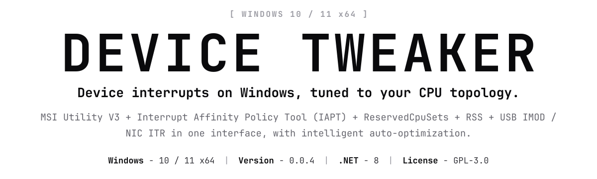</picture></p>

<p align="center">
<a href="https://github.com/arsenzaaa/DEVICE-TWEAKER/releases/latest"><picture><source media="(prefers-color-scheme: dark)" srcset="./assets/readme/button-download-en-dark.svg"></picture></a>
<a href="https://arsenzaaa.github.io/DEVICE-TWEAKER/en/guide/"><picture><source media="(prefers-color-scheme: dark)" srcset="./assets/readme/button-guide-en-dark.svg"></picture></a>
<a href="https://arsenzaaa.github.io/DEVICE-TWEAKER/en/"><picture><source media="(prefers-color-scheme: dark)" srcset="./assets/readme/button-site-en-dark.svg"></picture></a>
<a href="./CHANGELOG.en.md"><picture><source media="(prefers-color-scheme: dark)" srcset="./assets/readme/button-changelog-en-dark.svg"></picture></a>
</p>

<p align="center"><a href="./assets/screenshots/showcase_intel_14900k_full_en.png">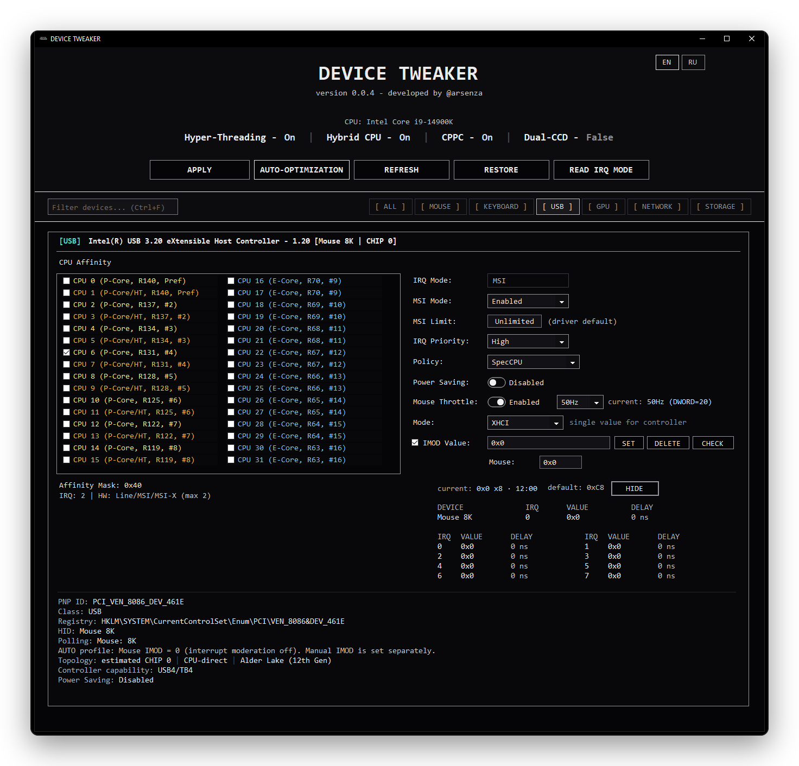</a></p>

## <samp>[ WHY ]</samp>

ISRs / DPCs run above any thread and do not know which cores the game is using. A driver on the core of an important thread (GAME / RENDER / RHI) interrupts it -> the thread waits or moves to another core and loses its L1 / L2 -> frame time grows and stutters appear. Two drivers on one core delay each other's ISRs / DPCs; on one SMT-SET they share cache and EXECUTION-UNITS.

DEVICE TWEAKER spreads interrupts across physical cores: drivers share neither cores nor SMT-SETs, and core 0 stays free when possible. **AUTO-OPTIMIZATION** builds a plan from the topology (P-Core / E-Core, SMT / HT, CPPC, CCD / CCX) and device roles. Every device can also be tuned by hand: MSI, affinity, priority, ReservedCpuSets, RSS, USB IMOD, NIC ITR, Mouse Throttle, power saving.

## <samp>[ GUIDE ]</samp>

How it works in Windows and what the program does, device type by device type. The same chapters with search are on the [site](https://arsenzaaa.github.io/DEVICE-TWEAKER/en/guide/).

<p align="center">
<a href="./docs/guide/01-interrupts.en.md"><picture><source media="(prefers-color-scheme: dark)" srcset="./assets/readme/card-01-en-dark.svg">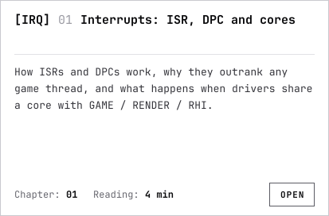</picture></a>
<a href="./docs/guide/02-msi.en.md"><picture><source media="(prefers-color-scheme: dark)" srcset="./assets/readme/card-02-en-dark.svg">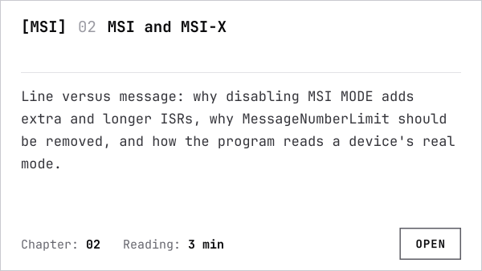</picture></a>
<a href="./docs/guide/03-affinity.en.md"><picture><source media="(prefers-color-scheme: dark)" srcset="./assets/readme/card-03-en-dark.svg">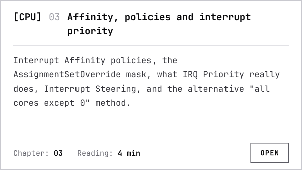</picture></a>
<a href="./docs/guide/04-gpu.en.md"><picture><source media="(prefers-color-scheme: dark)" srcset="./assets/readme/card-04-en-dark.svg">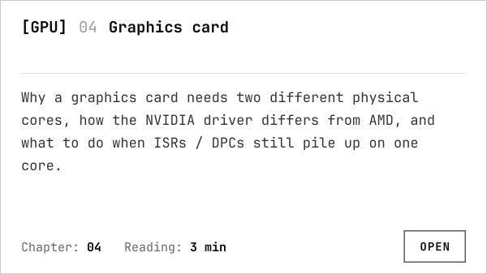</picture></a>
<a href="./docs/guide/05-usb-imod.en.md"><picture><source media="(prefers-color-scheme: dark)" srcset="./assets/readme/card-05-en-dark.svg">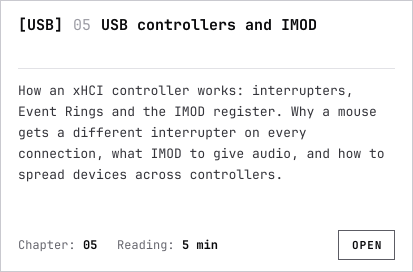</picture></a>
<a href="./docs/guide/06-network.en.md"><picture><source media="(prefers-color-scheme: dark)" srcset="./assets/readme/card-06-en-dark.svg">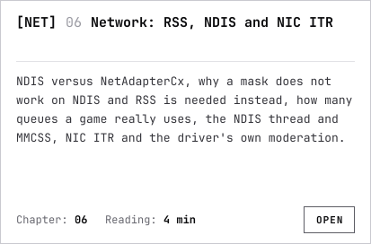</picture></a>
<a href="./docs/guide/07-cpu-topology.en.md"><picture><source media="(prefers-color-scheme: dark)" srcset="./assets/readme/card-07-en-dark.svg">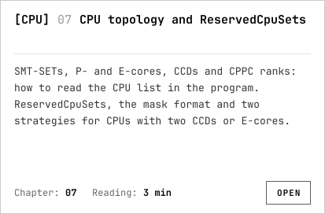</picture></a>
<a href="./docs/guide/08-input.en.md"><picture><source media="(prefers-color-scheme: dark)" srcset="./assets/readme/card-08-en-dark.svg">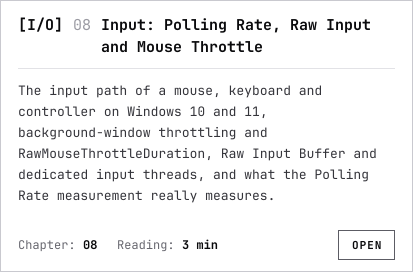</picture></a>
<a href="./docs/guide/09-power.en.md"><picture><source media="(prefers-color-scheme: dark)" srcset="./assets/readme/card-09-en-dark.svg">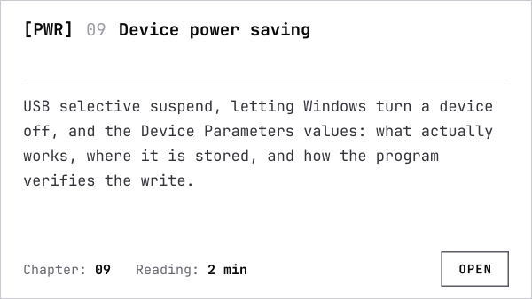</picture></a>
<a href="./docs/guide/10-verification.en.md"><picture><source media="(prefers-color-scheme: dark)" srcset="./assets/readme/card-10-en-dark.svg">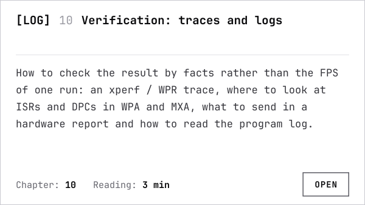</picture></a>
<a href="./docs/guide/11-driver.en.md"><picture><source media="(prefers-color-scheme: dark)" srcset="./assets/readme/card-11-en-dark.svg">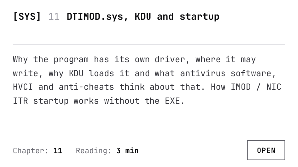</picture></a>
</p>

## <samp>[ INSTALLATION ]</samp>

- [`DEVICE.TWEAKER.SelfContained.exe`](https://github.com/arsenzaaa/DEVICE-TWEAKER/releases/latest/download/DEVICE.TWEAKER.SelfContained.exe) — .NET included.
- [`DEVICE.TWEAKER.exe`](https://github.com/arsenzaaa/DEVICE-TWEAKER/releases/latest/download/DEVICE.TWEAKER.exe) — requires the [.NET 8 Desktop Runtime x64](https://dotnet.microsoft.com/download/dotnet/8.0).

Run as administrator -> **AUTO-OPTIMIZATION**, or manual settings and **APPLY** -> restart. **CHECK** in the IMOD or NIC ITR block shows the actual register values.

> **DTIMOD.sys and KDU.** IMOD and NIC ITR are written by the custom DTIMOD.sys driver, and only to memory that Windows assigned to the selected device. The driver has no public signature and is loaded by [KDU](./src/IMOD/KDU/README.md) -> antivirus software flags such loaders as HackTool, HVCI and the Microsoft Vulnerable Driver Blocklist block the loading, and FACEIT and Vanguard may conflict with it. All other settings work without the driver. Details in [chapter 11](./docs/guide/11-driver.en.md).

SHA-256 hashes of the files are in `SHA256SUMS.txt` on the [release page](https://github.com/arsenzaaa/DEVICE-TWEAKER/releases/latest), of the sources in `SOURCE-SHA256SUMS.txt`:

```powershell
(Get-FileHash .\DEVICE.TWEAKER.SelfContained.exe -Algorithm SHA256).Hash
Select-String -Path .\SHA256SUMS.txt -Pattern 'DEVICE.TWEAKER.SelfContained.exe'
```

## <samp>[ ROLLBACK ]</samp>

Before every apply the program creates a verified backup in the `Backups` folder next to the EXE. **RESTORE → ORIGINAL** returns the registry to its state before the first auto-optimization and removes the startup task. The same menu has every backup and **RESET WINDOWS DEFAULT**.

## <samp>[ FEEDBACK ]</samp>

Report bugs in [issues](https://github.com/arsenzaaa/DEVICE-TWEAKER/issues/new?template=bug_report.yml) with the log from the `logs` folder, your Windows version and PC configuration. To help with auto-optimization, send a [hardware report](https://github.com/arsenzaaa/DEVICE-TWEAKER/issues/new?template=hardware_report.yml) with three logs: before applying, right after and after a restart. Updates are posted in [Telegram](https://t.me/arsenzaa).

<p align="center"><sub><a href="https://arsenzaaa.github.io/DEVICE-TWEAKER/en/">Site</a> · <a href="./docs/SETTINGS.en.md">Settings guide</a> · <a href="./docs/DEVELOPMENT.en.md">Development and build</a> · <a href="./docs/THIRD_PARTY_NOTICES.md">Third-party components</a> · <a href="./.github/SECURITY.md">Security</a> · <a href="./LICENSE">GPL-3.0</a></sub></p>
