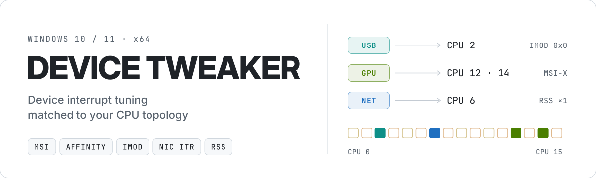
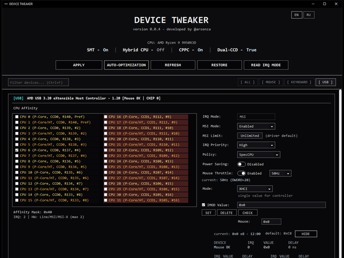
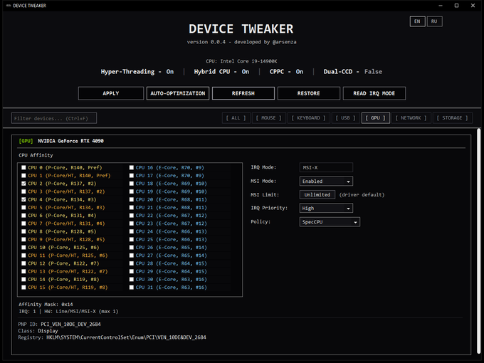
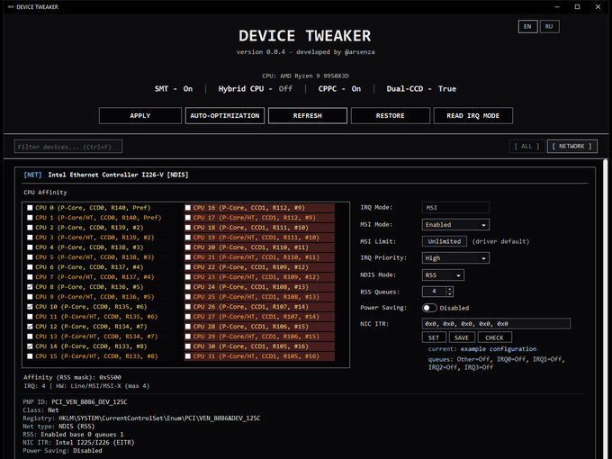
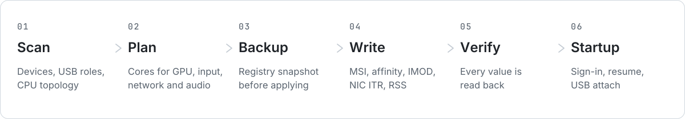

<a href="./README.md">Русский</a>

  <a href="https://github.com/arsenzaaa/DEVICE-TWEAKER/releases/latest">
    <picture>
      <source media="(prefers-color-scheme: dark) and (max-width: 600px)" srcset="./assets/branding/hero-mobile-en-dark.svg">
      <source media="(prefers-color-scheme: light) and (max-width: 600px)" srcset="./assets/branding/hero-mobile-en-light.svg">
      <source media="(prefers-color-scheme: dark)" srcset="./assets/branding/hero-en-dark.svg">
      
    </picture>
  </a>

  <a href="https://github.com/arsenzaaa/DEVICE-TWEAKER/releases/latest"><picture><source media="(prefers-color-scheme: dark)" srcset="./assets/branding/button-download-en-dark.svg"></picture></a>&nbsp;
  <a href="./src/docs/SETTINGS.en.md"><picture><source media="(prefers-color-scheme: dark)" srcset="./assets/branding/button-settings-en-dark.svg"></picture></a>&nbsp;
  <a href="./CHANGELOG.en.md"><picture><source media="(prefers-color-scheme: dark)" srcset="./assets/branding/button-changelog-en-dark.svg"></picture></a>

  
  
  
  
  

<strong>MSI Utility&nbsp;V3 + Interrupt Affinity Policy Tool + ReservedCpuSets + IMOD / NIC&nbsp;ITR</strong> in one program, with intelligent auto-optimization for your CPU topology.

## Interface

<table>
  <tr>
    <td width="33%" align="center"> USB IMOD · Ryzen 9 9950X3D</td>
    <td width="33%" align="center"> GPU · a pair of physical cores</td>
    <td width="33%" align="center"> Network · NIC ITR and RSS</td>
  </tr>
</table>

Screenshots show test devices and values.

## Features

<table>
  <tr>
    <td width="50%" valign="top">
      <h3>Auto-optimization</h3>
      Accounts for P-Core / E-Core, SMT / HT, CCD / CCX, CPPC ranking and device roles. A discrete GPU gets two different physical cores; input, network and audio follow their own rules. If the topology is uncertain, nothing is written.
    </td>
    <td width="50%" valign="top">
      <h3>Interrupts</h3>
      MSI Mode, MSI Limit, IRQ Priority, Policy and Interrupt Affinity. Shows the registry setting, the live IRQ Mode and the device's hardware capabilities (HW) separately.
    </td>
  </tr>
  <tr>
    <td width="50%" valign="top">
      <h3>USB IMOD</h3>
      xHCI interrupt moderation: one value per controller, per interrupter, or per role — mouse, keyboard, audio, gamepad. The role map is read from the xHCI contexts.
    </td>
    <td width="50%" valign="top">
      <h3>Network</h3>
      NIC&nbsp;ITR for Intel I210/I211, I219, I225/I226, I350, 82576/82580 and Realtek RTL8111/8168, RTL8125/8126, with the driver's own moderation turned off. RSS uses one CPU per physical core, within the MSI-X vectors.
    </td>
  </tr>
  <tr>
    <td width="50%" valign="top">
      <h3>Devices and CPU</h3>
      Finds GPUs, USB controllers, network and audio controllers, and storage. Knows which controller your mouse, keyboard and microphone are on, and which core every thread belongs to.
    </td>
    <td width="50%" valign="top">
      <h3>Input and system</h3>
      Polling Rate measurement via Raw Input, Mouse Throttle on Windows 11, ReservedCpuSets, and power saving for USB controllers, hubs and wired network.
    </td>
  </tr>
  <tr>
    <td width="50%" valign="top">
      <h3>Rollback</h3>
      A verified backup before settings are applied; restore the original state or any backup, or reset to Windows defaults.
    </td>
    <td width="50%" valign="top">
      <h3>Transparency</h3>
      Detailed log: what was applied, what was skipped and why. Every value is read back after writing. Open source, including the driver.
    </td>
  </tr>
</table>

## How it works

  <picture>
    <source media="(prefers-color-scheme: dark) and (max-width: 600px)" srcset="./assets/branding/pipeline-mobile-en-dark.svg">
    <source media="(prefers-color-scheme: light) and (max-width: 600px)" srcset="./assets/branding/pipeline-mobile-en-light.svg">
    <source media="(prefers-color-scheme: dark)" srcset="./assets/branding/pipeline-en-dark.svg">
    
  </picture>

Interrupt settings are written to the registry and take effect after a restart. IMOD and NIC&nbsp;ITR are registers of the device itself: the project's own driver **DTIMOD.sys** writes them, and only into memory Windows allocated to that device. Register values last until a restart or sleep, so the saved profile is applied by the open `ApplyIMOD.ps1` script from Task Scheduler — it works without the EXE.

## Download

| Build | Requires |
| --- | --- |
| **With built-in .NET** [DEVICE.TWEAKER.SelfContained.exe](https://github.com/arsenzaaa/DEVICE-TWEAKER/releases/latest/download/DEVICE.TWEAKER.SelfContained.exe) | nothing, all included |
| **Standard** [DEVICE.TWEAKER.exe](https://github.com/arsenzaaa/DEVICE-TWEAKER/releases/latest/download/DEVICE.TWEAKER.exe) | [.NET 8 Desktop Runtime x64](https://dotnet.microsoft.com/download/dotnet/8.0) |

DTIMOD.sys and the KDU loader are built into both. Checksums are in `SHA256SUMS.txt` on the [release page](https://github.com/arsenzaaa/DEVICE-TWEAKER/releases/latest).

## Quick start

1. Run the program **as administrator**.
2. Click **AUTO-OPTIMIZATION** — the program saves your original settings and offers USB IMOD if a suitable xHCI controller is present. Or configure devices manually and click **APPLY**.
3. Restart the PC.
4. **CHECK** in the IMOD / NIC&nbsp;ITR block reads the actual register values.
5. Everything can be rolled back via **RESTORE**: the original state, any backup, or Windows defaults.

Every setting is explained in the [settings guide](./src/docs/SETTINGS.en.md).

## FAQ

<strong>Why a driver, and why an antivirus may flag KDU</strong>

 

IMOD and NIC&nbsp;ITR are hardware registers that user mode cannot write. DTIMOD.sys has no public signature, so [KDU](./src/IMOD/KDU/README.md) loads it through a signed vulnerable driver; antiviruses flag such loaders as HackTool. The DTIMOD sources and the pinned KDU version are in this repository, and binaries are checked by SHA-256. The driver is only needed for IMOD, NIC&nbsp;ITR and the **READ IRQ MODE** button — everything else works without it.

<strong>HVCI, Vulnerable Driver Blocklist and anti-cheats</strong>

 

Memory Integrity (HVCI) and the Microsoft Vulnerable Driver Blocklist block loading through KDU; FACEIT and Vanguard may conflict with it. Before USB IMOD the program shows a **SYSTEM CHECK** with their state. MSI, affinity, RSS and the other registry settings do not depend on the driver.

<strong>How to undo everything</strong>

 

**RESTORE → ORIGINAL** returns the registry to the snapshot taken before the first apply and removes the IMOD / NIC&nbsp;ITR startup task. Then restart the PC. Backups are kept in the `Backups` folder next to the EXE.

<strong>Do IMOD and NIC ITR survive restarts and sleep</strong>

 

Yes. The `\DEVICE TWEAKER\IMOD` task applies the saved profile at sign-in, after resume from sleep and when a USB device is attached. Its files and logs are in `%ProgramData%\DEVICE TWEAKER\Startup`.

## Feedback

Found a bug? Open an [issue](https://github.com/arsenzaaa/DEVICE-TWEAKER/issues/new?template=bug_report.yml) with the log from the `logs` folder next to the EXE, your Windows build and PC configuration. For auto-optimization, three logs help most: before applying, right after, and after a restart.

News and discussion: [Telegram](https://t.me/arsenzaa).

## Documentation

[Settings guide](./src/docs/SETTINGS.en.md) · [Changelog](./CHANGELOG.en.md) · [Build](./src/docs/BUILD.md) · [QA](./dev/qa/README.md) · [Security](./.github/SECURITY.md) · [Contributing](./.github/CONTRIBUTING.md) · [GPL-3.0](./LICENSE)
