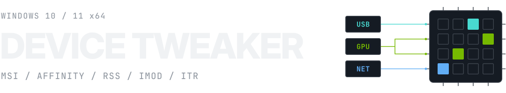
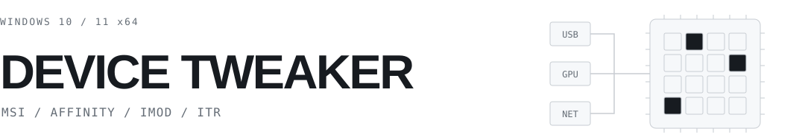
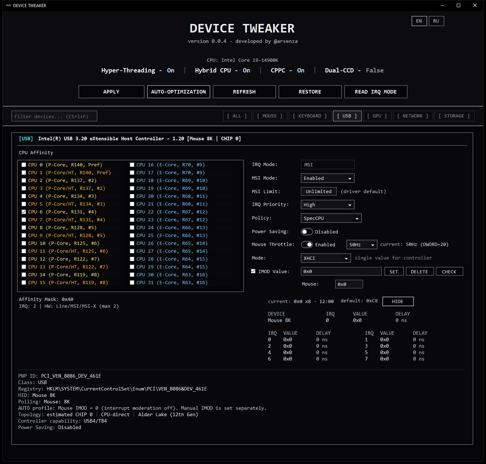
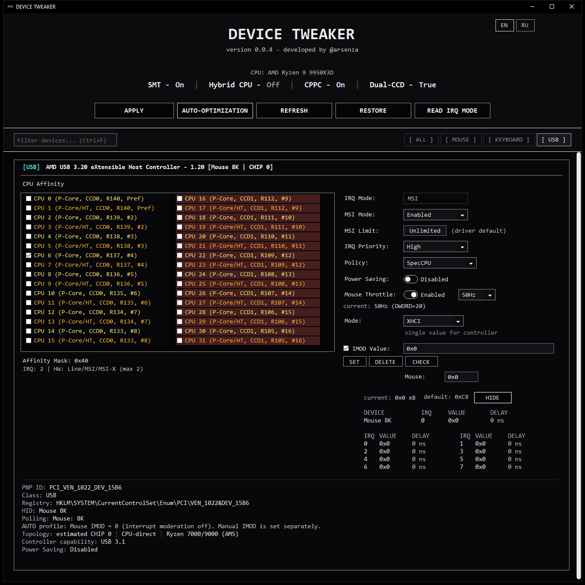
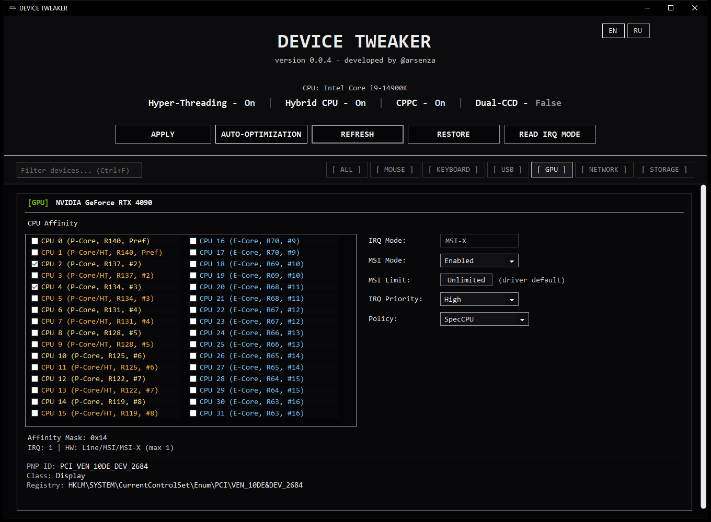
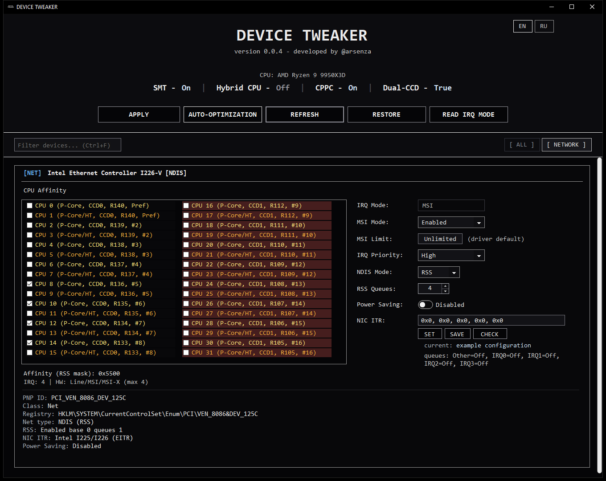
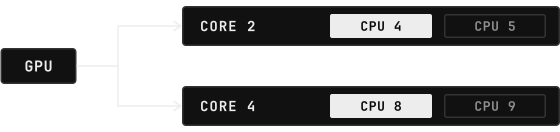
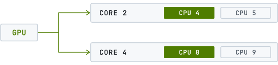

<a href="./README.md">Русский</a>

<h1>
  <a href="https://github.com/arsenzaaa/DEVICE-TWEAKER#gh-dark-mode-only"><picture><source media="(max-width: 600px)" srcset="./assets/branding/hero-mobile-dark.svg"></picture></a>
  <a href="https://github.com/arsenzaaa/DEVICE-TWEAKER#gh-light-mode-only"><picture><source media="(max-width: 600px)" srcset="./assets/branding/hero-mobile-light.svg"></picture></a>
</h1>

<strong>DEVICE TWEAKER is a utility for configuring device interrupts on Windows 10/11 x64.</strong>

MSI Utility V3 + Interrupt Affinity Policy Tool (IAPT) + ReservedCpuSets + IMOD / ITR controls in one interface with intelligent auto-optimization.

  
  
  
  

## <samp>[ INTERFACE ]</samp>

<table width="100%">
<tr><th align="left" width="860"><samp>More configurations</samp></th></tr>
<tr><td width="860">

<samp>USB IMOD on AMD</samp>

</td></tr>
<tr><td width="860">

<samp>GPU interrupt settings</samp>

</td></tr>
<tr><td width="860">

<samp>NIC ITR / RSS</samp>

</td></tr>
</table>

Screenshots show test devices and values.

## <samp>[ FEATURES ]</samp>

<table width="100%">
<tr><th align="left" width="860"><strong>Intelligent auto-optimization</strong></th></tr>
<tr><td width="860">

Intelligent auto-optimization accounts for P-Core / E-Core, SMT / HT, CPPC rankings, CCD / CCX, device count, and device roles. A discrete GPU gets two distinct physical cores; USB / network / audio devices have separate allocation rules.

</td></tr>
</table>

<table width="100%">
<tr><th align="left" width="860"><strong>Interrupt settings</strong></th></tr>
<tr><td width="860">

Supports MSI Mode / MSI Limit / IRQ Priority / IRQ Policy / Interrupt Affinity settings.

Displays the MSI Mode registry setting separately from the current interrupt mode in IRQ Mode. HW lists the modes supported by the device.

On opening, it uses an already loaded DTIMOD.sys or Windows resources without loading the driver. If Windows resources cannot distinguish MSI from MSI-X, it shows MSI/MSI-X.

<strong>READ IRQ MODE</strong> at the top reads the modes of all displayed PCI devices through DTIMOD.sys, loading the driver if needed.

</td></tr>
</table>

<table width="100%">
<tr><th align="left" width="860"><strong>USB IMOD</strong></th></tr>
<tr><td width="860">

Reads and displays IMOD on supported xHCI USB controllers. <strong>Devices</strong> sets a profile by USB role, <strong>XHCI</strong> uses one value for the controller, and <strong>Interrupters</strong> allows values by index.

Uses the custom DTIMOD.sys driver for reads and writes, then reads the values again after writing. Supports saving custom values for the next Windows sign-in.

</td></tr>
</table>

<table width="100%">
<tr><th align="left" width="860"><strong>Network settings</strong></th></tr>
<tr><td width="860">

Reads and displays NIC ITR on supported Intel / Realtek network adapters, including compatible Killer models. Queue and RX/TX information depends on the controller family. Change current values and save a profile for automatic reapplication at the next Windows sign-in.

Supports RSS settings on wired NDIS network adapters: base CPU, queue count, and RSS/IRQ mode.

</td></tr>
</table>

<table width="100%">
<tr><th align="left" width="860"><strong>Device detection</strong></th></tr>
<tr><td width="860">

Automatically detects GPUs / USB controllers / network adapters / audio controllers / storage controllers.

Automatically identifies which USB controller hosts the mouse / keyboard / gamepad / microphone / audio / camera. If multiple devices share a controller, all detected roles are displayed.

</td></tr>
</table>

<table width="100%">
<tr><th align="left" width="860"><strong>CPU topology</strong></th></tr>
<tr><td width="860">

Automatically detects and displays P-Core / E-Core, SMT / HT, AMD CCD / CCX, and available CPPC rankings. Shows which physical core each logical thread belongs to.

</td></tr>
</table>

<table width="100%">
<tr><th align="left" width="860"><strong>CPU reservation</strong></th></tr>
<tr><td width="860">

Supports reserving selected CPUs through ReservedCpuSets.

</td></tr>
</table>

<table width="100%">
<tr><th align="left" width="860"><strong>Polling Rate</strong></th></tr>
<tr><td width="860">

Displays mouse / keyboard Polling Rate information and supports measuring Raw Input event frequency. Keyboard event frequency depends on key activity.

</td></tr>
</table>

<table width="100%">
<tr><th align="left" width="860"><strong>Mouse Throttle</strong></th></tr>
<tr><td width="860">

Supports RawMouseThrottleDuration settings on compatible Windows 11 builds, with the current value displayed in the interface.

</td></tr>
</table>

<table width="100%">
<tr><th align="left" width="860"><strong>Power saving</strong></th></tr>
<tr><td width="860">

Supports power-saving settings for USB controllers / root USB hubs / wired network adapters.

</td></tr>
</table>

<table width="100%">
<tr><th align="left" width="860"><strong>Interface / navigation</strong></th></tr>
<tr><td width="860">

Supports device search, category navigation and RU/EN switching without restarting.

</td></tr>
</table>

<table width="100%">
<tr><th align="left" width="860"><strong>Backups / logs</strong></th></tr>
<tr><td width="860">

Supports creating backups, restoring a selected backup, deleting old backups, and settings reset.

Writes detailed logs of device detection and settings changes (what was applied / what was skipped / why).

</td></tr>
</table>

<table width="100%">
<tr><th align="left" width="860"><strong>Download</strong></th></tr>
<tr><td width="860">

The <a href="https://github.com/arsenzaaa/DEVICE-TWEAKER/releases/tag/v0.0.4">release</a> has two builds:

<strong>Standard build</strong> DEVICE.TWEAKER.exe Requires the <a href="https://dotnet.microsoft.com/download/dotnet/8.0">.NET 8 Desktop Runtime x64</a>.

<strong>Standalone build</strong> DEVICE.TWEAKER.SelfContained.exe Includes .NET, so no separate installation is needed.

Both builds include the DTIMOD.sys driver and KDU loader. The SHA-256 hash of each EXE is listed in SHA256SUMS.txt.

</td></tr>
</table>

<table width="100%">
<tr><th align="left" width="860"><strong>Usage</strong></th></tr>
<tr><td width="860">

Download the build you need and run the program as administrator.

For intelligent auto-optimization, click <strong>AUTO-OPTIMIZATION</strong>. If eligible xHCI USB controllers are detected, the program offers to include IMOD tuning before applying settings. NIC ITR is configured manually.

For manual configuration, choose the settings and click <strong>APPLY</strong>. This button applies interrupt, ReservedCpuSets, RSS, Mouse Throttle, power-saving, and USB IMOD settings.

IMOD / NIC ITR also have separate buttons:

<ul>
<li>IMOD: <strong>SET</strong> applies settings and saves values that differ from the defaults for the next Windows sign-in.</li>
<li>NIC ITR: <strong>SET</strong> changes current values; <strong>SAVE</strong> stores a profile for the next Windows sign-in.</li>
<li><strong>CHECK</strong> reads current IMOD / NIC ITR values.</li>
<li>IMOD: <strong>DELETE</strong> removes the shared IMOD / NIC ITR startup entry and returns the IMOD fields to their default value. Restart the PC to finish resetting.</li>
</ul>

<strong>REFRESH</strong> detects devices again. To roll back settings, click <strong>RESTORE</strong> and select the backup you need.

After <strong>APPLY</strong> / <strong>AUTO-OPTIMIZATION</strong>, restart the PC to finish applying the settings.

The program creates a backup before manual apply and reset. Intelligent auto-optimization preserves the original settings.

Detailed settings description: <a href="./src/docs/SETTINGS.en.md">SETTINGS.en.md</a>.

</td></tr>
</table>

<table width="100%">
<tr><th align="left" width="860"><strong>Bugs / testing</strong></th></tr>
<tr><td width="860">

Report bugs or other problems in <a href="https://github.com/arsenzaaa/DEVICE-TWEAKER/issues/new?template=bug_report.yml">issues</a>. Include a log, the program version, Windows build, and PC configuration. Also describe what you did and what happened.

To help test intelligent auto-optimization, send logs in this order:

<ol>
<li>Before intelligent auto-optimization (or after settings reset).</li>
<li>After intelligent auto-optimization.</li>
<li>After restarting the PC and reopening the program.</li>
</ol>

Project updates and discussion: <a href="https://t.me/arsenzaa">Telegram</a>.

</td></tr>
</table>

<table width="100%">
<tr><th align="left" width="860"><strong>Source</strong></th></tr>
<tr><td width="860">

<a href="./src/README.en.md">Build and checks</a> · <a href="./CHANGELOG.en.md">Changelog</a> · <a href="./LICENSE">GPL-3.0</a>

</td></tr>
</table>
