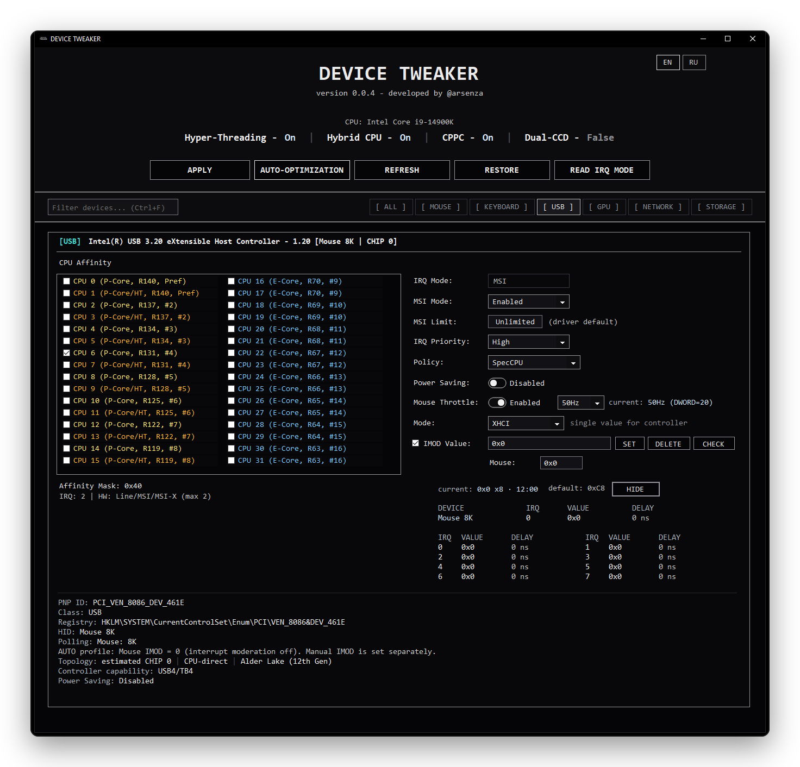
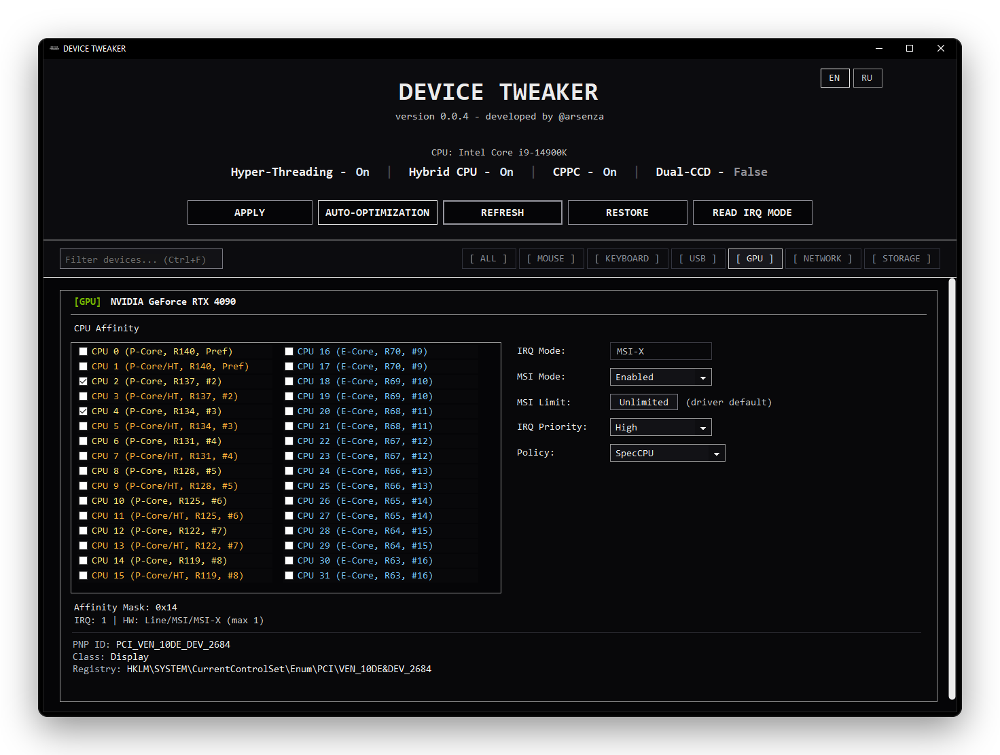
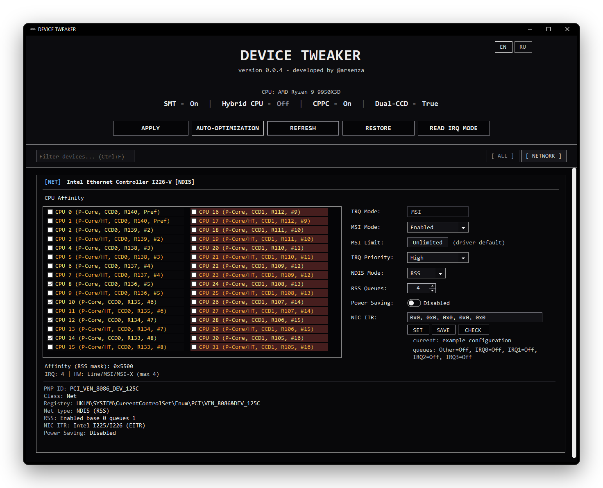
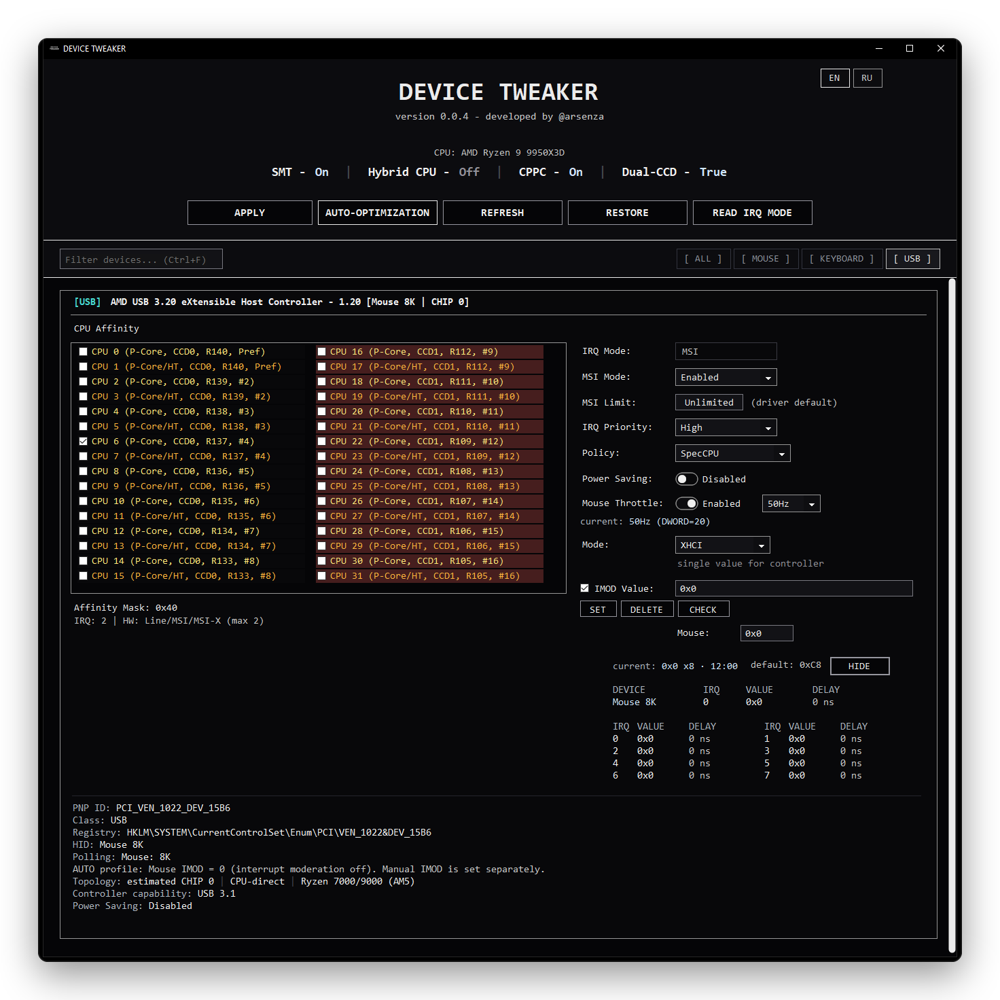

<div align="right"><a href="./README.md">Русский</a></div>

<p align="center"></p>

<h1 align="center">DEVICE TWEAKER</h1>

<p align="center"><b>Device interrupts on Windows 10 / 11 x64, tuned to your CPU topology.</b></p>

<p align="center">MSI Utility V3 + Interrupt Affinity Policy Tool (IAPT) + ReservedCpuSets + RSS + USB IMOD / NIC ITR in one interface, with intelligent auto-optimization.</p>

<p align="center">
<a href="https://github.com/arsenzaaa/DEVICE-TWEAKER/releases/latest"></a>
<a href="https://github.com/arsenzaaa/DEVICE-TWEAKER/releases"></a>

<a href="./LICENSE"></a>
</p>

<p align="center"><b><a href="https://github.com/arsenzaaa/DEVICE-TWEAKER/releases/latest">Download</a></b> · <a href="https://arsenzaaa.github.io/DEVICE-TWEAKER/en/">Documentation</a> · <a href="./CHANGELOG.en.md">Changelog</a> · <a href="https://t.me/arsenzaa">Telegram</a></p>

<p align="center"><a href="./assets/screenshots/showcase_intel_14900k_full_en.png"></a></p>

## <samp>[ FEATURES ]</samp>

<table>
<tr>
<td width="50%" valign="top"><b>Intelligent auto-optimization</b><br>A plan built from the CPU topology and device roles: P- / E-cores, SMT / HT, CPPC, CCD / CCX. A discrete GPU gets two different physical cores; the mouse, network and audio have their own rules.</td>
<td width="50%" valign="top"><b>Interrupts</b><br>MSI Mode, MSI Limit, IRQ Priority, IRQ Policy and Interrupt Affinity for each device. The registry setting, the current IRQ Mode and the device's capabilities are shown separately.</td>
</tr>
<tr>
<td valign="top"><b>USB IMOD</b><br>The interrupt moderation interval of each xHCI interrupter: by device role, for the whole controller or by index. The device → interrupter map is read from the controller's memory.</td>
<td valign="top"><b>NIC ITR and RSS</b><br>Moderation registers of Intel and Realtek adapters, including Killer. RSS on wired adapters: base CPU and queues, one processor per physical core.</td>
</tr>
<tr>
<td valign="top"><b>Startup without the EXE</b><br>A saved IMOD / NIC ITR profile is applied by a Task Scheduler task at sign-in, after sleep and when USB devices connect. The script is readable and its files are checked by SHA-256.</td>
<td valign="top"><b>Device detection</b><br>GPUs, USB, network, audio and storage, by category. Each USB controller shows where the mouse, keyboard, gamepad, microphone, audio and camera are.</td>
</tr>
<tr>
<td valign="top"><b>Input and power</b><br>Polling Rate with a Raw Input measurement, RawMouseThrottleDuration on Windows 11, power saving of USB and network adapters, ReservedCpuSets.</td>
<td valign="top"><b>Backups and logs</b><br>A verified backup before every apply and a one-step return to the original state. The log records what was applied, what was skipped and why.</td>
</tr>
</table>

<table>
<tr>
<td width="33%" valign="top"><a href="./assets/screenshots/showcase_gpu_full_en.png"></a></td>
<td width="33%" valign="top"><a href="./assets/screenshots/showcase_nic_full_en.png"></a></td>
<td width="33%" valign="top"><a href="./assets/screenshots/showcase_amd_imod_full_en.png"></a></td>
</tr>
<tr>
<td align="center"><sub>GPU on two physical cores</sub></td>
<td align="center"><sub>NIC ITR and RSS, Intel I226-V</sub></td>
<td align="center"><sub>USB IMOD, Ryzen 9 9950X3D</sub></td>
</tr>
</table>

<sub>Screenshots show test devices and values.</sub>

## <samp>[ INSTALLATION ]</samp>

| File | Requirements |
| :--- | :--- |
| [`DEVICE.TWEAKER.SelfContained.exe`](https://github.com/arsenzaaa/DEVICE-TWEAKER/releases/latest/download/DEVICE.TWEAKER.SelfContained.exe) | none, .NET included |
| [`DEVICE.TWEAKER.exe`](https://github.com/arsenzaaa/DEVICE-TWEAKER/releases/latest/download/DEVICE.TWEAKER.exe) | [.NET 8 Desktop Runtime x64](https://dotnet.microsoft.com/download/dotnet/8.0) |

1. Run the program as administrator.
2. Click **AUTO-OPTIMIZATION**, or choose the settings yourself and click **APPLY**.
3. Restart the PC. **CHECK** in the IMOD or NIC ITR block shows the actual register values.

> [!IMPORTANT]
> IMOD and NIC ITR registers are written by the custom DTIMOD.sys driver, and only to memory that Windows assigned to the selected device. The driver has no public signature and is loaded by [KDU](./src/IMOD/KDU/README.md), so antivirus software may flag the program as HackTool. HVCI and the Microsoft Vulnerable Driver Blocklist block this kind of loading, and FACEIT and Vanguard may conflict with it: **SYSTEM CHECK** shows their state. All other settings work without the driver.

<details>
<summary><b>Verifying the files</b></summary>
<br>

SHA-256 hashes of both EXEs are in `SHA256SUMS.txt` on the [release page](https://github.com/arsenzaaa/DEVICE-TWEAKER/releases/latest), and of the sources in `SOURCE-SHA256SUMS.txt`.

```powershell
(Get-FileHash .\DEVICE.TWEAKER.SelfContained.exe -Algorithm SHA256).Hash
Select-String -Path .\SHA256SUMS.txt -Pattern 'DEVICE.TWEAKER.SelfContained.exe'
```

The hashes must match. DTIMOD.sys and the KDU loader are embedded in the EXE; their sources and pinned versions are in the repository.

</details>

## <samp>[ WHAT THE PROGRAM CHANGES ]</samp>

| Setting | Where it is written |
| :--- | :--- |
| MSI Mode, MSI Limit | `MSISupported`, `MessageNumberLimit` in `Interrupt Management\MessageSignaledInterruptProperties` |
| IRQ Priority | `DevicePriority` in `Interrupt Management\Affinity Policy` |
| IRQ Policy, Interrupt Affinity | `DevicePolicy`, `AssignmentSetOverride` in the same key |
| RSS | `*RssBaseProcNumber`, `*NumRssQueues`, `*MaxRssProcessors`, `*RssMaxProcNumber` in the adapter class key |
| ReservedCpuSets | `ReservedCpuSets` in `Session Manager\kernel` |
| Mouse Throttle | `RawMouseThrottleDuration` in `HKCU\Control Panel\Mouse` |
| Power saving | `PnPCapabilities`, `SelectiveSuspendEnabled`, `EnhancedPowerManagementEnabled`, USB selective suspend in the power plan |
| USB IMOD | the IMOD register of each xHCI interrupter, 250 ns steps |
| NIC ITR | EITR / ITR on Intel, IntrMit on Realtek |

Registry settings take effect after a restart. IMOD and NIC ITR registers change immediately and are read back after writing. Every setting is described in detail in the [documentation](https://arsenzaaa.github.io/DEVICE-TWEAKER/en/settings/).

## <samp>[ ROLLBACK ]</samp>

Before every apply the program creates a verified backup in the `Backups` folder next to the EXE. **RESTORE → ORIGINAL** returns the registry to its state before the first auto-optimization and removes the startup task. The same menu has every backup and **RESET WINDOWS DEFAULT**.

## <samp>[ FEEDBACK ]</samp>

Report bugs in [issues](https://github.com/arsenzaaa/DEVICE-TWEAKER/issues/new?template=bug_report.yml) with the log from the `logs` folder next to the EXE, your Windows version and PC configuration. Auto-optimization results on your hardware go to a [hardware report](https://github.com/arsenzaaa/DEVICE-TWEAKER/issues/new?template=hardware_report.yml): three logs, before applying, right after and after a restart. Updates are posted in [Telegram](https://t.me/arsenzaa).

<p align="center"><sub><a href="https://arsenzaaa.github.io/DEVICE-TWEAKER/en/">Documentation</a> · <a href="./docs/DEVELOPMENT.en.md">Development and build</a> · <a href="./docs/THIRD_PARTY_NOTICES.md">Third-party components</a> · <a href="./.github/SECURITY.md">Security</a> · <a href="./LICENSE">GPL-3.0</a></sub></p>
