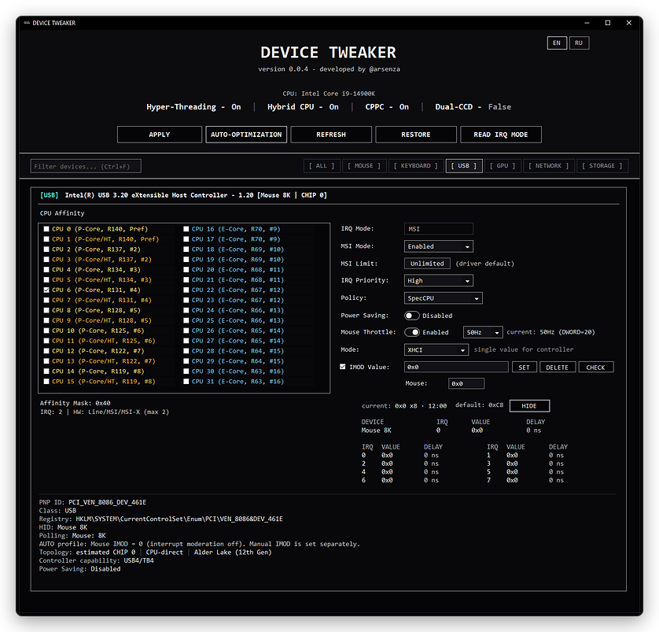
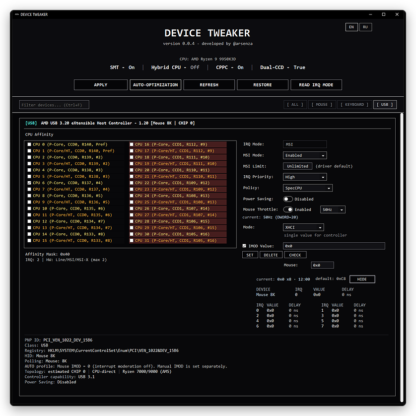
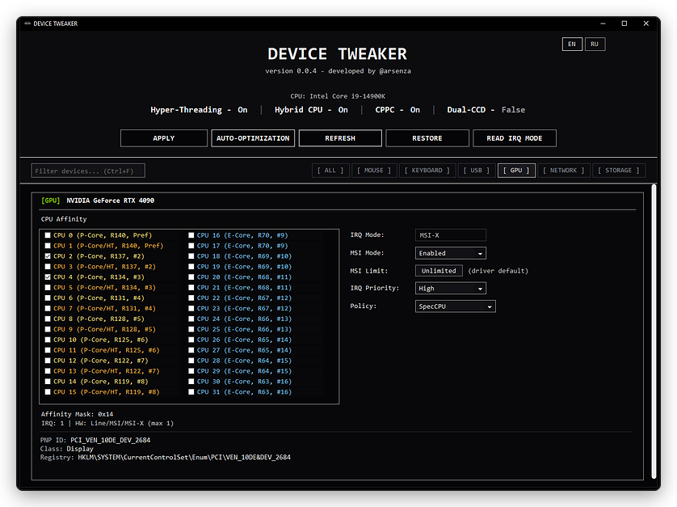
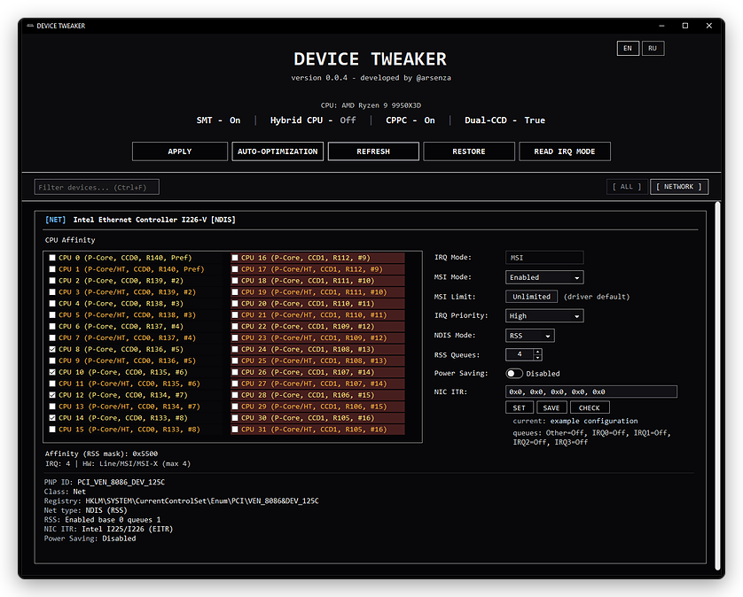

<h1 align="center">DEVICE TWEAKER</h1>

<p align="center">Spreads device interrupts across CPU cores on Windows 10 and 11.</p>

<p align="center">
  <a href="https://github.com/arsenzaaa/DEVICE-TWEAKER/releases/latest"></a>
  <a href="https://github.com/arsenzaaa/DEVICE-TWEAKER/releases"></a>
  
  <a href="./LICENSE"></a>
</p>

<p align="center">
  <a href="https://github.com/arsenzaaa/DEVICE-TWEAKER/releases/latest"><b>Download</b></a> ·
  <a href="./docs/guide/README.en.md">Guide</a> ·
  <a href="./docs/SETTINGS.en.md">Settings</a> ·
  <a href="./CHANGELOG.en.md">Changelog</a> ·
  <a href="https://t.me/arsenzaa">Telegram</a> ·
  <a href="./README.md">Русский</a>
</p>

<p align="center"><a href="./assets/screenshots/showcase_intel_14900k_full_en.png"><picture><source srcset="./assets/screenshots/readme/showcase_intel_14900k_full_en.png 1x, ./assets/screenshots/framed/showcase_intel_14900k_full_en.png 2x"></picture></a></p>

## About

Device drivers handle interrupts on whatever cores Windows assigned to them. When that core is running a game thread, the thread is paused and loses time. When several drivers share a core, they delay each other. In games this shows up as uneven frame times and input lag.

DEVICE TWEAKER takes the CPU layout into account (P- and E-cores, Hyper-Threading / SMT, CPPC core ranking, AMD CCDs) and gives each device its own physical core. Settings that usually take several utilities and registry edits are in one window: MSI Mode, Interrupt Affinity, ReservedCpuSets, RSS, and interrupt moderation for USB controllers (IMOD) and network cards (NIC ITR).

## Features

- **Auto-optimization.** Builds a plan from the CPU topology and device roles: the graphics card gets two different physical cores, drivers never share a core, and core 0 is kept free when possible.
- **MSI and MSI-X.** Turns on MSI Mode and sets MSI Limit. The current interrupt mode can be read straight from PCI configuration space.
- **Interrupt Affinity and priority.** Policy, core mask and IRQ Priority per device.
- **USB IMOD.** xHCI interrupt moderation set separately for the mouse, keyboard, audio and other devices on a controller.
- **Network.** RSS across physical cores and interrupt moderation registers (ITR) for Intel and Realtek controllers.
- **Input and power.** Mouse Polling Rate measurement, Mouse Throttle, ReservedCpuSets and device power saving.
- **Startup.** A Task Scheduler task applies IMOD and NIC ITR at sign-in, after sleep and when USB devices connect. It is a readable PowerShell script and does not need the EXE.
- **Backups and log.** A verified backup is made before every apply. The log records what was applied, what was skipped and why.

## Installation

Download one file from the [latest release](https://github.com/arsenzaaa/DEVICE-TWEAKER/releases/latest):

- `DEVICE.TWEAKER.SelfContained.exe` runs as is, .NET is included;
- `DEVICE.TWEAKER.exe` is smaller but needs the [.NET 8 Desktop Runtime x64](https://dotnet.microsoft.com/download/dotnet/8.0).

Nothing to install. Checksums are in `SHA256SUMS.txt` on the release page:

```powershell
(Get-FileHash .\DEVICE.TWEAKER.SelfContained.exe -Algorithm SHA256).Hash
```

## Quick start

1. Run the program as administrator.
2. Click **AUTO-OPTIMIZATION**, or select a device, set it up by hand and click **APPLY**.
3. Restart the computer: MSI Mode and Interrupt Affinity take effect after a restart.
4. **CHECK** in the IMOD or NIC ITR block shows the values currently written to the registers.

To undo everything, open **RESTORE** and choose **ORIGINAL**: the state before the first auto-optimization. Any other backup can be restored from the same menu.

> [!IMPORTANT]
> IMOD and NIC ITR registers are written by the DTIMOD.sys driver, and only to memory that Windows assigned to the selected device. The driver has no public signature and is loaded by [KDU](./src/IMOD/KDU/README.md). This is why antivirus software flags the program as HackTool, and why HVCI and the Microsoft Vulnerable Driver Blocklist prevent the driver from loading. All other settings work without it. Details in [chapter 11](./docs/guide/11-driver.en.md).

## Documentation

The [guide](./docs/guide/README.en.md) explains how interrupts work in Windows and what exactly the program changes:

1. [Interrupts: ISR, DPC and cores](./docs/guide/01-interrupts.en.md)
2. [MSI and MSI-X](./docs/guide/02-msi.en.md)
3. [Affinity, policies and interrupt priority](./docs/guide/03-affinity.en.md)
4. [Graphics card](./docs/guide/04-gpu.en.md)
5. [USB controllers and IMOD](./docs/guide/05-usb-imod.en.md)
6. [Network: RSS, NDIS and NIC ITR](./docs/guide/06-network.en.md)
7. [CPU topology and ReservedCpuSets](./docs/guide/07-cpu-topology.en.md)
8. [Input: Polling Rate, Raw Input and Mouse Throttle](./docs/guide/08-input.en.md)
9. [Device power saving](./docs/guide/09-power.en.md)
10. [Verification: traces and logs](./docs/guide/10-verification.en.md)
11. [DTIMOD.sys, KDU and startup](./docs/guide/11-driver.en.md)

Every interface element is described in the [settings reference](./docs/SETTINGS.en.md).

<details>
<summary>More screenshots</summary>
<br>

<p align="center"></p>
<p align="center"></p>
<p align="center"></p>

</details>

## Feedback

- Found a bug: open an [issue](https://github.com/arsenzaaa/DEVICE-TWEAKER/issues/new?template=bug_report.yml) and attach the log from the `logs` folder next to the EXE.
- Want to share results on your hardware: fill in a [hardware report](https://github.com/arsenzaaa/DEVICE-TWEAKER/issues/new?template=hardware_report.yml) with three logs, before applying, right after and after a restart.
- News and discussion in [Telegram](https://t.me/arsenzaa).

Building from source is described in [DEVELOPMENT.en.md](./docs/DEVELOPMENT.en.md).

## License

[GPL-3.0](./LICENSE). Third-party components are listed in [THIRD_PARTY_NOTICES.md](./docs/THIRD_PARTY_NOTICES.md).
