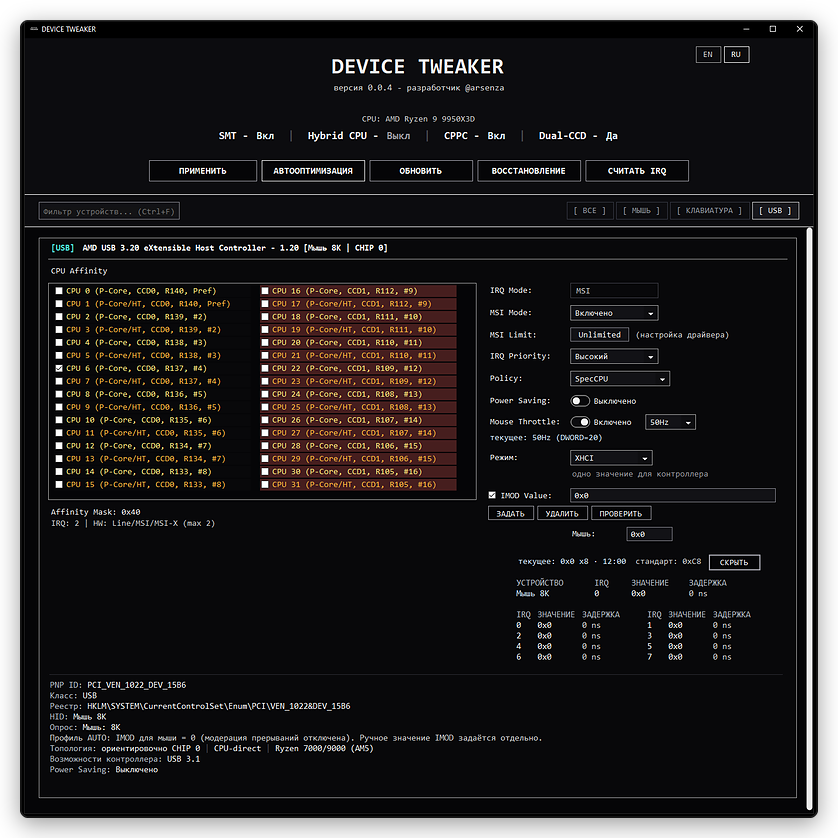
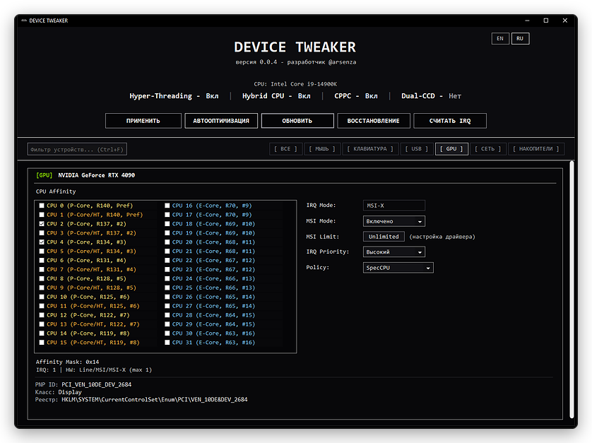
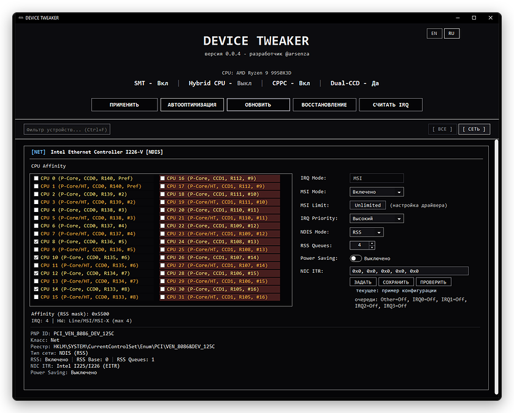

<h1 align="center">DEVICE TWEAKER</h1>

<p align="center">Распределение прерываний устройств по ядрам процессора в Windows 10 и 11.</p>

<p align="center">
  <a href="https://github.com/arsenzaaa/DEVICE-TWEAKER/releases/latest"></a>
  <a href="https://github.com/arsenzaaa/DEVICE-TWEAKER/releases"></a>
  
  <a href="./LICENSE"></a>
</p>

<p align="center">
  <a href="https://github.com/arsenzaaa/DEVICE-TWEAKER/releases/latest"><b>Скачать</b></a> ·
  <a href="./docs/guide/README.md">Гайд</a> ·
  <a href="./docs/SETTINGS.md">Настройки</a> ·
  <a href="./CHANGELOG.md">Изменения</a> ·
  <a href="https://t.me/arsenzaa">Telegram</a> ·
  <a href="./README.en.md">English</a>
</p>

<p align="center"><a href="./assets/screenshots/showcase_intel_14900k_full_ru.png"><picture><source srcset="./assets/screenshots/readme/showcase_intel_14900k_full_ru.png 1x, ./assets/screenshots/framed/showcase_intel_14900k_full_ru.png 2x"></picture></a></p>

## О программе

Драйверы устройств обрабатывают прерывания на тех ядрах, которые им назначила Windows. Если это ядро занято потоком игры, поток приостанавливается и теряет время. Если несколько драйверов работают на одном ядре, они задерживают друг друга. В играх это проявляется как нестабильное время кадра и задержка ввода.

DEVICE TWEAKER учитывает устройство процессора (P- и E-ядра, Hyper-Threading / SMT, рейтинг ядер CPPC, CCD у AMD) и назначает каждому устройству своё физическое ядро. Всё, что обычно настраивают несколькими утилитами и правкой реестра, собрано в одном окне: MSI Mode, Interrupt Affinity, ReservedCpuSets, RSS, модерация прерываний USB-контроллеров (IMOD) и сетевых карт (NIC ITR).

## Возможности

- **Автооптимизация.** Программа сама составляет план по топологии процессора и ролям устройств: видеокарта получает два разных физических ядра, драйверы не делят одно ядро, ядро 0 по возможности остаётся свободным.
- **MSI и MSI-X.** Включение MSI Mode и настройка MSI Limit. Текущий режим прерываний можно считать прямо из конфигурации PCI.
- **Interrupt Affinity и приоритет.** Политика, маска ядер и IRQ Priority для каждого устройства.
- **USB IMOD.** Модерация прерываний xHCI отдельно для мыши, клавиатуры, аудио и других устройств на контроллере.
- **Сеть.** RSS по физическим ядрам и регистры модерации прерываний (ITR) для контроллеров Intel и Realtek.
- **Ввод и питание.** Замер Polling Rate мыши, Mouse Throttle, ReservedCpuSets и энергосбережение устройств.
- **Автозапуск.** Задача Планировщика применяет настройки IMOD и NIC ITR при входе в Windows, после сна и при подключении USB. Это открытый PowerShell-скрипт, EXE для него не нужен.
- **Бекапы и лог.** Перед каждым применением создаётся проверенный бекап. В логе записано, что применилось, что пропущено и почему.

## Установка

Скачайте один файл из [последнего релиза](https://github.com/arsenzaaa/DEVICE-TWEAKER/releases/latest):

- `DEVICE.TWEAKER.SelfContained.exe` работает сразу, .NET уже внутри;
- `DEVICE.TWEAKER.exe` меньше по размеру, но нужен [.NET 8 Desktop Runtime x64](https://dotnet.microsoft.com/download/dotnet/8.0).

Установка не требуется. Контрольные суммы лежат в `SHA256SUMS.txt` на странице релиза:

```powershell
(Get-FileHash .\DEVICE.TWEAKER.SelfContained.exe -Algorithm SHA256).Hash
```

## Быстрый старт

1. Запустите программу от имени администратора.
2. Нажмите **АВТООПТИМИЗАЦИЯ** или выберите устройство, настройте его вручную и нажмите **ПРИМЕНИТЬ**.
3. Перезагрузите компьютер: MSI Mode и Interrupt Affinity вступают в силу после перезагрузки.
4. Кнопка **ПРОВЕРИТЬ** в блоке IMOD или NIC ITR показывает значения, которые сейчас записаны в регистрах.

Чтобы вернуть всё как было, откройте **ВОССТАНОВЛЕНИЕ** и выберите **ИСХОДНЫЙ**: это состояние до первой автооптимизации. Там же можно восстановить любой другой бекап.

> [!IMPORTANT]
> Регистры IMOD и NIC ITR записывает драйвер DTIMOD.sys, и только в память, которую Windows выделила выбранному устройству. У драйвера нет публичной подписи, его загружает [KDU](./src/IMOD/KDU/README.md). Поэтому антивирусы помечают программу как HackTool, а HVCI и Microsoft Vulnerable Driver Blocklist не дают загрузить драйвер. Остальные настройки работают без него. Подробнее в [главе 11](./docs/guide/11-driver.md).

## Документация

[Гайд](./docs/guide/README.md) объясняет, как прерывания устроены в Windows и что именно меняет программа:

1. [Прерывания: ISR, DPC и ядра](./docs/guide/01-interrupts.md)
2. [MSI и MSI-X](./docs/guide/02-msi.md)
3. [Affinity, политики и приоритет прерываний](./docs/guide/03-affinity.md)
4. [Видеокарта](./docs/guide/04-gpu.md)
5. [USB-контроллеры и IMOD](./docs/guide/05-usb-imod.md)
6. [Сеть: RSS, NDIS и NIC ITR](./docs/guide/06-network.md)
7. [Топология процессора и ReservedCpuSets](./docs/guide/07-cpu-topology.md)
8. [Ввод: Polling Rate, Raw Input и Mouse Throttle](./docs/guide/08-input.md)
9. [Энергосбережение устройств](./docs/guide/09-power.md)
10. [Проверка: трейсы и логи](./docs/guide/10-verification.md)
11. [DTIMOD.sys, KDU и автозапуск](./docs/guide/11-driver.md)

Каждый элемент интерфейса описан в [справочнике настроек](./docs/SETTINGS.md).

<details>
<summary>Другие скриншоты</summary>
<br>

<p align="center"></p>
<p align="center"></p>
<p align="center"></p>

</details>

## Обратная связь

- Нашли ошибку: создайте [issue](https://github.com/arsenzaaa/DEVICE-TWEAKER/issues/new?template=bug_report.yml) и приложите лог из папки `logs` рядом с EXE.
- Хотите поделиться результатом на своём железе: заполните [отчёт о железе](https://github.com/arsenzaaa/DEVICE-TWEAKER/issues/new?template=hardware_report.yml) с тремя логами, до применения, сразу после и после перезагрузки.
- Новости и обсуждение в [Telegram](https://t.me/arsenzaa).

Сборка из исходников описана в [DEVELOPMENT.md](./docs/DEVELOPMENT.md).

## Лицензия

[GPL-3.0](./LICENSE). Сторонние компоненты перечислены в [THIRD_PARTY_NOTICES.md](./docs/THIRD_PARTY_NOTICES.md).
