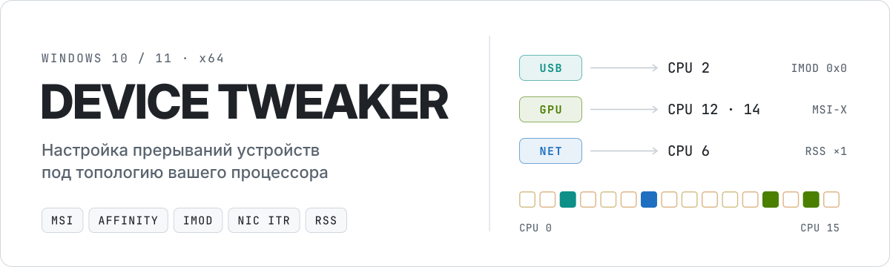
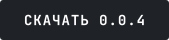
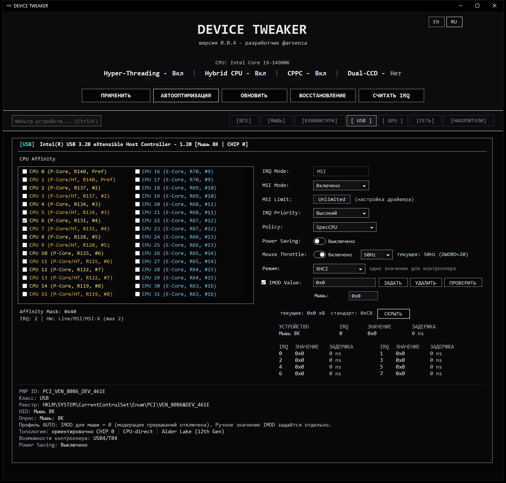
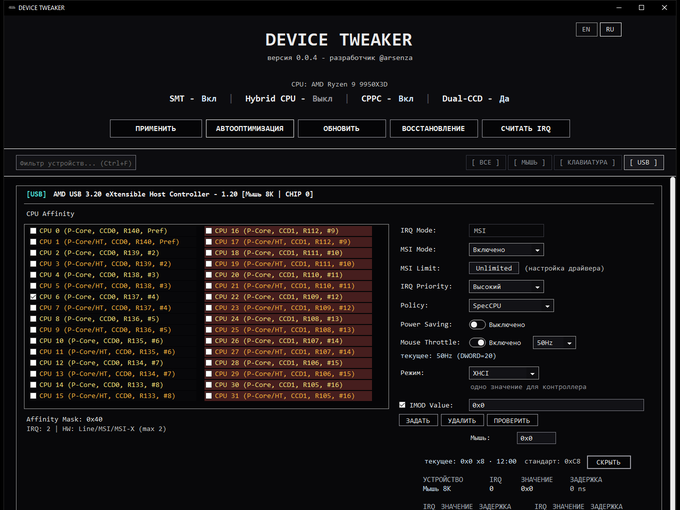
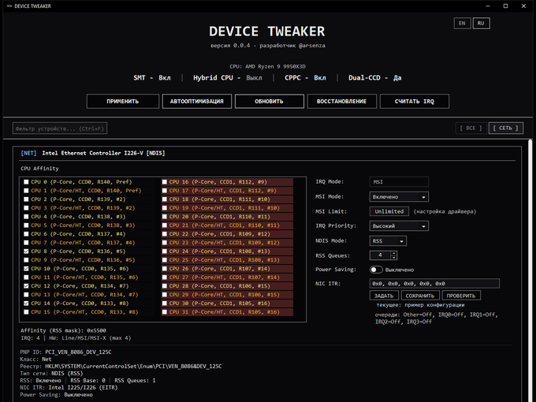
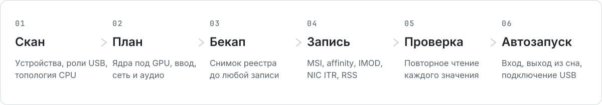

<a href="./README.en.md">English</a>

  <a href="https://github.com/arsenzaaa/DEVICE-TWEAKER/releases/latest">
    <picture>
      <source media="(prefers-color-scheme: dark) and (max-width: 600px)" srcset="./assets/branding/hero-mobile-ru-dark.svg">
      <source media="(prefers-color-scheme: light) and (max-width: 600px)" srcset="./assets/branding/hero-mobile-ru-light.svg">
      <source media="(prefers-color-scheme: dark)" srcset="./assets/branding/hero-ru-dark.svg">
      
    </picture>
  </a>

  <a href="https://github.com/arsenzaaa/DEVICE-TWEAKER/releases/latest"><picture><source media="(prefers-color-scheme: dark)" srcset="./assets/branding/button-download-ru-dark.svg"></picture></a>&nbsp;
  <a href="./src/docs/SETTINGS.md"><picture><source media="(prefers-color-scheme: dark)" srcset="./assets/branding/button-settings-ru-dark.svg"></picture></a>&nbsp;
  <a href="./CHANGELOG.md"><picture><source media="(prefers-color-scheme: dark)" srcset="./assets/branding/button-changelog-ru-dark.svg"></picture></a>

  
  
  
  
  

<strong>MSI Utility&nbsp;V3 + Interrupt Affinity Policy Tool + ReservedCpuSets + IMOD / NIC&nbsp;ITR</strong> в одной программе, с интеллектуальной авто-оптимизацией под топологию процессора.

## Интерфейс

<table>
  <tr>
    <td width="33%" align="center"> USB IMOD · Ryzen 9 9950X3D</td>
    <td width="33%" align="center"> GPU · пара физических ядер</td>
    <td width="33%" align="center"> Сеть · NIC ITR и RSS</td>
  </tr>
</table>

На скриншотах тестовые устройства и значения.

## Возможности

<table>
  <tr>
    <td width="50%" valign="top">
      <h3>Авто-оптимизация</h3>
      Учитывает P-Core / E-Core, SMT / HT, CCD / CCX, CPPC-рейтинг и роли устройств. Дискретной GPU — два разных физических ядра, вводу, сети и аудио — свои правила. Неясная топология — запись не начинается.
    </td>
    <td width="50%" valign="top">
      <h3>Прерывания</h3>
      MSI Mode, MSI Limit, IRQ Priority, Policy и Interrupt Affinity. Отдельно показывает настройку из реестра, текущий режим IRQ Mode и возможности устройства (HW).
    </td>
  </tr>
  <tr>
    <td width="50%" valign="top">
      <h3>USB IMOD</h3>
      Модерация прерываний xHCI: одно значение на контроллер, по interrupter'ам или по ролям — мышь, клавиатура, аудио, геймпад. Карта ролей читается из контекстов xHCI.
    </td>
    <td width="50%" valign="top">
      <h3>Сеть</h3>
      NIC&nbsp;ITR для Intel I210/I211, I219, I225/I226, I350, 82576/82580 и Realtek RTL8111/8168, RTL8125/8126 с отключением модерации драйвера. RSS — по одному CPU на физическое ядро, в пределах векторов MSI-X.
    </td>
  </tr>
  <tr>
    <td width="50%" valign="top">
      <h3>Устройства и CPU</h3>
      Находит GPU, USB-контроллеры, сетевые и аудиоконтроллеры, накопители. Знает, на каком контроллере мышь, клавиатура и микрофон, и к какому ядру относится каждый поток.
    </td>
    <td width="50%" valign="top">
      <h3>Ввод и система</h3>
      Замер Polling Rate через Raw Input, Mouse Throttle на Windows 11, ReservedCpuSets и энергосбережение USB-контроллеров, хабов и проводной сети.
    </td>
  </tr>
  <tr>
    <td width="50%" valign="top">
      <h3>Откат</h3>
      Проверенный бекап перед каждой записью, восстановление исходного состояния или любого бекапа, сброс к настройкам Windows.
    </td>
    <td width="50%" valign="top">
      <h3>Прозрачность</h3>
      Подробный лог: что применилось, что пропущено и почему. После записи каждое значение читается повторно. Открытый код, включая драйвер.
    </td>
  </tr>
</table>

## Как это работает

  <picture>
    <source media="(prefers-color-scheme: dark) and (max-width: 600px)" srcset="./assets/branding/pipeline-mobile-ru-dark.svg">
    <source media="(prefers-color-scheme: light) and (max-width: 600px)" srcset="./assets/branding/pipeline-mobile-ru-light.svg">
    <source media="(prefers-color-scheme: dark)" srcset="./assets/branding/pipeline-ru-dark.svg">
    
  </picture>

Настройки прерываний записываются в реестр и вступают в силу после перезагрузки. IMOD и NIC&nbsp;ITR — регистры самого устройства: их пишет собственный драйвер **DTIMOD.sys**, и только в память, которую Windows выделила этому устройству. Значения в регистрах живут до перезагрузки или сна, поэтому сохранённый профиль применяет открытый скрипт `ApplyIMOD.ps1` из Планировщика заданий — он работает и без EXE.

## Скачать

| Сборка | Что нужно |
| --- | --- |
| **Со встроенным .NET** [DEVICE.TWEAKER.SelfContained.exe](https://github.com/arsenzaaa/DEVICE-TWEAKER/releases/latest/download/DEVICE.TWEAKER.SelfContained.exe) | ничего, всё внутри |
| **Обычная** [DEVICE.TWEAKER.exe](https://github.com/arsenzaaa/DEVICE-TWEAKER/releases/latest/download/DEVICE.TWEAKER.exe) | [.NET 8 Desktop Runtime x64](https://dotnet.microsoft.com/download/dotnet/8.0) |

DTIMOD.sys и загрузчик KDU встроены в обе сборки. Контрольные суммы — в `SHA256SUMS.txt` на [странице релиза](https://github.com/arsenzaaa/DEVICE-TWEAKER/releases/latest).

## Быстрый старт

1. Запустите программу **от имени администратора**.
2. Нажмите **АВТООПТИМИЗАЦИЯ** — программа сохранит исходные настройки и предложит включить USB IMOD, если есть подходящий контроллер xHCI. Или настройте устройства вручную и нажмите **ПРИМЕНИТЬ**.
3. Перезагрузите компьютер.
4. **ПРОВЕРИТЬ** в блоке IMOD / NIC&nbsp;ITR считывает фактические значения регистров.
5. Откатить всё можно через **ВОССТАНОВЛЕНИЕ**: исходное состояние, любой бекап или сброс к настройкам Windows.

Подробно о каждой настройке — в [описании настроек](./src/docs/SETTINGS.md).

## Вопросы

<strong>Зачем драйвер и почему антивирус может ругаться на KDU</strong>

 

IMOD и NIC&nbsp;ITR — аппаратные регистры, из пользовательского режима их не записать. DTIMOD.sys не имеет публичной подписи, поэтому его загружает [KDU](./src/IMOD/KDU/README.md) через подписанный уязвимый драйвер. Антивирусы помечают такие загрузчики как HackTool. Исходники DTIMOD и закреплённая версия KDU лежат в репозитории, бинарники сверяются по SHA-256. Драйвер нужен только для IMOD, NIC&nbsp;ITR и кнопки **СЧИТАТЬ IRQ** — остальные настройки работают без него.

<strong>HVCI, Vulnerable Driver Blocklist и античиты</strong>

 

Целостность памяти (HVCI) и Microsoft Vulnerable Driver Blocklist блокируют загрузку через KDU; FACEIT и Vanguard могут конфликтовать с ней. Перед USB IMOD программа показывает **ПРОВЕРКУ СИСТЕМЫ** с их состоянием. MSI, affinity, RSS и остальные настройки реестра от драйвера не зависят.

<strong>Как вернуть всё как было</strong>

 

**ВОССТАНОВЛЕНИЕ → ИСХОДНЫЙ** возвращает реестр к снимку, сделанному до первого применения, и удаляет автозапуск IMOD / NIC&nbsp;ITR. Затем перезагрузите компьютер. Бекапы лежат в папке `Backups` рядом с EXE.

<strong>Сохранятся ли IMOD и NIC ITR после перезагрузки и сна</strong>

 

Да. Задача `\DEVICE TWEAKER\IMOD` применяет сохранённый профиль при входе в Windows, после выхода из сна и при подключении USB-устройства. Её файлы и логи — в `%ProgramData%\DEVICE TWEAKER\Startup`.

## Обратная связь

Нашли ошибку — откройте [issue](https://github.com/arsenzaaa/DEVICE-TWEAKER/issues/new?template=bug_report.yml) и приложите лог из папки `logs` рядом с EXE, версию Windows и конфигурацию ПК. Для проверки авто-оптимизации особенно полезны три лога: до применения, сразу после и после перезагрузки.

Новости и обсуждение — в [Telegram](https://t.me/arsenzaa).

## Документация

[Описание настроек](./src/docs/SETTINGS.md) · [История изменений](./CHANGELOG.md) · [Сборка](./src/docs/BUILD.md) · [Проверки](./dev/qa/README.md) · [Безопасность](./.github/SECURITY.md) · [Участие](./.github/CONTRIBUTING.md) · [GPL-3.0](./LICENSE)
