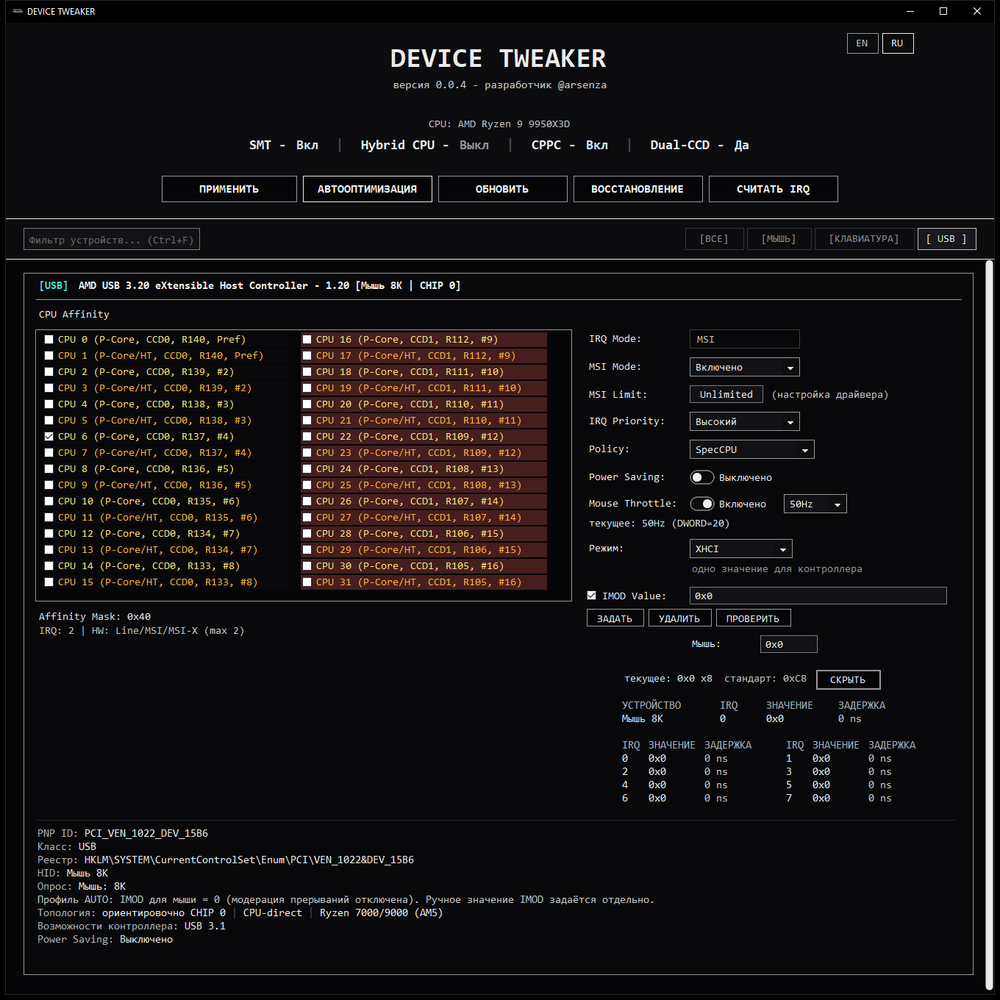
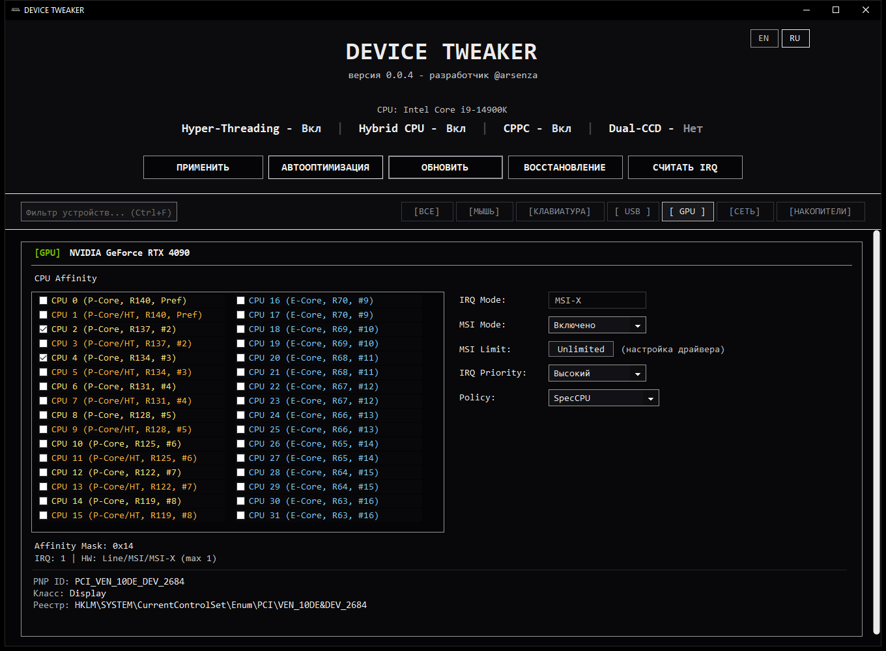
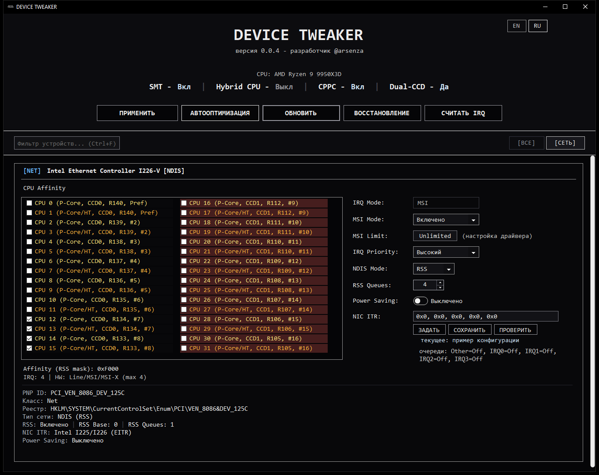
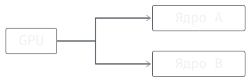
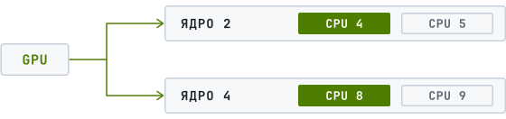

<a href="./README.en.md">English</a>

<h1>
  <a href="https://github.com/arsenzaaa/DEVICE-TWEAKER#gh-dark-mode-only"><picture><source media="(max-width: 600px)" srcset="./assets/branding/hero-mobile-dark.svg"></picture></a>
  <a href="https://github.com/arsenzaaa/DEVICE-TWEAKER#gh-light-mode-only"><picture><source media="(max-width: 600px)" srcset="./assets/branding/hero-mobile-light.svg"></picture></a>
</h1>

<strong>DEVICE TWEAKER настраивает прерывания устройств в Windows 10/11 x64.</strong>

MSI Utility V3 + Interrupt Affinity Policy Tool (IAPT) + ReservedCpuSets + управление IMOD / ITR в одном интерфейсе с интеллектуальной авто-оптимизацией.

  
  
  
  

## <samp>[ ИНТЕРФЕЙС ]</samp>

<table width="100%">
<tr><th align="left" width="860"><samp>Другие конфигурации</samp></th></tr>
<tr><td width="860">

<samp>USB IMOD на AMD</samp>

</td></tr>
<tr><td width="860">

<samp>Настройка прерываний GPU</samp>

</td></tr>
<tr><td width="860">

<samp>NIC ITR / RSS</samp>

</td></tr>
</table>

На скриншотах тестовые устройства и значения.

## <samp>[ ФУНКЦИОНАЛЬНОСТЬ ]</samp>

<table width="100%">
<tr><th align="left" width="860"><strong>Интеллектуальная авто-оптимизация</strong></th></tr>
<tr><td width="860">

Интеллектуальная авто-оптимизация учитывает P-Core / E-Core, SMT / HT, CPPC-рейтинг, CCD / CCX, количество устройств и их роли. Для дискретной GPU подбираются два разных физических ядра, для USB / сети / аудио используются свои правила распределения.

</td></tr>
</table>

<table width="100%">
<tr><th align="left" width="860"><strong>Настройка прерываний</strong></th></tr>
<tr><td width="860">

Поддерживает настройку MSI Mode / MSI Limit / IRQ Priority / IRQ Policy / Interrupt Affinity.

Отдельно отображает настройку MSI Mode из реестра и текущий режим прерываний в IRQ Mode. Поддерживаемые устройством режимы отображаются в HW.

При открытии использует уже загруженный DTIMOD.sys или ресурсы Windows, без загрузки драйвера. Если по ресурсам Windows нельзя отличить MSI от MSI-X, показывает MSI/MSI-X.

<strong>СЧИТАТЬ IRQ</strong> вверху окна читает режимы всех отображаемых PCI-устройств через DTIMOD.sys; при необходимости загружает драйвер.

</td></tr>
</table>

<table width="100%">
<tr><th align="left" width="860"><strong>USB IMOD</strong></th></tr>
<tr><td width="860">

Считывает и отображает IMOD у поддерживаемых USB-контроллеров xHCI. Режим <strong>Устройства</strong> задаёт профиль по USB-ролям, <strong>XHCI</strong> использует одно значение для контроллера, <strong>Interrupters</strong> позволяет задать значения по индексам.

Для чтения и записи использует самописный драйвер DTIMOD.sys, после записи повторно считывает значения. Поддерживает сохранение изменённых значений для следующего входа в Windows.

</td></tr>
</table>

<table width="100%">
<tr><th align="left" width="860"><strong>Настройка сети</strong></th></tr>
<tr><td width="860">

Считывает и отображает NIC ITR у поддерживаемых сетевых адаптеров Intel / Realtek, включая совместимые Killer. Информация по очередям и RX/TX зависит от семейства контроллера. Позволяет изменить текущие значения и сохранить профиль для автоматического применения при следующем входе в Windows.

Поддерживает настройку RSS у проводных сетевых адаптеров NDIS: базовый CPU, количество очередей и режим RSS/IRQ.

</td></tr>
</table>

<table width="100%">
<tr><th align="left" width="860"><strong>Определение устройств</strong></th></tr>
<tr><td width="860">

Автоматически определяет GPU / USB-контроллеры / сетевые адаптеры / аудиоконтроллеры / контроллеры накопителей.

Автоматически определяет, на каком USB-контроллере находятся мышь / клавиатура / геймпад / микрофон / аудио / камера. Если несколько устройств подключены к одному контроллеру, отображаются все найденные роли.

</td></tr>
</table>

<table width="100%">
<tr><th align="left" width="860"><strong>Топология процессора</strong></th></tr>
<tr><td width="860">

Автоматически определяет и отображает P-Core / E-Core, SMT / HT, AMD CCD / CCX и доступный CPPC-рейтинг. Показывает, к какому физическому ядру относится каждый логический поток.

</td></tr>
</table>

<table width="100%">
<tr><th align="left" width="860"><strong>Резервирование CPU</strong></th></tr>
<tr><td width="860">

Поддерживает резервирование выбранных CPU через ReservedCpuSets.

</td></tr>
</table>

<table width="100%">
<tr><th align="left" width="860"><strong>Polling Rate</strong></th></tr>
<tr><td width="860">

Отображает информацию о Polling Rate мыши / клавиатуры и поддерживает замер частоты событий Raw Input. У клавиатуры частота событий зависит от нажатий.

</td></tr>
</table>

<table width="100%">
<tr><th align="left" width="860"><strong>Mouse Throttle</strong></th></tr>
<tr><td width="860">

Поддерживает настройку RawMouseThrottleDuration на совместимых сборках Windows 11 с отображением текущего значения в интерфейсе.

</td></tr>
</table>

<table width="100%">
<tr><th align="left" width="860"><strong>Энергосбережение</strong></th></tr>
<tr><td width="860">

Поддерживает настройку энергосбережения USB-контроллеров / корневых USB-хабов / проводных сетевых адаптеров.

</td></tr>
</table>

<table width="100%">
<tr><th align="left" width="860"><strong>Интерфейс / навигация</strong></th></tr>
<tr><td width="860">

Поддерживает поиск по устройствам, переход по категориям и переключение RU/EN без перезапуска.

</td></tr>
</table>

<table width="100%">
<tr><th align="left" width="860"><strong>Бекапы / логи</strong></th></tr>
<tr><td width="860">

Поддерживает создание бекапов, восстановление выбранного бекапа, удаление старых бекапов и сброс настроек.

Записывает подробные логи определения устройств и применения настроек (что применилось / что пропущено / по какой причине).

</td></tr>
</table>

<table width="100%">
<tr><th align="left" width="860"><strong>Скачать</strong></th></tr>
<tr><td width="860">

В <a href="https://github.com/arsenzaaa/DEVICE-TWEAKER/releases/tag/v0.0.4">релизе</a> доступны две сборки:

<strong>Обычная сборка</strong> DEVICE.TWEAKER.exe Для запуска требуется <a href="https://dotnet.microsoft.com/download/dotnet/8.0">.NET 8 Desktop Runtime x64</a>.

<strong>Со встроенным .NET</strong> DEVICE.TWEAKER.SelfContained.exe Включает .NET, отдельно устанавливать его не нужно.

Драйвер DTIMOD.sys и загрузчик KDU встроены в обе сборки. SHA-256 каждого EXE указан в SHA256SUMS.txt.

</td></tr>
</table>

<table width="100%">
<tr><th align="left" width="860"><strong>Использование</strong></th></tr>
<tr><td width="860">

Скачайте нужную сборку и запустите программу от имени администратора.

Для интеллектуальной авто-оптимизации нажмите <strong>АВТООПТИМИЗАЦИЯ</strong>. Если есть подходящие USB-контроллеры xHCI, программа предложит включить настройку IMOD перед применением. NIC ITR настраивается вручную.

Для ручной настройки выберите нужные параметры и нажмите <strong>ПРИМЕНИТЬ</strong>. Эта кнопка применяет настройки прерываний, ReservedCpuSets, RSS, Mouse Throttle, энергосбережения и USB IMOD.

У IMOD / NIC ITR также есть отдельные кнопки:

<ul>
<li>IMOD: <strong>ЗАДАТЬ</strong> применяет настройки и сохраняет значения, отличающиеся от стандартных, для следующего входа в Windows.</li>
<li>NIC ITR: <strong>ЗАДАТЬ</strong> меняет текущие значения, <strong>СОХРАНИТЬ</strong> сохраняет профиль для следующего входа в Windows.</li>
<li><strong>ПРОВЕРИТЬ</strong> считывает текущие значения IMOD / NIC ITR.</li>
<li>IMOD: <strong>УДАЛИТЬ</strong> убирает общий автозапуск IMOD / NIC ITR и возвращает поля IMOD к стандартному значению. Чтобы завершить сброс, перезагрузите компьютер.</li>
</ul>

<strong>ОБНОВИТЬ</strong> повторно определяет устройства. Для отката настроек нажмите <strong>ВОССТАНОВЛЕНИЕ</strong> и выберите нужный бекап.

После <strong>ПРИМЕНИТЬ</strong> / <strong>АВТООПТИМИЗАЦИЯ</strong> перезагрузите компьютер, чтобы завершить применение настроек.

Перед ручным применением и сбросом программа создаёт бекап. При интеллектуальной авто-оптимизации сохраняются исходные настройки.

Подробное описание настроек: <a href="./DEVICE%20TWEAKER/docs/SETTINGS.md">SETTINGS.md</a>.

</td></tr>
</table>

<table width="100%">
<tr><th align="left" width="860"><strong>Баги / тестирование</strong></th></tr>
<tr><td width="860">

Сообщайте о найденных багах / недоработках в <a href="https://github.com/arsenzaaa/DEVICE-TWEAKER/issues/new?template=bug_report.yml">issues</a>. Прикладывайте лог, версию программы, сборку Windows и конфигурацию ПК. Также напишите, что делали и что произошло.

Если хотите помочь с тестированием интеллектуальной авто-оптимизации, отправляйте логи в следующем порядке:

<ol>
<li>До применения интеллектуальной авто-оптимизации (или после ресета настроек).</li>
<li>После применения интеллектуальной авто-оптимизации.</li>
<li>После перезагрузки компьютера и повторного запуска программы.</li>
</ol>

Обновления и обсуждение проекта: <a href="https://t.me/arsenzaa">Telegram</a>.

</td></tr>
</table>

<table width="100%">
<tr><th align="left" width="860"><strong>Исходники</strong></th></tr>
<tr><td width="860">

<a href="./DEVICE%20TWEAKER/README.md">Сборка и проверки</a> · <a href="./CHANGELOG.md">История изменений</a> · <a href="./LICENSE">GPL-3.0</a>

</td></tr>
</table>
