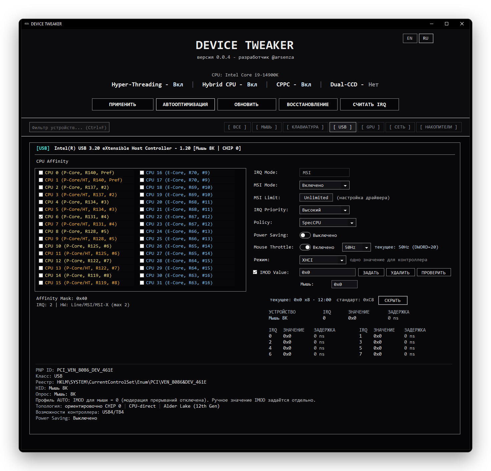

<div align="right"><a href="./README.en.md">English</a></div>

<p align="center"></p>

<h1 align="center">DEVICE TWEAKER</h1>

<p align="center"><b>Прерывания устройств Windows 10 / 11 x64 под топологию процессора.</b></p>

<p align="center">MSI Utility V3 + Interrupt Affinity Policy Tool (IAPT) + ReservedCpuSets + RSS + USB IMOD / NIC ITR в одном интерфейсе, с интеллектуальной авто-оптимизацией.</p>

<p align="center"><b><a href="https://github.com/arsenzaaa/DEVICE-TWEAKER/releases/latest">Скачать 0.0.4</a></b> · <a href="https://arsenzaaa.github.io/DEVICE-TWEAKER/">Документация</a> · <a href="./CHANGELOG.md">История изменений</a> · <a href="https://t.me/arsenzaa">Telegram</a></p>

<p align="center"><a href="./assets/screenshots/showcase_intel_14900k_full_ru.png"></a></p>

## <samp>[ ЗАЧЕМ ]</samp>

ISR / DPC выполняются выше любого потока и не знают, какие ядра заняты игрой. Драйвер на ядре с важным потоком (GAME / RENDER / RHI) прерывает его -> поток ждёт или уходит на другое ядро и теряет свой L1 / L2 -> растёт время кадра, появляются статтеры. Два драйвера на одном ядре задерживают ISR / DPC друг друга, на одном SMT-SET делят кэш и EXECUTION-UNITS.

DEVICE TWEAKER разносит прерывания по физическим ядрам: драйвера не делят ядра и SMT-SET, ядро 0 по возможности остаётся свободным. Всё, что для этого нужно, собрано в одном окне: MSI, affinity, приоритет, ReservedCpuSets, RSS и модерация прерываний USB и сети.

## <samp>[ АВТООПТИМИЗАЦИЯ ]</samp>

**АВТООПТИМИЗАЦИЯ** читает топологию (P-Core / E-Core, SMT / HT, CPPC, CCD / CCX), находит роли устройств и строит план:

- **GPU** -> два разных физических ядра. На одном ядре ISR видеокарты прерывает её же DPC -> спайки задержки. SMT-соседи одного ядра за два ядра не считаются.
- **USB-контроллер с мышью / клавиатурой / геймпадом, сеть, аудио** -> свои ядра по правилам совместного размещения.
- **Несколько CCD** -> выбирается целевой CCD.
- **Накопители** -> MSI и высокий приоритет, affinity остаётся за Windows: на части NVMe `SpecifiedProcessors` не даёт Windows загрузиться.
- **Встроенная GPU** -> affinity возвращается Windows. **Wi-Fi** не трогается.

Если топология определена ненадёжно, запись не начинается. Перед первым запуском сохраняется исходное состояние, его возвращает **ВОССТАНОВЛЕНИЕ → ИСХОДНЫЙ**.

## <samp>[ ПРЕРЫВАНИЯ ]</samp>

**MSI MODE** — прерывания сообщениями вместо линии. Без MSI на трейсе xHCI выполнение DPC прерывается двумя ISR, с MSI не прерывается. **MSI LIMIT** — `Unlimited` удаляет ограничение числа сообщений.

**IRQ PRIORITY** влияет на приоритет аппаратного прерывания. Это не приоритет игры и не приоритет DPC.

**INTERRUPT AFFINITY** задаёт логические процессоры для IRQ устройства. В списке видно, к какому физическому ядру относится каждый поток, P / E-core, CCD и CPPC-рейтинг. Policy `SpecCPU` использует отмеченную маску, остальные политики оставляют выбор Windows.

```text
HKLM\SYSTEM\CurrentControlSet\Enum\PCI\<устройство>\Device Parameters\Interrupt Management
  MessageSignaledInterruptProperties  MSISupported           1 = MSI / MSI-X
                                      MessageNumberLimit     удаляется при Unlimited
  Affinity Policy                     DevicePriority         3 = High
                                      DevicePolicy           4 = SpecifiedProcessors
                                      AssignmentSetOverride  маска CPU
```

**IRQ MODE** показывает, что устройство использует сейчас: Line / MSI / MSI-X. **HW** — что оно поддерживает. **СЧИТАТЬ IRQ** уточняет режим по битам `MSI Enable` / `MSI-X Enable` в конфигурации PCI через DTIMOD.sys.

## <samp>[ USB IMOD ]</samp>

IMOD — интервал модерации прерываний у **interrupter'а** контроллера xHCI, а не у отдельной мыши. Шаг 250 нс: `0xC8` = 50 мкс (Windows по умолчанию), `0xFA0` = 1 мс, `0x0` = модерация выключена.

Interrupter выдаётся устройству при подключении и после перезагрузки может смениться -> программа каждый раз заново читает карту «устройство → interrupter» из контекстов xHCI в памяти: TRB кольца передачи, при ошибке — Slot Context.

- **Устройства** — значения по ролям. Профиль AUTO: мышь `0x0`, аудио `0xFA0` (реже, но дольше -> меньше нагрузка), клавиатура и геймпад `0xC8`.
- **XHCI** — одно значение на весь контроллер.
- **Interrupters** — значения по индексам.

После записи регистры читаются повторно. **ПРОВЕРИТЬ** показывает фактические значения и время чтения.

## <samp>[ СЕТЬ ]</samp>

У адаптеров NDIS прерывания распределяет RSS, поэтому вместо маски настраиваются базовый CPU и очереди. Процессоры берутся по одному на физическое ядро, SMT-соседи пропускаются, число очередей ограничено значениями драйвера и векторами MSI-X.

```text
HKLM\SYSTEM\CurrentControlSet\Control\Class\{4d36e972-e325-11ce-bfc1-08002be10318}\<адаптер>
  *RssBaseProcNumber  *NumRssQueues  *MaxRssProcessors  *RssMaxProcNumber
```

**NIC ITR** — регистры модерации самого контроллера: EITR у Intel I210 / I211, I225 / I226, I350, 82576 / 82580, ITR у I219, IntrMit у Realtek RTL8111 / 8168, RTL8125 / 8126, включая совместимые Killer. **СОХРАНИТЬ** выключает собственную модерацию драйвера (`*InterruptModeration`, у Intel также `ITR`) -> иначе драйвер перезаписывает регистр.

## <samp>[ АВТОЗАПУСК ]</samp>

Регистры IMOD и NIC ITR держат значение до перезагрузки, сна или сброса контроллера. Сохранённый профиль применяет задача Планировщика `\DEVICE TWEAKER\IMOD` от SYSTEM: при входе в Windows, после выхода из сна и при подключении USB / HID-устройства.

Задача запускает открытый `ApplyIMOD.ps1` из `%ProgramData%\DEVICE TWEAKER\Startup` и работает без EXE. Перед запуском сверяются SHA-256 runtime, драйвера и загрузчика, изменять папку могут только администраторы и SYSTEM.

## <samp>[ ОСТАЛЬНОЕ ]</samp>

- **ReservedCpuSets** -> Windows не планирует на зарезервированные ядра обычные потоки. Драйвер с маской на такое ядро продолжает работать там, а потоки от него защищены. `Session Manager\kernel`, маска CPU.
- **Mouse Throttle** -> `RawMouseThrottleDuration` в `HKCU\Control Panel\Mouse`: частота Raw Input для фоновых окон Windows 11, 1000 / значение Гц.
- **Polling Rate** -> мышь и клавиатура по данным USB и замер частоты событий Raw Input.
- **Энергосбережение** -> USB-контроллеры, корневые USB-хабы, проводные адаптеры и USB selective suspend в плане питания. После записи значения перечитываются через WMI.
- **Бекапы и логи** -> проверенный бекап перед каждым применением в папке `Backups`, подробный лог в `logs`: что применилось, что пропущено и почему.

Настройки реестра вступают в силу после перезагрузки, регистры IMOD и NIC ITR — сразу. Подробно о каждой настройке — в [документации](https://arsenzaaa.github.io/DEVICE-TWEAKER/settings/).

## <samp>[ УСТАНОВКА ]</samp>

- [`DEVICE.TWEAKER.SelfContained.exe`](https://github.com/arsenzaaa/DEVICE-TWEAKER/releases/latest/download/DEVICE.TWEAKER.SelfContained.exe) — .NET встроен.
- [`DEVICE.TWEAKER.exe`](https://github.com/arsenzaaa/DEVICE-TWEAKER/releases/latest/download/DEVICE.TWEAKER.exe) — нужен [.NET 8 Desktop Runtime x64](https://dotnet.microsoft.com/download/dotnet/8.0).

Запустите от имени администратора -> **АВТООПТИМИЗАЦИЯ** или ручная настройка и **ПРИМЕНИТЬ** -> перезагрузка. **ПРОВЕРИТЬ** в блоке IMOD или NIC ITR покажет фактические значения регистров.

> **DTIMOD.sys и KDU.** Регистры IMOD и NIC ITR недоступны из пользовательского режима, их пишет собственный драйвер DTIMOD.sys, и только в память, которую Windows выделила выбранному устройству. Публичной подписи у драйвера нет, его загружает [KDU](./src/IMOD/KDU/README.md) -> антивирусы относят такие загрузчики к HackTool. HVCI и Microsoft Vulnerable Driver Blocklist блокируют загрузку, FACEIT и Vanguard могут с ней конфликтовать: состояние показывает **ПРОВЕРКА СИСТЕМЫ**. Остальные настройки от драйвера не зависят.

SHA-256 файлов — в `SHA256SUMS.txt` на [странице релиза](https://github.com/arsenzaaa/DEVICE-TWEAKER/releases/latest), исходников — в `SOURCE-SHA256SUMS.txt`:

```powershell
(Get-FileHash .\DEVICE.TWEAKER.SelfContained.exe -Algorithm SHA256).Hash
Select-String -Path .\SHA256SUMS.txt -Pattern 'DEVICE.TWEAKER.SelfContained.exe'
```

## <samp>[ ОТКАТ ]</samp>

**ВОССТАНОВЛЕНИЕ → ИСХОДНЫЙ** возвращает реестр к состоянию до первой авто-оптимизации и удаляет задачу автозапуска. В том же меню — любой из бекапов и **СБРОС WINDOWS**.

## <samp>[ ОБРАТНАЯ СВЯЗЬ ]</samp>

Ошибки — в [issues](https://github.com/arsenzaaa/DEVICE-TWEAKER/issues/new?template=bug_report.yml) с логом из папки `logs`, версией Windows и конфигурацией ПК. Чтобы помочь с тестированием авто-оптимизации, отправьте [отчёт о железе](https://github.com/arsenzaaa/DEVICE-TWEAKER/issues/new?template=hardware_report.yml) с тремя логами: до применения, сразу после и после перезагрузки. Обновления — в [Telegram](https://t.me/arsenzaa).

<p align="center"><sub><a href="https://arsenzaaa.github.io/DEVICE-TWEAKER/">Документация</a> · <a href="./docs/DEVELOPMENT.md">Разработка и сборка</a> · <a href="./docs/THIRD_PARTY_NOTICES.md">Сторонние компоненты</a> · <a href="./.github/SECURITY.md">Безопасность</a> · <a href="./LICENSE">GPL-3.0</a></sub></p>
