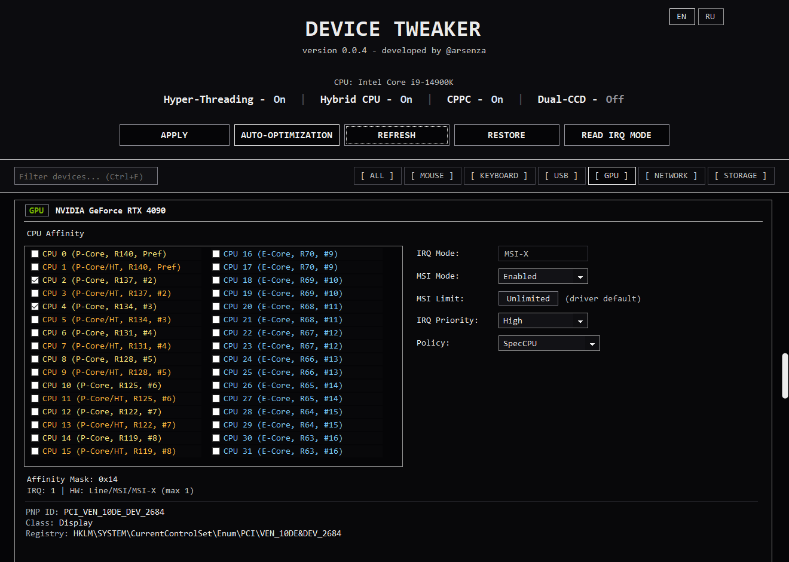

# DEVICE TWEAKER

**English** · [Русский](./README.ru.md)

**DEVICE TWEAKER** combines the controls familiar from MSI Utility V3 and Interrupt Affinity Policy Tool with ReservedCpuSets and USB IMOD in one Windows utility.

Configure device interrupts manually, or use automatic optimization to select CPU cores based on your processor's topology. Inspect the current state, apply changes and restore saved settings from the same interface.

**[Download for Windows](https://github.com/arsenzaaa/DEVICE-TWEAKER/releases/latest/download/DEVICE.TWEAKER.SelfContained.exe)** · [Guide](./docs/guide/README.md) · [Screenshots](./docs/SCREENSHOTS.md) · [Changelog](./CHANGELOG.md)

## Features

### Interrupts and CPU affinity

Adjust MSI Mode, MSI Limit, IRQ Priority and interrupt affinity for each device. Inspect the current IRQ mode alongside the saved configuration and manage ReservedCpuSets separately.

### Topology-aware automatic optimization

Select cores for the GPU, input devices and network adapters automatically. Selection accounts for physical cores and SMT siblings, P/E cores, CCDs and available CPPC rankings. Individual device settings remain available for manual adjustment.

### USB and network tuning

Set USB IMOD for a controller, by device role or by interrupter index. Configure RSS processors and queues, and NIC ITR on supported Intel and Realtek adapters. IMOD and NIC ITR support register readback and saved startup profiles.

### Backups and diagnostics

Preserve original device settings and restore saved backups. Operation logs record the build, target device, requested values and the result of each stage. Built-in tools measure mouse event rates and provide Mouse Throttle and device power-saving controls.

## Getting started

Requires **Windows 10/11 x64** and administrator access.

The **[self-contained build](https://github.com/arsenzaaa/DEVICE-TWEAKER/releases/latest/download/DEVICE.TWEAKER.SelfContained.exe)** includes .NET and needs no installation. The smaller [framework-dependent build](https://github.com/arsenzaaa/DEVICE-TWEAKER/releases/latest/download/DEVICE.TWEAKER.exe) requires [.NET 10 Desktop Runtime x64](https://dotnet.microsoft.com/download/dotnet/10.0).

1. Run the EXE as administrator and select a device.
2. Adjust its settings and click **APPLY**, or use **AUTO-OPTIMIZATION** to select settings automatically.
3. Restart Windows after changing MSI, Interrupt Affinity or ReservedCpuSets. See the [verification guide](./docs/guide/10-verification.md) for checking the result.

Open **RESTORE** to access saved backups. Logs are stored in the `logs` folder next to the EXE. All release files and checksums are on the [releases page](https://github.com/arsenzaaa/DEVICE-TWEAKER/releases/latest).

**Driver compatibility.** IMOD, NIC ITR and PCI configuration reads use DTIMOD.sys, loaded through KDU; MSI, affinity, RSS, ReservedCpuSets and the other settings work without it. The driver may conflict with anti-cheat software, including EAC, Vanguard and FACEIT. Closing the application does not unload the driver. Loading requirements and startup profile behavior are covered in the [driver guide](./docs/guide/11-driver.md).

**Antivirus warnings.** Microsoft Defender and other antivirus software may flag KDU as a hacking tool. Check the EXE against `SHA256SUMS.txt` from the release and add the program folder and `%ProgramData%\DEVICE TWEAKER` to exclusions instead of disabling protection.

## Documentation

- [User guide](./docs/guide/README.md) - interrupt handling, CPU topology and device configuration.
- [Settings reference](./docs/SETTINGS.md) - interface controls, applying changes and restoring settings.
- [Development](./docs/DEVELOPMENT.md) - building from source and running focused checks with the QA workbench.

## Feedback and support

Report bugs and suggest improvements through [Issues](https://github.com/arsenzaaa/DEVICE-TWEAKER/issues); attach the `logs` folder to bug reports. Use the [hardware report form](https://github.com/arsenzaaa/DEVICE-TWEAKER/issues/new?template=hardware_report.yml) to share results from your system. Project news is posted in the [Telegram channel](https://t.me/arsenzaa).

Support the development of DEVICE TWEAKER on [Boosty](https://boosty.to/arsenza).

[Contributing](./.github/CONTRIBUTING.md) · [GPL-3.0](./LICENSE) · [Third-party components](./docs/THIRD_PARTY_NOTICES.md) · [Security](./.github/SECURITY.md)
