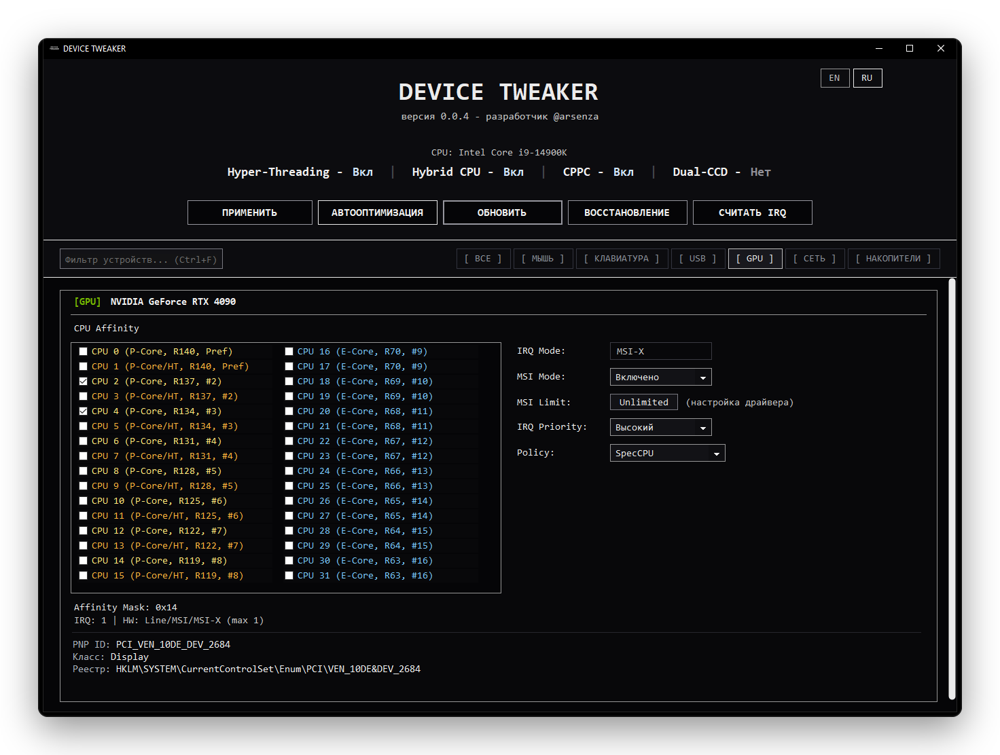
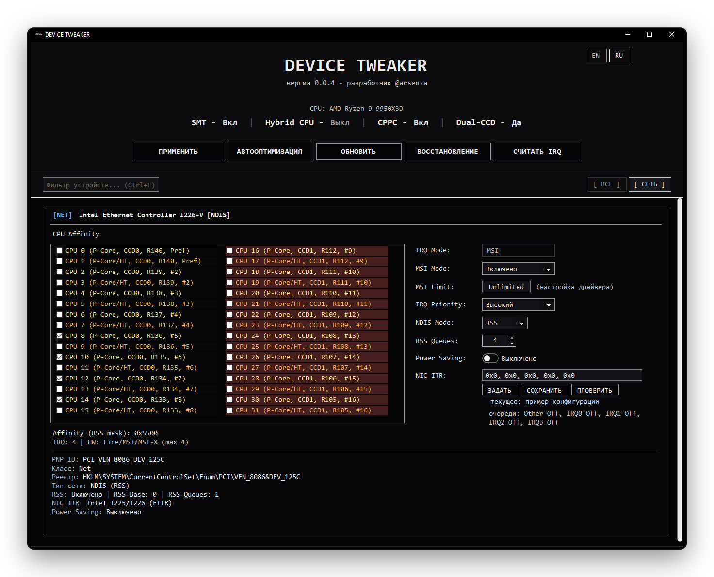
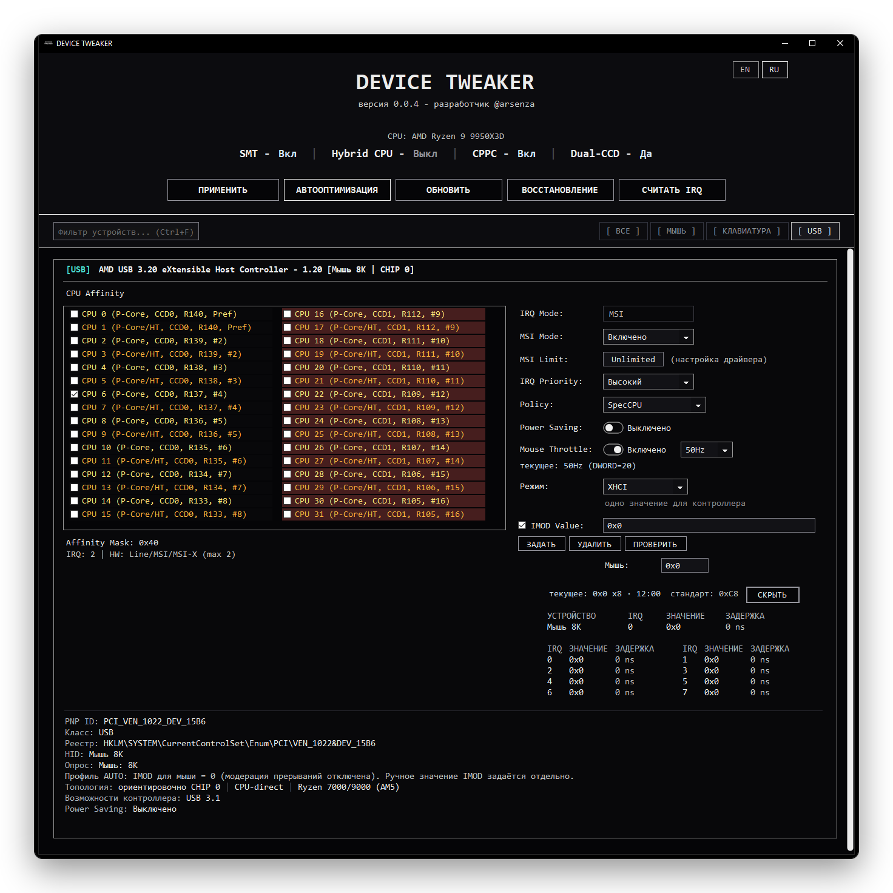

<div align="right"><a href="./README.en.md">English</a></div>

<p align="center"></p>

<h1 align="center">DEVICE TWEAKER</h1>

<p align="center"><b>Прерывания устройств Windows 10 / 11 x64 под топологию процессора.</b></p>

<p align="center">MSI Utility V3 + Interrupt Affinity Policy Tool (IAPT) + ReservedCpuSets + RSS + USB IMOD / NIC ITR в одном интерфейсе, с интеллектуальной авто-оптимизацией.</p>

<p align="center">
<a href="https://github.com/arsenzaaa/DEVICE-TWEAKER/releases/latest"></a>
<a href="https://github.com/arsenzaaa/DEVICE-TWEAKER/releases"></a>

<a href="./LICENSE"></a>
</p>

<p align="center"><b><a href="https://github.com/arsenzaaa/DEVICE-TWEAKER/releases/latest">Скачать</a></b> · <a href="https://arsenzaaa.github.io/DEVICE-TWEAKER/">Документация</a> · <a href="./CHANGELOG.md">История изменений</a> · <a href="https://t.me/arsenzaa">Telegram</a></p>

<p align="center"><a href="./assets/screenshots/showcase_intel_14900k_full_ru.png"></a></p>

## <samp>[ ВОЗМОЖНОСТИ ]</samp>

<table>
<tr>
<td width="50%" valign="top"><b>Интеллектуальная авто-оптимизация</b><br>План по топологии процессора и ролям устройств: P- / E-cores, SMT / HT, CPPC, CCD / CCX. Дискретная GPU получает два разных физических ядра, у мыши, сети и аудио свои правила.</td>
<td width="50%" valign="top"><b>Прерывания</b><br>MSI Mode, MSI Limit, IRQ Priority, IRQ Policy и Interrupt Affinity для каждого устройства. Режим из реестра, текущий IRQ Mode и возможности устройства показаны раздельно.</td>
</tr>
<tr>
<td valign="top"><b>USB IMOD</b><br>Интервал модерации прерываний каждого interrupter'а xHCI: по ролям устройств, на весь контроллер или по индексам. Карта «устройство → interrupter» читается из памяти контроллера.</td>
<td valign="top"><b>NIC ITR и RSS</b><br>Регистры модерации Intel и Realtek, включая Killer. RSS проводных адаптеров: базовый CPU и очереди, по одному процессору на физическое ядро.</td>
</tr>
<tr>
<td valign="top"><b>Автозапуск без EXE</b><br>Сохранённый профиль IMOD / NIC ITR применяет задача Планировщика при входе в Windows, после сна и при подключении USB. Скрипт открытый, файлы сверяются по SHA-256.</td>
<td valign="top"><b>Определение устройств</b><br>GPU, USB, сеть, аудио и накопители по категориям. Для каждого USB-контроллера видно, где мышь, клавиатура, геймпад, микрофон, аудио и камера.</td>
</tr>
<tr>
<td valign="top"><b>Ввод и питание</b><br>Polling Rate с замером Raw Input, RawMouseThrottleDuration в Windows 11, энергосбережение USB и сетевых адаптеров, ReservedCpuSets.</td>
<td valign="top"><b>Бекапы и логи</b><br>Проверенный бекап перед каждым применением, возврат к исходному состоянию в один шаг. Лог фиксирует, что применилось, что пропущено и почему.</td>
</tr>
</table>

<table>
<tr>
<td width="33%" valign="top"><a href="./assets/screenshots/showcase_gpu_full_ru.png"></a></td>
<td width="33%" valign="top"><a href="./assets/screenshots/showcase_nic_full_ru.png"></a></td>
<td width="33%" valign="top"><a href="./assets/screenshots/showcase_amd_imod_full_ru.png"></a></td>
</tr>
<tr>
<td align="center"><sub>GPU на двух физических ядрах</sub></td>
<td align="center"><sub>NIC ITR и RSS, Intel I226-V</sub></td>
<td align="center"><sub>USB IMOD, Ryzen 9 9950X3D</sub></td>
</tr>
</table>

<sub>На скриншотах тестовые устройства и значения.</sub>

## <samp>[ УСТАНОВКА ]</samp>

| Файл | Требования |
| :--- | :--- |
| [`DEVICE.TWEAKER.SelfContained.exe`](https://github.com/arsenzaaa/DEVICE-TWEAKER/releases/latest/download/DEVICE.TWEAKER.SelfContained.exe) | нет, .NET встроен |
| [`DEVICE.TWEAKER.exe`](https://github.com/arsenzaaa/DEVICE-TWEAKER/releases/latest/download/DEVICE.TWEAKER.exe) | [.NET 8 Desktop Runtime x64](https://dotnet.microsoft.com/download/dotnet/8.0) |

1. Запустите программу от имени администратора.
2. Нажмите **АВТООПТИМИЗАЦИЯ** или выберите параметры вручную и нажмите **ПРИМЕНИТЬ**.
3. Перезагрузите компьютер. **ПРОВЕРИТЬ** в блоке IMOD или NIC ITR покажет фактические значения регистров.

> [!IMPORTANT]
> Регистры IMOD и NIC ITR пишет собственный драйвер DTIMOD.sys, и только в память, которую Windows выделила выбранному устройству. Публичной подписи у драйвера нет, его загружает [KDU](./src/IMOD/KDU/README.md), поэтому антивирусы могут относить программу к HackTool. HVCI и Microsoft Vulnerable Driver Blocklist блокируют такую загрузку, FACEIT и Vanguard могут с ней конфликтовать: состояние показывает **ПРОВЕРКА СИСТЕМЫ**. Остальные настройки от драйвера не зависят.

<details>
<summary><b>Проверка файлов</b></summary>
<br>

SHA-256 обоих EXE указаны в `SHA256SUMS.txt` на [странице релиза](https://github.com/arsenzaaa/DEVICE-TWEAKER/releases/latest), исходников — в `SOURCE-SHA256SUMS.txt`.

```powershell
(Get-FileHash .\DEVICE.TWEAKER.SelfContained.exe -Algorithm SHA256).Hash
Select-String -Path .\SHA256SUMS.txt -Pattern 'DEVICE.TWEAKER.SelfContained.exe'
```

Хеши должны совпасть. DTIMOD.sys и загрузчик KDU встроены в EXE; их исходники и закреплённые версии лежат в репозитории.

</details>

## <samp>[ ЧТО МЕНЯЕТ ПРОГРАММА ]</samp>

| Настройка | Куда записывается |
| :--- | :--- |
| MSI Mode, MSI Limit | `MSISupported`, `MessageNumberLimit` в `Interrupt Management\MessageSignaledInterruptProperties` |
| IRQ Priority | `DevicePriority` в `Interrupt Management\Affinity Policy` |
| IRQ Policy, Interrupt Affinity | `DevicePolicy`, `AssignmentSetOverride` там же |
| RSS | `*RssBaseProcNumber`, `*NumRssQueues`, `*MaxRssProcessors`, `*RssMaxProcNumber` в ключе класса адаптера |
| ReservedCpuSets | `ReservedCpuSets` в `Session Manager\kernel` |
| Mouse Throttle | `RawMouseThrottleDuration` в `HKCU\Control Panel\Mouse` |
| Энергосбережение | `PnPCapabilities`, `SelectiveSuspendEnabled`, `EnhancedPowerManagementEnabled`, USB selective suspend в плане питания |
| USB IMOD | регистр IMOD каждого interrupter'а xHCI, шаг 250 нс |
| NIC ITR | EITR / ITR у Intel, IntrMit у Realtek |

Настройки реестра вступают в силу после перезагрузки. Регистры IMOD и NIC ITR меняются сразу и после записи читаются повторно. Подробно о каждой настройке — в [документации](https://arsenzaaa.github.io/DEVICE-TWEAKER/settings/).

## <samp>[ ОТКАТ ]</samp>

Перед каждым применением программа создаёт проверенный бекап в папке `Backups` рядом с EXE. **ВОССТАНОВЛЕНИЕ → ИСХОДНЫЙ** возвращает реестр к состоянию до первой авто-оптимизации и удаляет задачу автозапуска. В том же меню — любой из бекапов и **СБРОС WINDOWS**.

## <samp>[ ОБРАТНАЯ СВЯЗЬ ]</samp>

Ошибки — в [issues](https://github.com/arsenzaaa/DEVICE-TWEAKER/issues/new?template=bug_report.yml) с логом из папки `logs` рядом с EXE, версией Windows и конфигурацией ПК. Результаты авто-оптимизации на своём железе — в [отчёт о железе](https://github.com/arsenzaaa/DEVICE-TWEAKER/issues/new?template=hardware_report.yml): три лога, до применения, сразу после и после перезагрузки. Обновления — в [Telegram](https://t.me/arsenzaa).

<p align="center"><sub><a href="https://arsenzaaa.github.io/DEVICE-TWEAKER/">Документация</a> · <a href="./docs/DEVELOPMENT.md">Разработка и сборка</a> · <a href="./docs/THIRD_PARTY_NOTICES.md">Сторонние компоненты</a> · <a href="./.github/SECURITY.md">Безопасность</a> · <a href="./LICENSE">GPL-3.0</a></sub></p>
