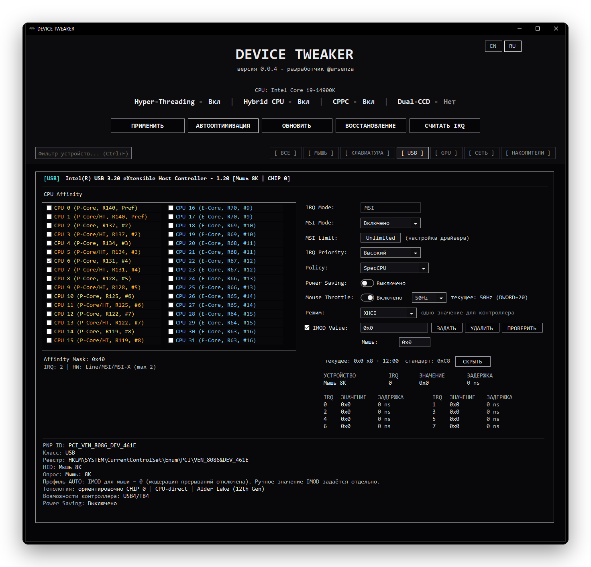

<div align="right"><a href="./README.en.md">English</a></div>

<p align="center"></p>

<h1 align="center">DEVICE TWEAKER</h1>

<p align="center"><b>Прерывания устройств Windows 10 / 11 x64 под топологию процессора.</b></p>

<p align="center">MSI Utility V3 + Interrupt Affinity Policy Tool (IAPT) + ReservedCpuSets + RSS + USB IMOD / NIC ITR в одном интерфейсе, с интеллектуальной авто-оптимизацией.</p>

<p align="center"><b><a href="https://github.com/arsenzaaa/DEVICE-TWEAKER/releases/latest">Скачать 0.0.4</a></b> · <a href="https://arsenzaaa.github.io/DEVICE-TWEAKER/">Сайт и гайд</a> · <a href="./CHANGELOG.md">История изменений</a> · <a href="https://t.me/arsenzaa">Telegram</a></p>

<p align="center"><a href="./assets/screenshots/showcase_intel_14900k_full_ru.png"></a></p>

## <samp>[ ЗАЧЕМ ]</samp>

ISR / DPC выполняются выше любого потока и не знают, какие ядра заняты игрой. Драйвер на ядре с важным потоком (GAME / RENDER / RHI) прерывает его -> поток ждёт или уходит на другое ядро и теряет свой L1 / L2 -> растёт время кадра, появляются статтеры. Два драйвера на одном ядре задерживают ISR / DPC друг друга, на одном SMT-SET делят кэш и EXECUTION-UNITS.

DEVICE TWEAKER разносит прерывания по физическим ядрам: драйвера не делят ядра и SMT-SET, ядро 0 по возможности остаётся свободным. **АВТООПТИМИЗАЦИЯ** строит план по топологии (P-Core / E-Core, SMT / HT, CPPC, CCD / CCX) и ролям устройств. Вручную настраивается каждое устройство: MSI, affinity, приоритет, ReservedCpuSets, RSS, USB IMOD, NIC ITR, Mouse Throttle, энергосбережение.

## <samp>[ ГАЙД ]</samp>

Как это устроено в Windows и что делает программа, по каждому типу устройства. Те же главы с поиском — на [сайте](https://arsenzaaa.github.io/DEVICE-TWEAKER/guide/).

- `[IRQ]` **[Прерывания: ISR, DPC и ядра](./docs/guide/01-interrupts.md)** — Как устроены ISR и DPC, почему они важнее любого потока игры и что происходит, когда драйвера стоят на одном ядре с GAME / RENDER / RHI.
- `[MSI]` **[MSI и MSI-X](./docs/guide/02-msi.md)** — Линия против сообщения: почему без MSI MODE появляются лишние и более длинные ISR, зачем удалять MessageNumberLimit и как программа читает реальный режим устройства.
- `[CPU]` **[Affinity, политики и приоритет прерываний](./docs/guide/03-affinity.md)** — Политики Interrupt Affinity, маска AssignmentSetOverride, что на самом деле делает IRQ Priority, Interrupt Steering и альтернативный метод «все ядра, кроме 0».
- `[GPU]` **[Видеокарта](./docs/guide/04-gpu.md)** — Почему видеокарте нужны два разных физических ядра, чем драйвер NVIDIA отличается от AMD и что делать, если ISR / DPC всё равно собираются на одном ядре.
- `[USB]` **[USB-контроллеры и IMOD](./docs/guide/05-usb-imod.md)** — Как устроен контроллер xHCI: interrupter, Event Ring и регистр IMOD. Почему interrupter у мыши меняется при каждом подключении, какой IMOD ставить звуку и как разложить устройства по контроллерам.
- `[NET]` **[Сеть: RSS, NDIS и NIC ITR](./docs/guide/06-network.md)** — NDIS и NetAdapterCx, почему маска не работает на NDIS и вместо неё нужен RSS, сколько очередей реально использует игра, поток NDIS и MMCSS, NIC ITR и модерация драйвера.
- `[CPU]` **[Топология процессора и ReservedCpuSets](./docs/guide/07-cpu-topology.md)** — SMT-SET, P- и E-cores, CCD и CPPC-рейтинг: как читать список CPU в программе. ReservedCpuSets, формат маски и две стратегии для процессоров с двумя CCD или E-cores.
- `[I/O]` **[Ввод: Polling Rate, Raw Input и Mouse Throttle](./docs/guide/08-input.md)** — Путь ввода мыши, клавиатуры и контроллера в Windows 10 и 11, ограничение фоновых окон и RawMouseThrottleDuration, Raw Input Buffer и выделенный поток ввода, что на самом деле измеряет замер Polling Rate.
- `[PWR]` **[Энергосбережение устройств](./docs/guide/09-power.md)** — USB selective suspend, разрешение Windows отключать устройство и параметры Device Parameters: что из этого реально работает, где хранится и как программа проверяет запись.
- `[LOG]` **[Проверка: трейсы и логи](./docs/guide/10-verification.md)** — Как проверить результат не по FPS одного прогона, а по факту: трейс xperf / WPR, где смотреть ISR и DPC в WPA и MXA, что писать в отчёт о железе и как читать лог программы.
- `[SYS]` **[DTIMOD.sys, KDU и автозапуск](./docs/guide/11-driver.md)** — Зачем программе собственный драйвер, куда он может писать, почему его загружает KDU и что об этом думают антивирусы, HVCI и античиты. Как устроен автозапуск IMOD / NIC ITR без EXE.

## <samp>[ УСТАНОВКА ]</samp>

- [`DEVICE.TWEAKER.SelfContained.exe`](https://github.com/arsenzaaa/DEVICE-TWEAKER/releases/latest/download/DEVICE.TWEAKER.SelfContained.exe) — .NET встроен.
- [`DEVICE.TWEAKER.exe`](https://github.com/arsenzaaa/DEVICE-TWEAKER/releases/latest/download/DEVICE.TWEAKER.exe) — нужен [.NET 8 Desktop Runtime x64](https://dotnet.microsoft.com/download/dotnet/8.0).

Запустите от имени администратора -> **АВТООПТИМИЗАЦИЯ** или ручная настройка и **ПРИМЕНИТЬ** -> перезагрузка. **ПРОВЕРИТЬ** в блоке IMOD или NIC ITR покажет фактические значения регистров.

> **DTIMOD.sys и KDU.** IMOD и NIC ITR пишет собственный драйвер DTIMOD.sys, и только в память, которую Windows выделила выбранному устройству. Публичной подписи у драйвера нет, его загружает [KDU](./src/IMOD/KDU/README.md) -> антивирусы относят такие загрузчики к HackTool, HVCI и Microsoft Vulnerable Driver Blocklist блокируют загрузку, FACEIT и Vanguard могут с ней конфликтовать. Остальные настройки от драйвера не зависят. Подробно — [глава 11](./docs/guide/11-driver.md).

SHA-256 файлов — в `SHA256SUMS.txt` на [странице релиза](https://github.com/arsenzaaa/DEVICE-TWEAKER/releases/latest), исходников — в `SOURCE-SHA256SUMS.txt`:

```powershell
(Get-FileHash .\DEVICE.TWEAKER.SelfContained.exe -Algorithm SHA256).Hash
Select-String -Path .\SHA256SUMS.txt -Pattern 'DEVICE.TWEAKER.SelfContained.exe'
```

## <samp>[ ОТКАТ ]</samp>

Перед каждым применением программа создаёт проверенный бекап в папке `Backups` рядом с EXE. **ВОССТАНОВЛЕНИЕ → ИСХОДНЫЙ** возвращает реестр к состоянию до первой авто-оптимизации и удаляет задачу автозапуска. В том же меню — любой из бекапов и **СБРОС WINDOWS**.

## <samp>[ ОБРАТНАЯ СВЯЗЬ ]</samp>

Ошибки — в [issues](https://github.com/arsenzaaa/DEVICE-TWEAKER/issues/new?template=bug_report.yml) с логом из папки `logs`, версией Windows и конфигурацией ПК. Чтобы помочь с авто-оптимизацией, отправьте [отчёт о железе](https://github.com/arsenzaaa/DEVICE-TWEAKER/issues/new?template=hardware_report.yml) с тремя логами: до применения, сразу после и после перезагрузки. Обновления — в [Telegram](https://t.me/arsenzaa).

<p align="center"><sub><a href="https://arsenzaaa.github.io/DEVICE-TWEAKER/">Сайт</a> · <a href="./docs/SETTINGS.md">Описание настроек</a> · <a href="./docs/DEVELOPMENT.md">Разработка и сборка</a> · <a href="./docs/THIRD_PARTY_NOTICES.md">Сторонние компоненты</a> · <a href="./.github/SECURITY.md">Безопасность</a> · <a href="./LICENSE">GPL-3.0</a></sub></p>
