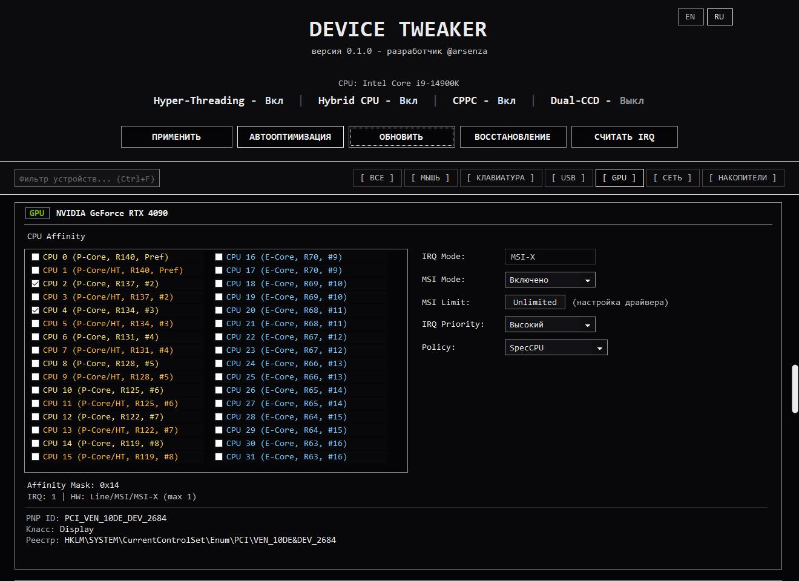

# DEVICE TWEAKER

[English](./README.md) · **Русский**

Утилита настройки аппаратных прерываний и низкоуровневых параметров устройств в Windows 10/11 x64. Поддерживает MSI/MSI-X, привязку прерываний к ядрам, ReservedCpuSets, USB xHCI IMOD, RSS и NIC ITR, а также автооптимизацию под топологию CPU, чтение фактических значений и автоматические бэкапы.

**[Скачать для Windows](https://github.com/arsenzaaa/DEVICE-TWEAKER/releases/latest/download/DEVICE.TWEAKER.SelfContained.exe)** · [Руководство](./docs/guide/README.ru.md) · [Скриншоты](./docs/SCREENSHOTS.ru.md) · [История изменений](./CHANGELOG.ru.md)

## Возможности

- **Прерывания:** настройка MSI/MSI-X, MSI Limit, IRQ Priority, масок CPU Affinity и ReservedCpuSets с чтением фактического режима IRQ для PCI-устройств.
- **Автооптимизация:** распределение прерываний GPU, ввода и сети по оптимальным физическим ядрам с учётом топологии CPU (P/E-ядра, CCD/CCX, SMT) либо ручная настройка любого устройства через **ПРИМЕНИТЬ**.
- **USB xHCI IMOD:** задание интервала модерации для всего контроллера, по ролям устройств или по индексам interrupter с обратным чтением регистров.
- **Сеть:** выбор очередей и базового CPU для RSS, а также чтение, применение и сохранение аппаратного NIC ITR на поддерживаемых адаптерах Intel и Realtek.
- **Ввод, питание, откат:** замер частоты опроса мыши в реальном времени, Mouse Throttle, управление энергосбережением устройств и восстановление из автоматических бэкапов.

## Начало работы

Нужны **Windows 10/11 x64** и права администратора. Основной EXE включает .NET. Компактная сборка (требует .NET 10 Desktop Runtime x64) доступна на [странице выпуска](https://github.com/arsenzaaa/DEVICE-TWEAKER/releases/latest).

1. Запустите EXE от имени администратора и выберите устройство в списке.
2. Измените настройки и нажмите **ПРИМЕНИТЬ** или выберите **АВТООПТИМИЗАЦИЯ** для автоматической настройки.
3. Перезагрузите Windows после изменения MSI, привязки прерываний или ReservedCpuSets. Проверьте результат по [руководству](./docs/guide/10-verification.ru.md).

Для USB IMOD, NIC ITR и чтения конфигурации PCI используется драйвер DTIMOD. Условия загрузки и возможные конфликты с античитами описаны в [руководстве по драйверу](./docs/guide/11-driver.ru.md).

## Документация

- [Справочник настроек](./docs/SETTINGS.ru.md)
- [Сборка из исходников и QA](./docs/DEVELOPMENT.ru.md)

## Обратная связь и поддержка

[Сообщить об ошибке](https://github.com/arsenzaaa/DEVICE-TWEAKER/issues/new?template=bug_report.yml) · [Отчёт об оборудовании](https://github.com/arsenzaaa/DEVICE-TWEAKER/issues/new?template=hardware_report.yml) · [Новости в Telegram](https://t.me/arsenzaa) · [Поддержать на Boosty](https://boosty.to/arsenza)

[Участие в проекте](./.github/CONTRIBUTING.ru.md) · [GPL-3.0](./LICENSE) · [Сторонние компоненты](./docs/THIRD_PARTY_NOTICES.ru.md) · [Безопасность](./.github/SECURITY.ru.md)
