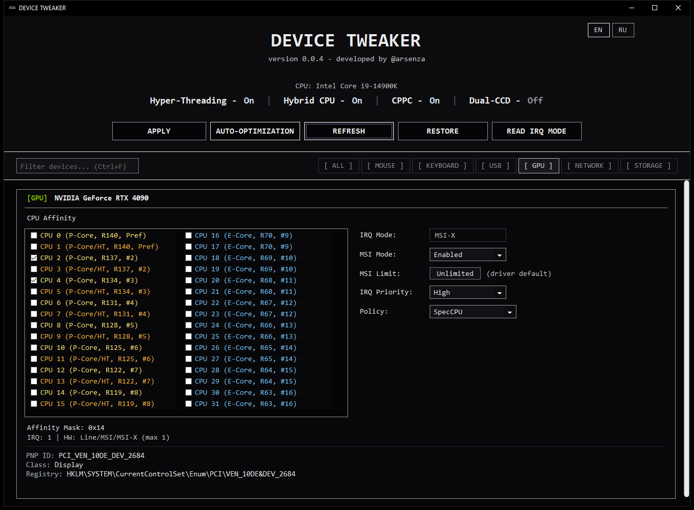
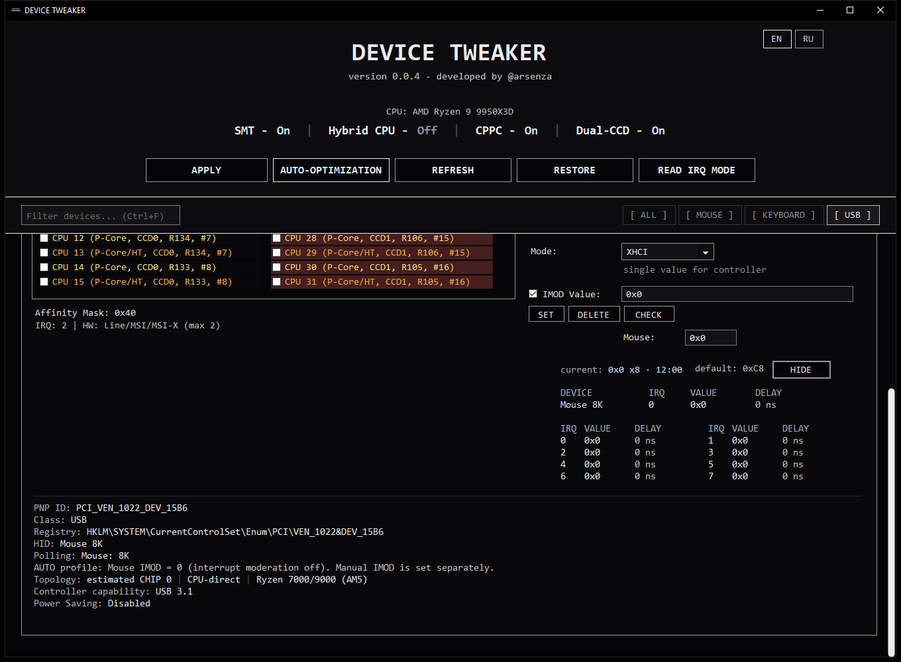
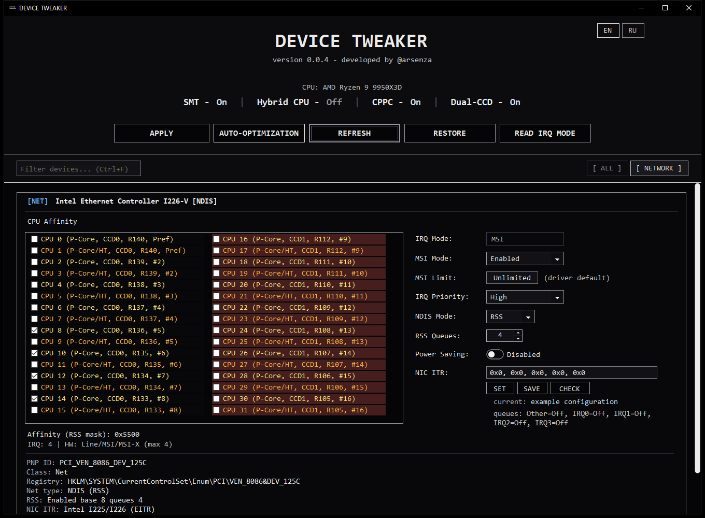

# Screenshots

[Documentation](./README.md) / Screenshots · [Русский](./SCREENSHOTS.ru.md)

GPU, USB and network settings in demo configurations.

## Device affinity and MSI

[GPU configuration](./guide/04-gpu.md)

## USB IMOD

[USB IMOD configuration](./guide/05-usb-imod.md)

## RSS and NIC ITR

[Network configuration](./guide/06-network.md)
