# Screenshots

[Documentation](./README.md) / Screenshots · [Русский](./SCREENSHOTS.ru.md)

Main panels and interface states on Intel and AMD models. Devices, settings and operation results use demonstration data. Click a screenshot to open its original.

[CPU and GPU](#cpu-and-gpu) · [USB IMOD](#usb-imod) · [Network adapters](#network-adapters) · [Reserved CPU Sets](#reserved-cpu-sets) · [Storage](#storage) · [Backups and restore](#backups-and-restore) · [Operation results](#operation-results) · [Driver](#driver)

## CPU and GPU

### Intel hybrid CPU

P/E cores, MSI-X and a manually selected affinity mask.

[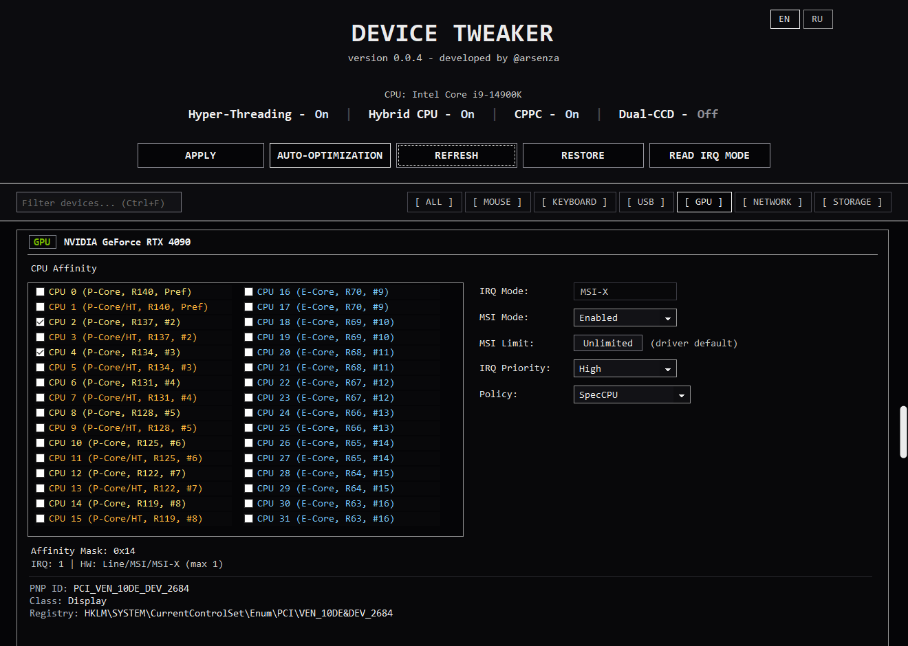](../assets/screenshots/intel-affinity.en.png)

### AMD dual-CCD CPU

CCD placement and CPPC rankings in the CPU selector.

[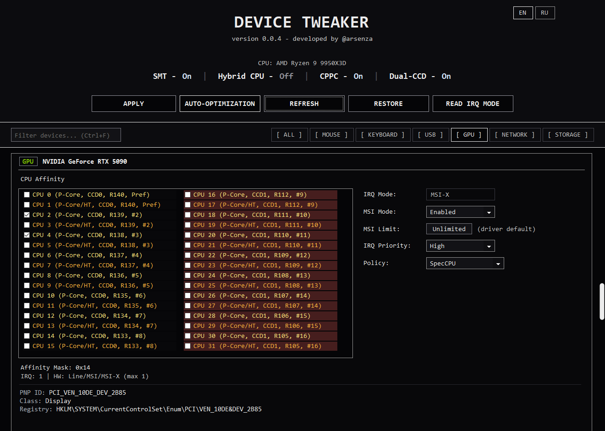](../assets/screenshots/amd-topology.en.png)

## USB IMOD

### One controller value

XHCI mode applies one IMOD value across the controller. Mouse Throttle and device power controls are shown alongside it.

[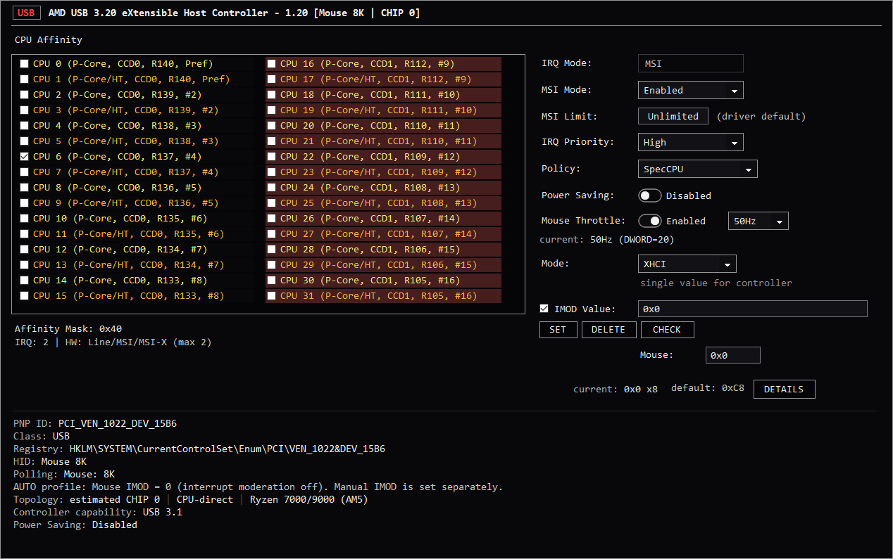](../assets/screenshots/usb-xhci.en.png)

### Device roles

Separate interval fields for mouse, keyboard, gamepad and audio on one controller.

[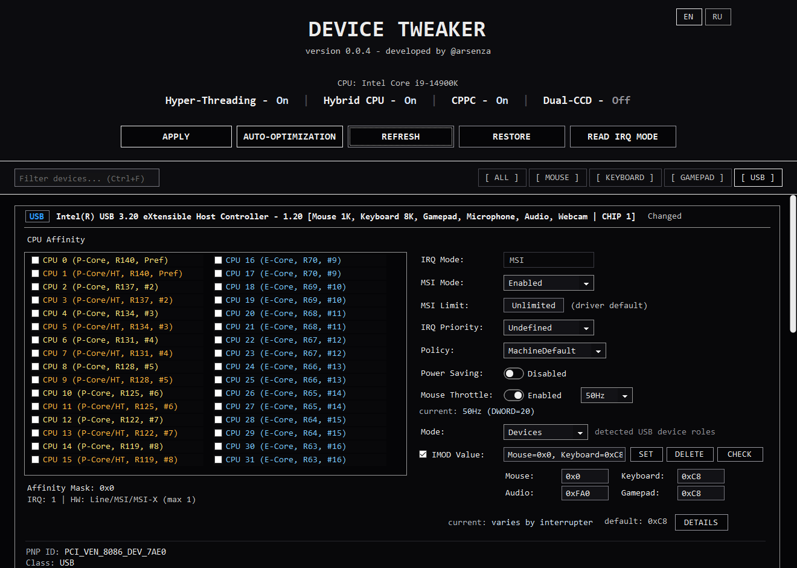](../assets/screenshots/usb-roles.en.png)

### Interrupter indices

Manual register values by interrupter index.

[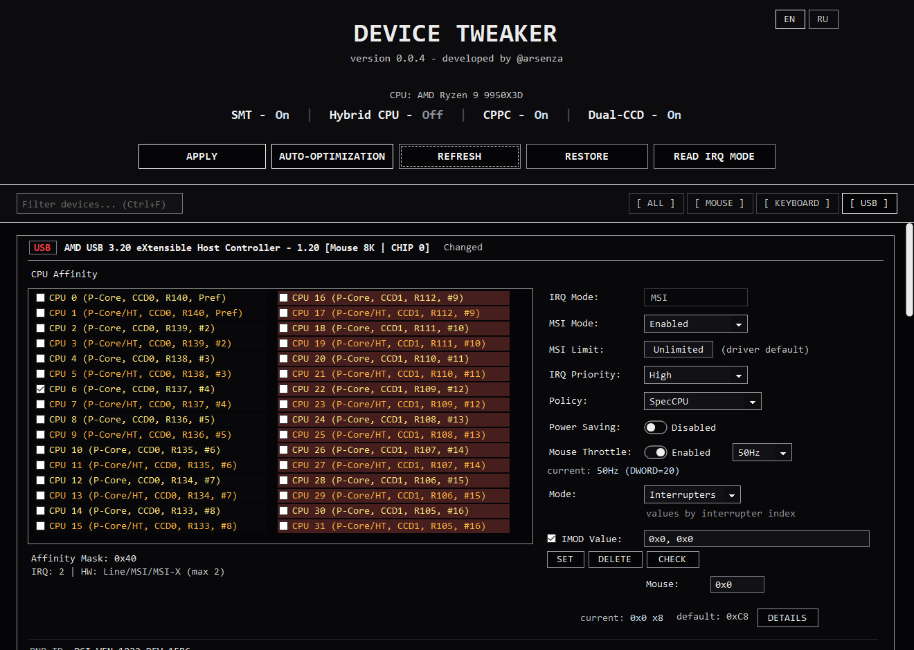](../assets/screenshots/usb-interrupters.en.png)

## Network adapters

### Intel: RSS and ITR

Receive-processing CPUs, queue count and Intel NIC ITR controls.

[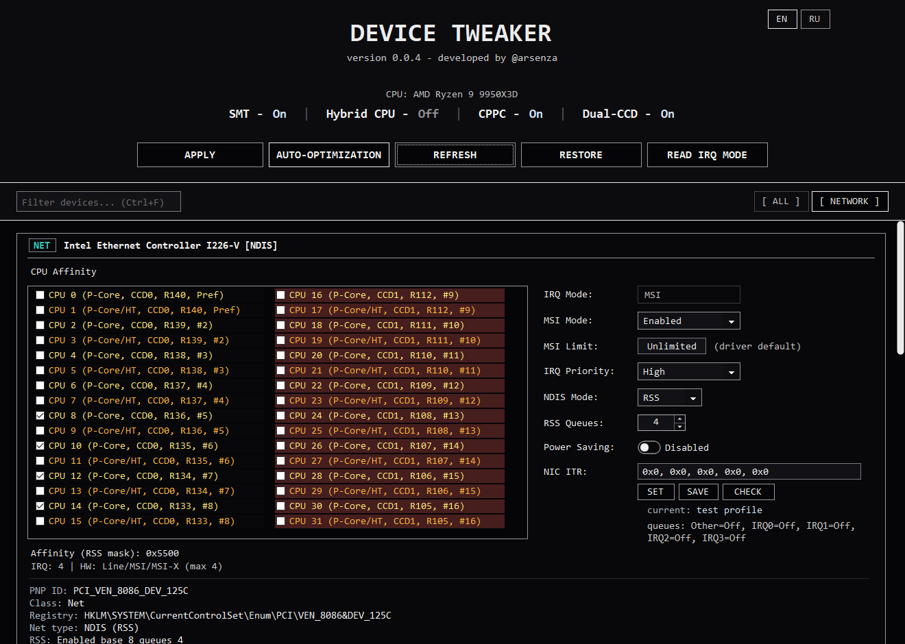](../assets/screenshots/network-rss.en.png)

### Realtek: NIC ITR

RTL8125 controls and separate RX/TX moderation readback.

[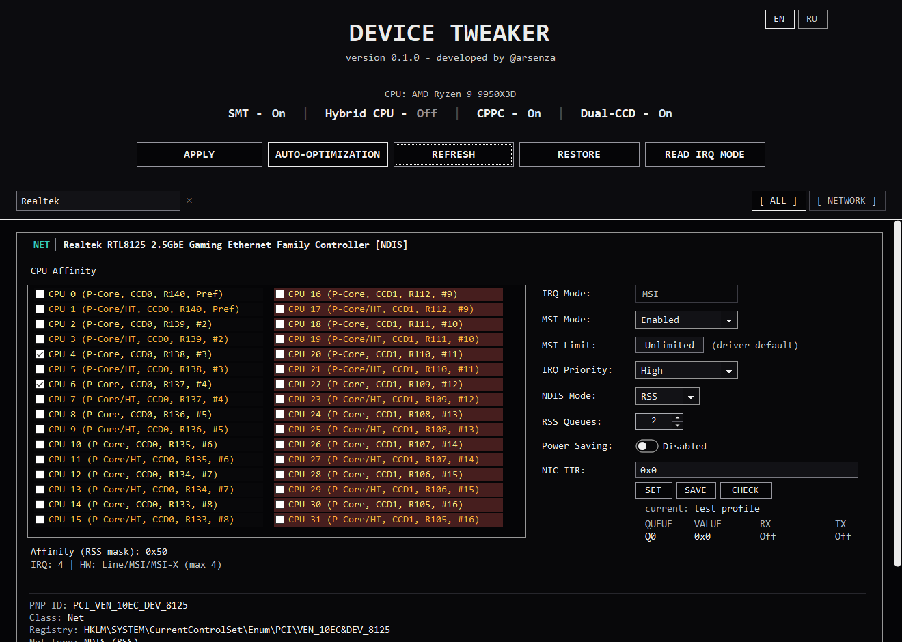](../assets/screenshots/network-realtek.en.png)

### NetAdapterCx: Realtek 5G

RTL8126 without the NDIS mode selector, with affinity controls and four-queue NIC ITR readback.

[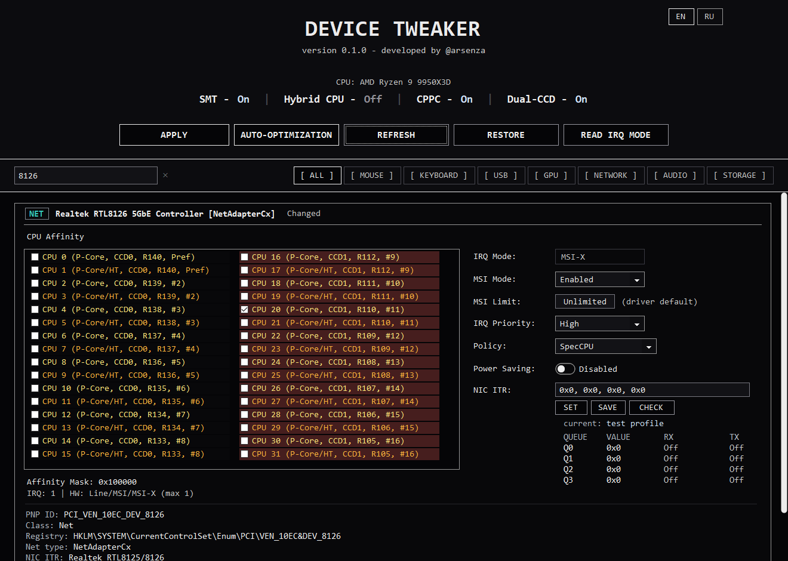](../assets/screenshots/network-netadaptercx.en.png)

## Reserved CPU Sets

System-wide logical-CPU reservation on a Ryzen 7 7800X3D. This panel configures a separate ReservedCpuSets mask.

[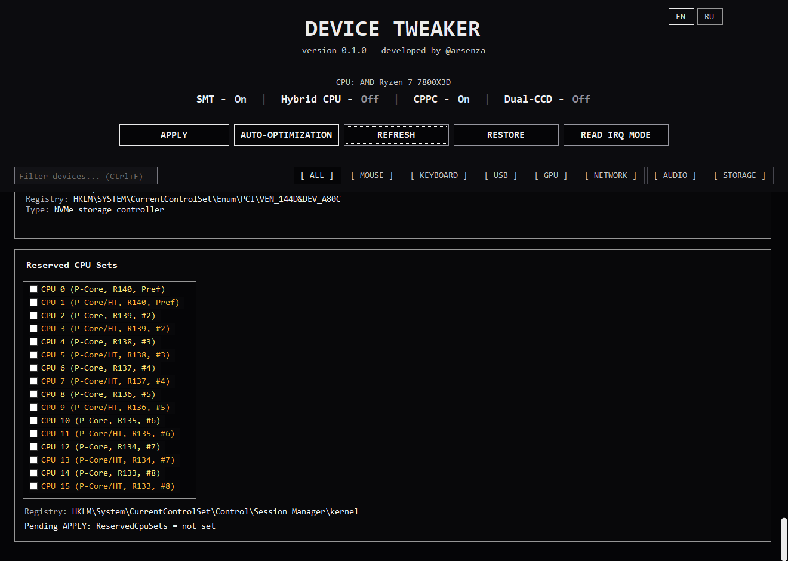](../assets/screenshots/reserved-cpu-sets.en.png)

## Storage

### NVMe controller

Samsung 990 PRO with Windows Default affinity and MSI-X resource information.

[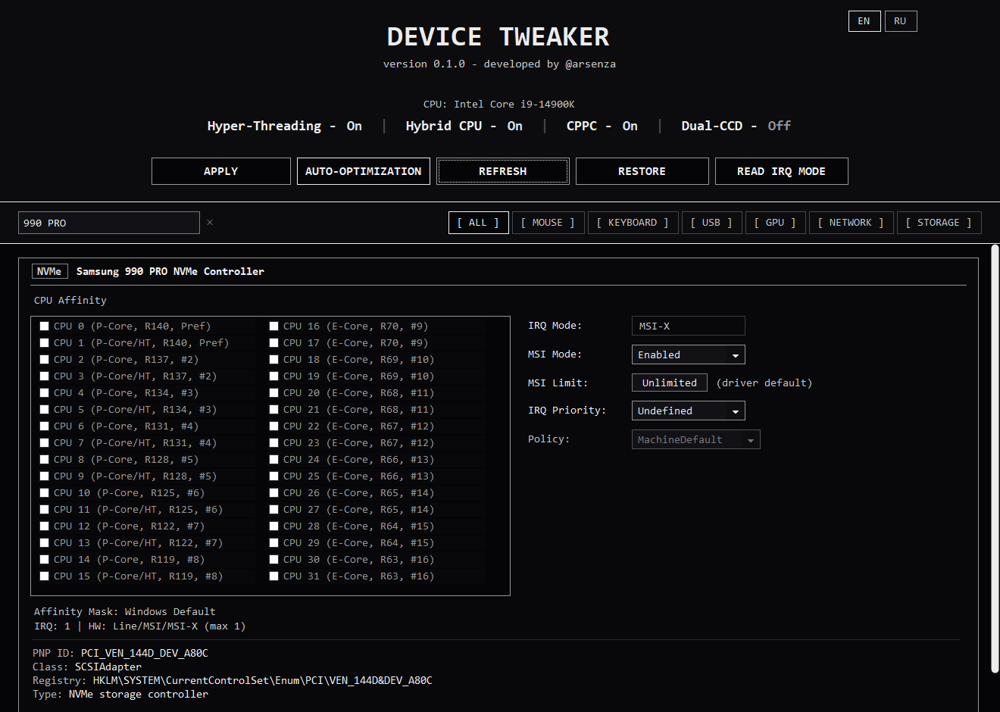](../assets/screenshots/storage.en.png)

## Backups and restore

### Backup location

Choosing where to keep an additional backup before auto-optimization.

[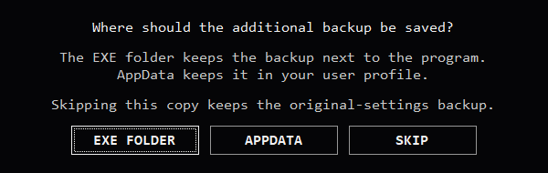](../assets/screenshots/backup-location.en.png)

### Restore selection

Saved snapshots and protected original settings.

[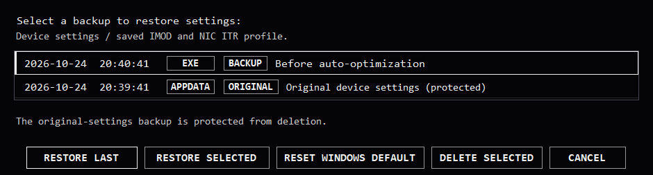](../assets/screenshots/restore.en.png)

## Operation results

### Completed operation

Reboot prompt with direct access to logs and backups.

[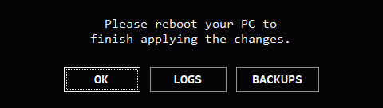](../assets/screenshots/operation-success.en.png)

### Warnings

A completion report identifies settings that need attention.

[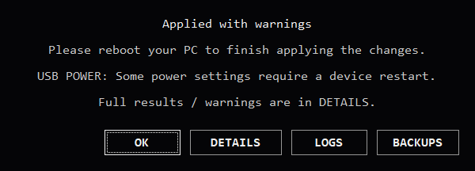](../assets/screenshots/operation-report.en.png)

### Partial result

Completed changes are retained; an unverified USB IMOD step is reported separately.

[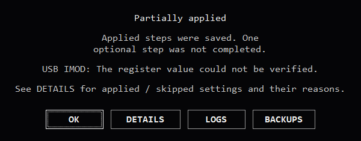](../assets/screenshots/operation-partial.en.png)

### Step details

The detailed report separates completed settings from a register-readback mismatch.

[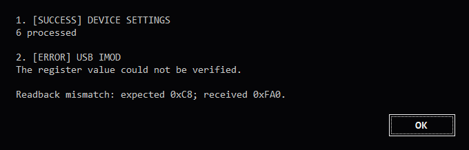](../assets/screenshots/operation-details.en.png)

## Driver

### Before loading DTIMOD

Compatibility notice before a driver-dependent action.

[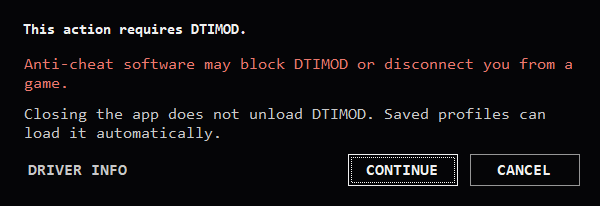](../assets/screenshots/driver-warning.en.png)

### Driver information

Read-only Windows and service information. It does not test anti-cheat compatibility.

[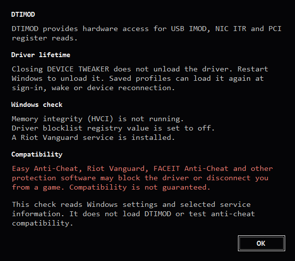](../assets/screenshots/system-check.en.png)
