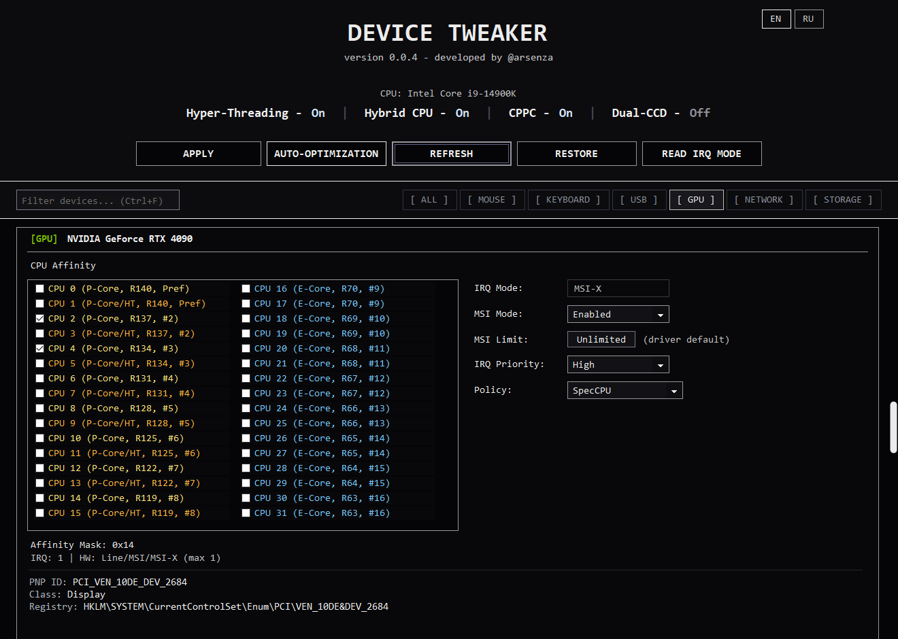
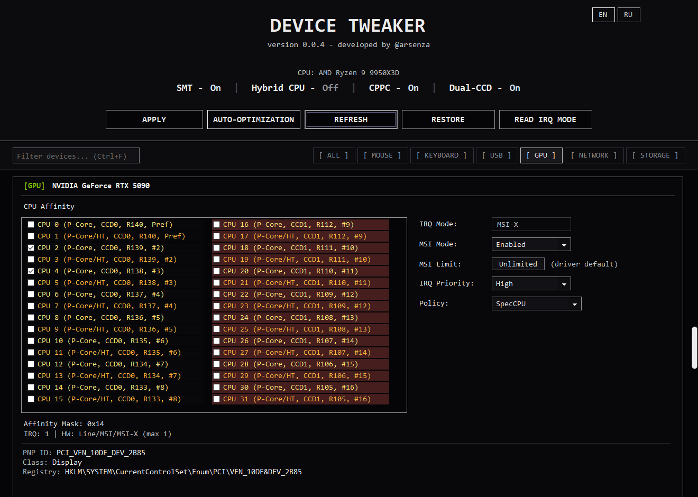
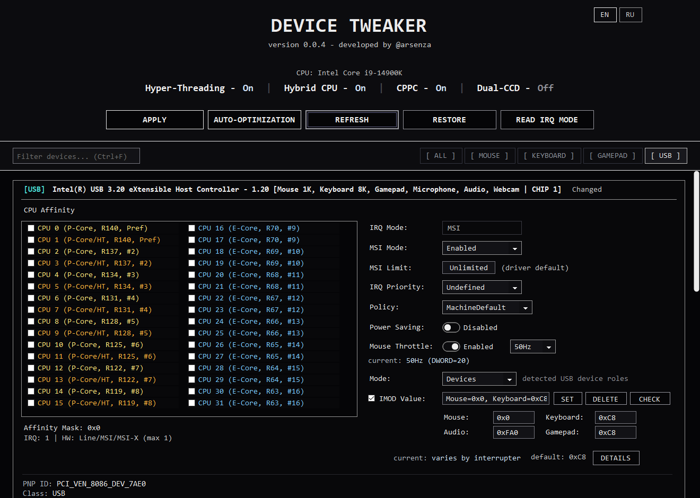
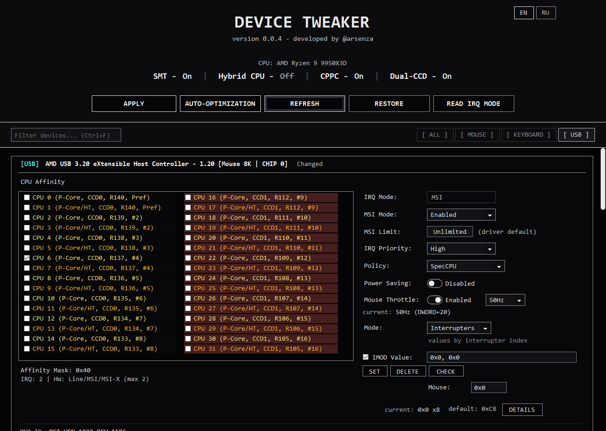
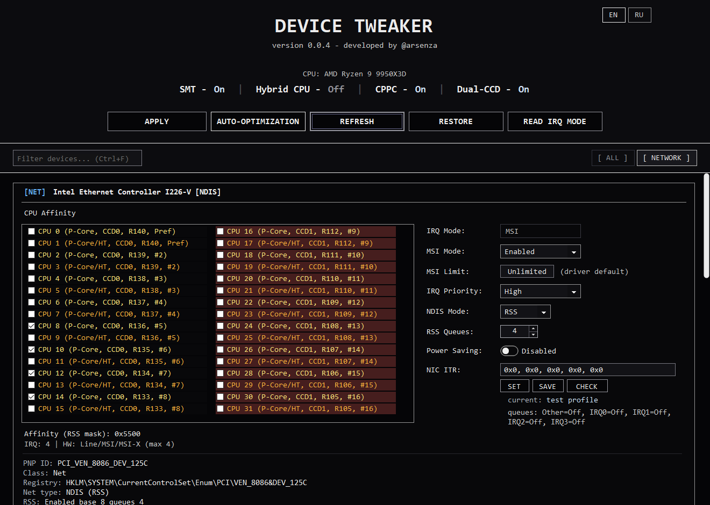
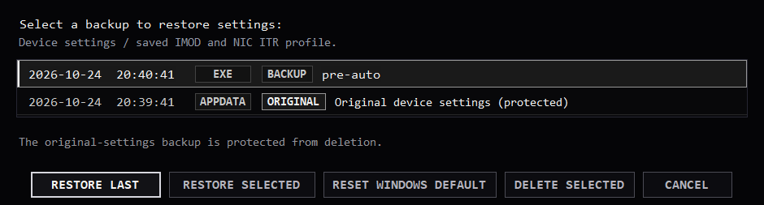
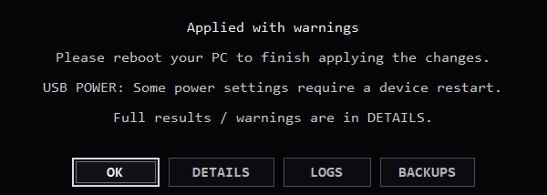
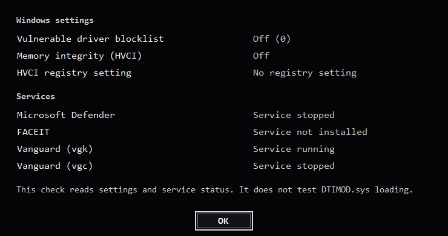

# Screenshots

[Documentation](./README.md) / Screenshots · [Русский](./SCREENSHOTS.ru.md)

Interface examples on Intel and AMD models. Devices, settings and operation results use demonstration data.

## Intel hybrid CPU

P/E cores, MSI-X and an explicit CPU affinity mask.

AMD dual-CCD CPU

Two CCDs and CPPC ratings in the CPU selector.

## USB device roles

Separate interval fields for mouse, keyboard, gamepad and audio on one controller.

USB interrupter indices

Editing IMOD values by interrupter index.

## RSS and NIC ITR

RSS processor selection, queue count and NIC ITR controls.

## Backup selection

Saved snapshots and the protected original device settings.

Operation report

Completion summary, warnings and access to logs and backups.

Windows and driver checks

Windows security settings and relevant service states.

