# Скриншоты

[Документация](./README.ru.md) / Скриншоты · [English](./SCREENSHOTS.md)

Основные панели и состояния интерфейса на моделях Intel и AMD. Устройства, настройки и результаты операций используют демонстрационные данные. Нажмите на снимок, чтобы открыть оригинал.

[CPU и GPU](#cpu-и-gpu) · [USB IMOD](#usb-imod) · [Сетевые адаптеры](#сетевые-адаптеры) · [Reserved CPU Sets](#reserved-cpu-sets) · [Накопители](#накопители) · [Бэкапы и восстановление](#бэкапы-и-восстановление) · [Результаты операций](#результаты-операций) · [Драйвер](#драйвер)

## CPU и GPU

### Гибридный Intel

P/E-ядра, MSI-X и вручную выбранная маска affinity.

### AMD с двумя CCD

Расположение ядер по CCD и CPPC-рейтинг в списке CPU.

[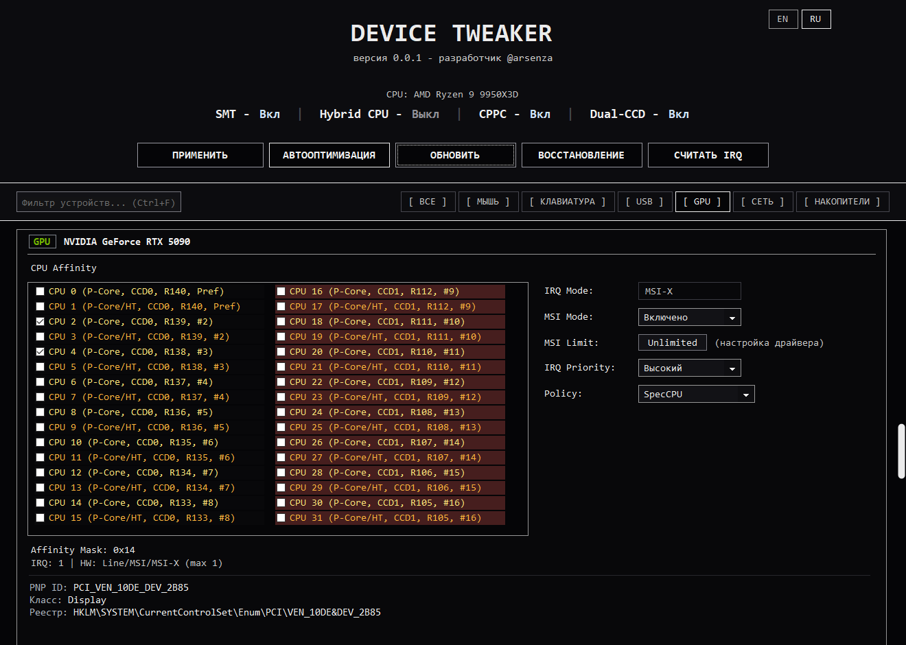](../assets/screenshots/amd-topology.ru.png)

## USB IMOD

### Общее значение контроллера

Режим XHCI задаёт общее значение IMOD для контроллера. Рядом находятся Mouse Throttle и управление энергосбережением.

[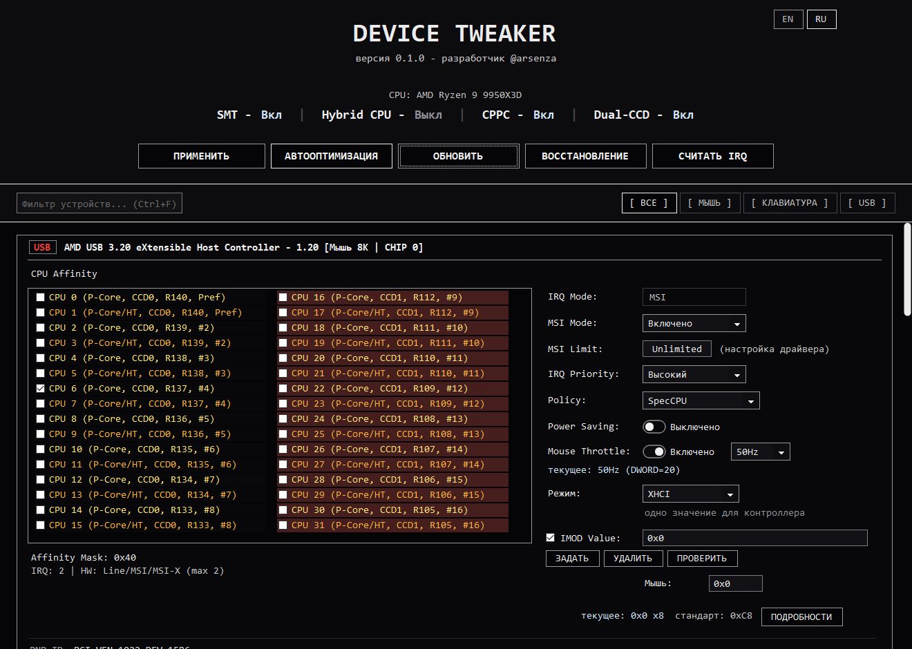](../assets/screenshots/usb-xhci.ru.png)

### Роли устройств

Отдельные поля интервалов мыши, клавиатуры, геймпада и аудио на одном контроллере.

[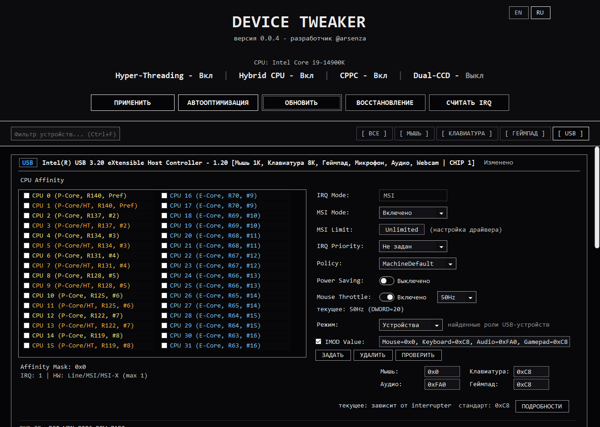](../assets/screenshots/usb-roles.ru.png)

### Индексы interrupter

Ручные значения регистров по индексам interrupter.

[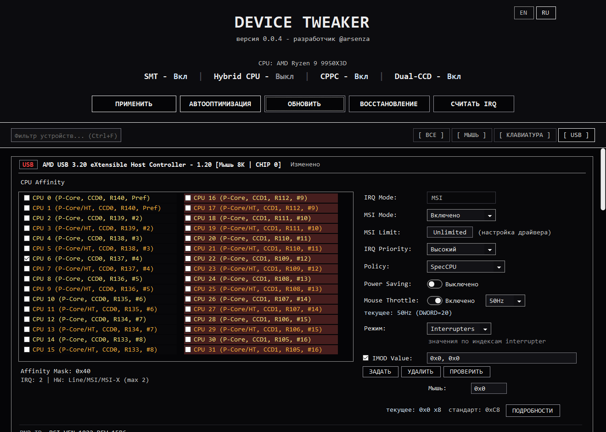](../assets/screenshots/usb-interrupters.ru.png)

## Сетевые адаптеры

### Intel: RSS и ITR

CPU обработки входящих пакетов, число очередей и настройка NIC ITR Intel.

[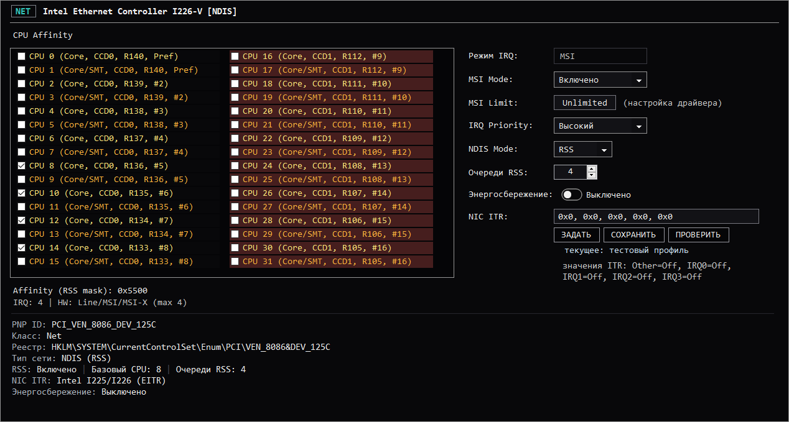](../assets/screenshots/network-rss.ru.png)

### Realtek: NIC ITR

Настройки RTL8125 и раздельное чтение модерации RX/TX.

[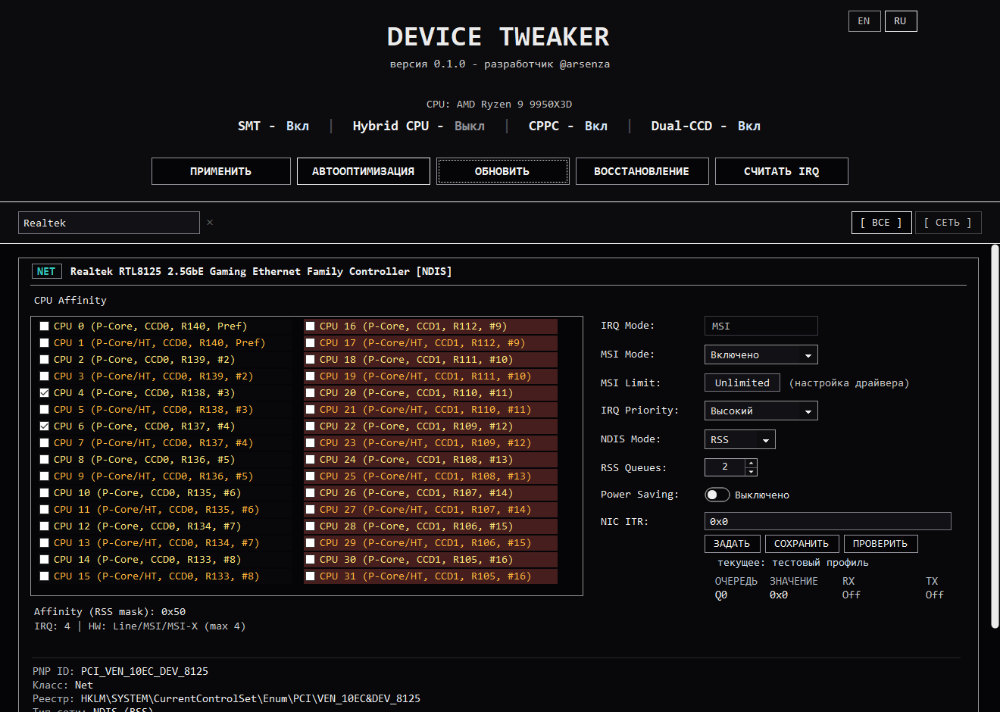](../assets/screenshots/network-realtek.ru.png)

### NetAdapterCx: Realtek 5G

Карточка RTL8126 без выбора режима NDIS, с настройками affinity и чтением четырёх очередей NIC ITR.

[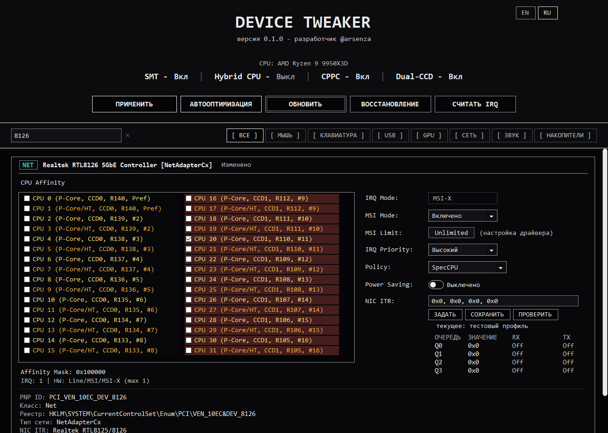](../assets/screenshots/network-netadaptercx.ru.png)

## Reserved CPU Sets

Системное резервирование логических CPU на Ryzen 7 7800X3D. Эта панель задаёт отдельную маску ReservedCpuSets.

[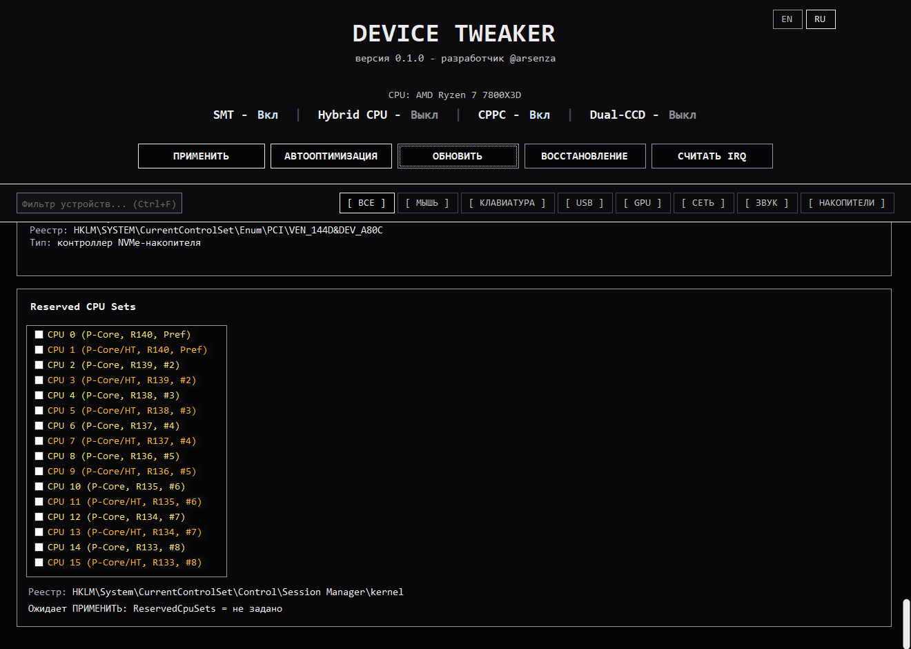](../assets/screenshots/reserved-cpu-sets.ru.png)

## Накопители

### Контроллер NVMe

Samsung 990 PRO с affinity по умолчанию Windows и сведениями о ресурсах MSI-X.

[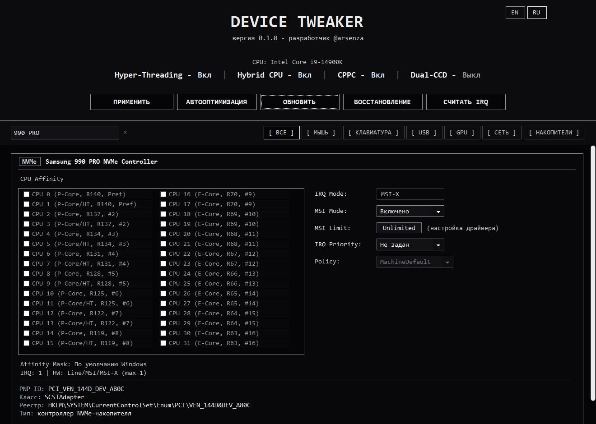](../assets/screenshots/storage.ru.png)

## Бэкапы и восстановление

### Расположение бэкапа

Выбор места дополнительной резервной копии перед автооптимизацией.

[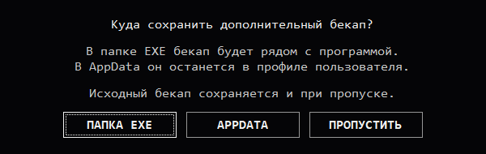](../assets/screenshots/backup-location.ru.png)

### Выбор для восстановления

Сохранённые снимки и защищённая копия исходных настроек.

[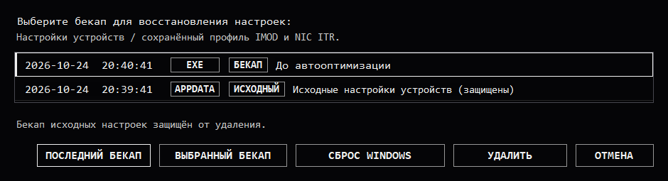](../assets/screenshots/restore.ru.png)

## Результаты операций

### Завершённая операция

Предложение перезагрузки с переходом к логам и бэкапам.

[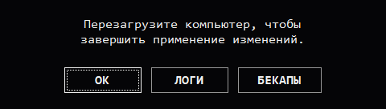](../assets/screenshots/operation-success.ru.png)

### Предупреждения

В результате операции перечислены настройки, требующие внимания.

[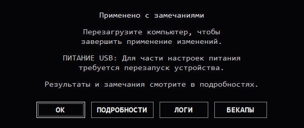](../assets/screenshots/operation-report.ru.png)

### Частичный результат

Выполненные изменения сохранены; неподтверждённый шаг USB IMOD отмечен отдельно.

[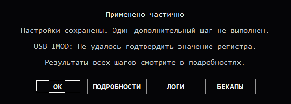](../assets/screenshots/operation-partial.ru.png)

### Подробности шагов

Подробный результат отделяет выполненные настройки от несовпадения при чтении регистра.

[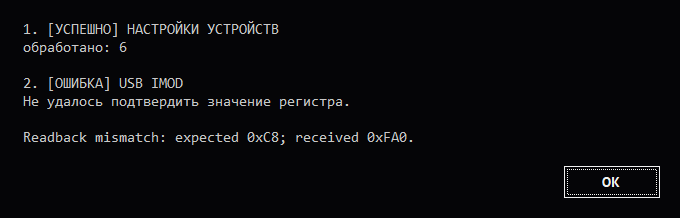](../assets/screenshots/operation-details.ru.png)

## Драйвер

### Перед загрузкой DTIMOD

Уведомление о совместимости перед действием, требующим драйвера.

[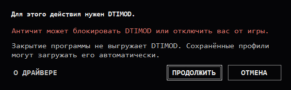](../assets/screenshots/driver-warning.ru.png)

### Сведения о драйвере

Чтение настроек Windows и состояния служб. Совместимость с античитами эта проверка не определяет.

[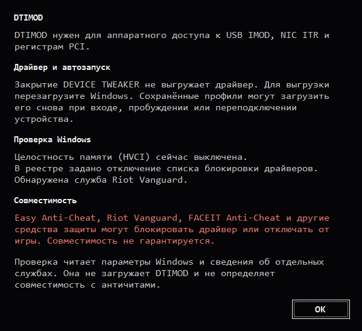](../assets/screenshots/system-check.ru.png)
