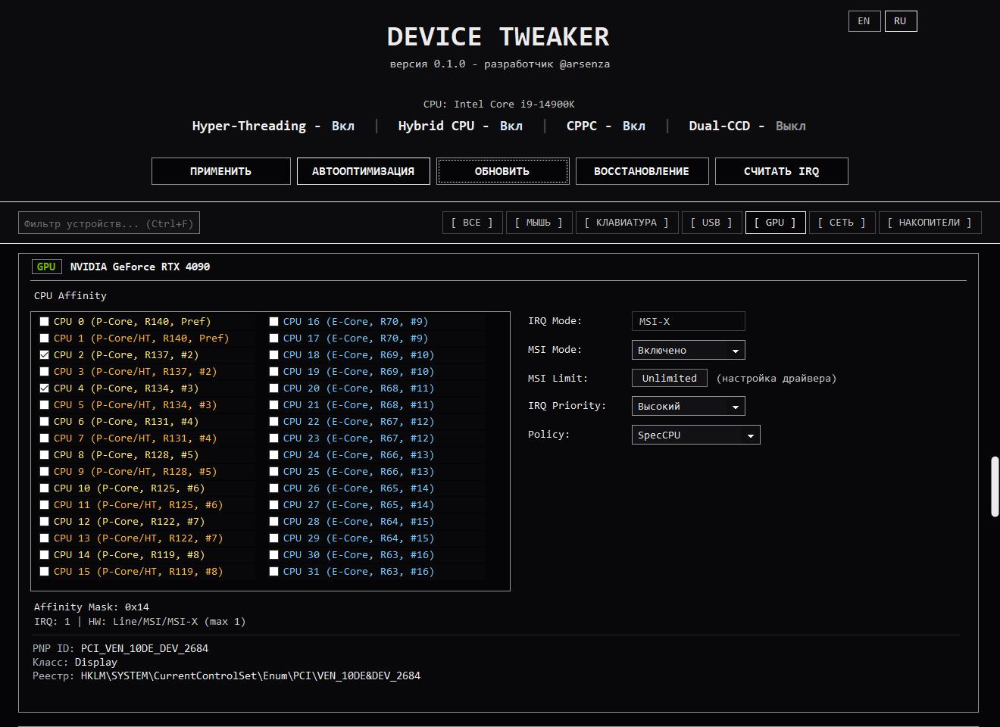

# Скриншоты

[Документация](./README.ru.md) / Скриншоты · [English](./SCREENSHOTS.md)

Снимки сделаны с демонстрационными данными. Нажмите на изображение, чтобы открыть его в исходном размере.

## Видеокарта

Привязка прерываний RTX 4090 на гибридном процессоре Intel. Выбраны два P-ядра.

## Контроллер USB

В режиме XHCI для контроллера AMD задан один интервал IMOD.

## Сетевой адаптер

Для Intel I226-V выбраны четыре очереди RSS и базовый CPU 8. Ниже показан тестовый профиль NIC ITR.

