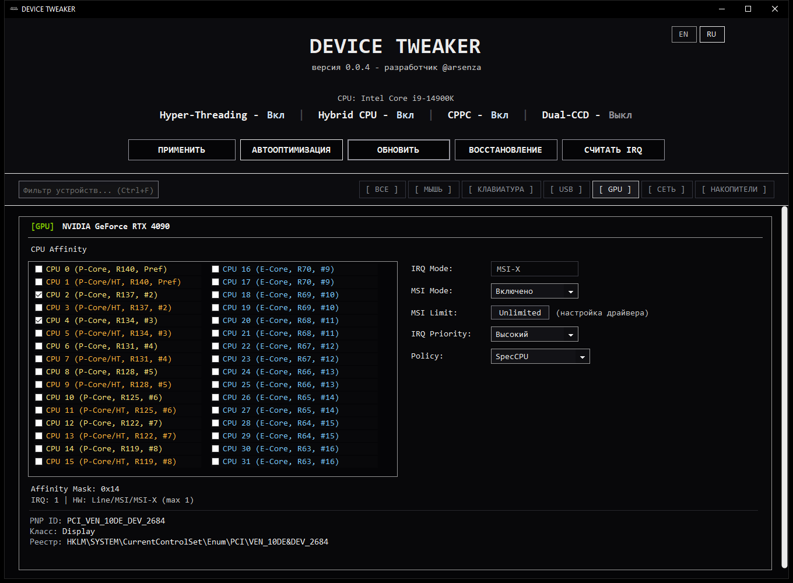
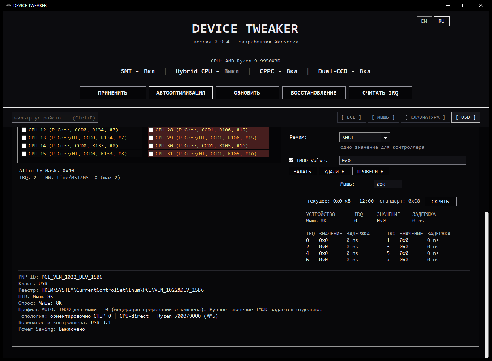
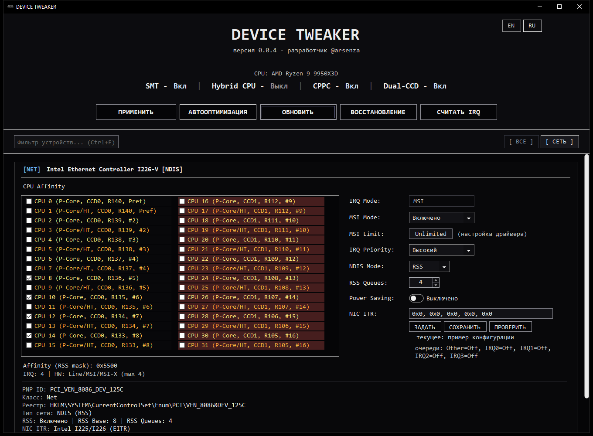

# Скриншоты

[Документация](./README.ru.md) / Скриншоты · [English](./SCREENSHOTS.md)

Настройки GPU, USB и сети в демонстрационных конфигурациях.

## Привязка к ядрам и MSI

[Настройка GPU](./guide/04-gpu.ru.md)

## USB IMOD

[Настройка USB IMOD](./guide/05-usb-imod.ru.md)

## RSS и NIC ITR

[Настройка сети](./guide/06-network.ru.md)
