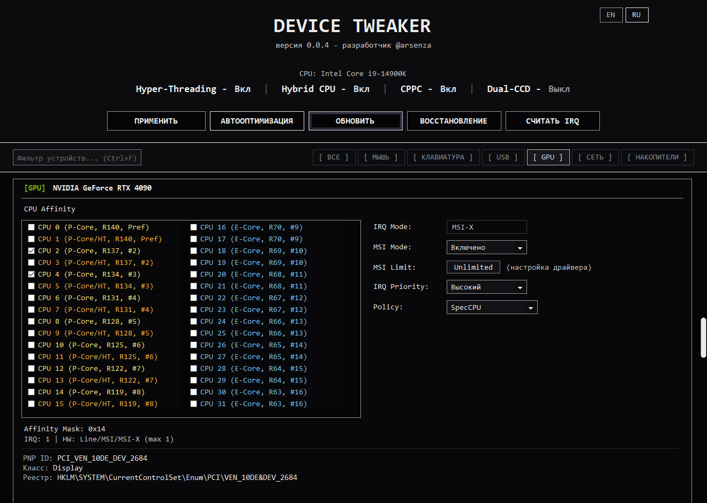
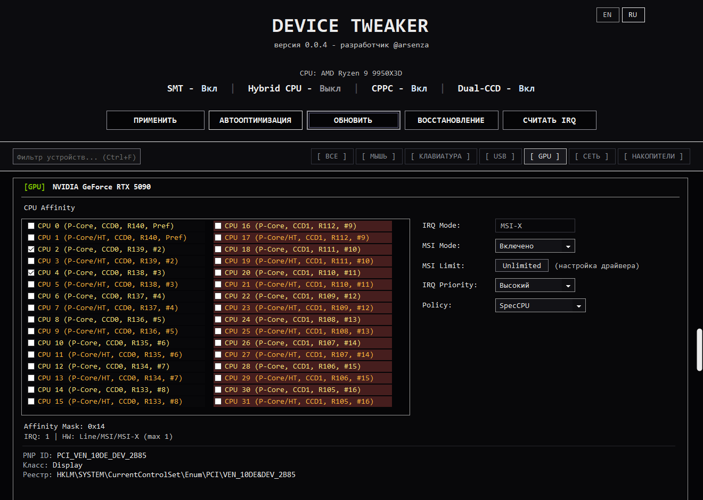
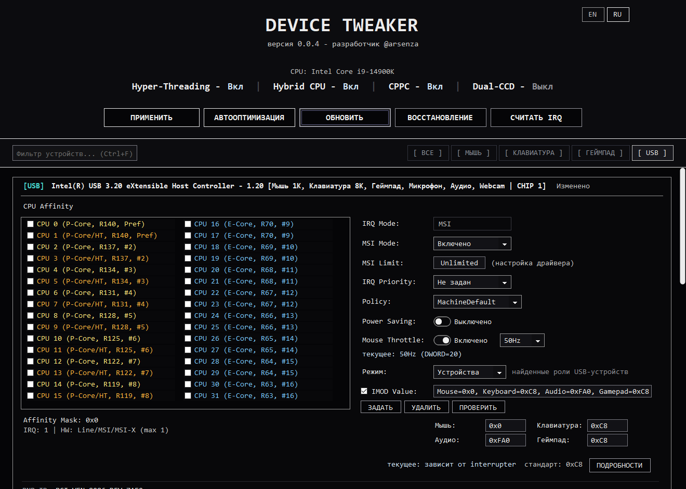
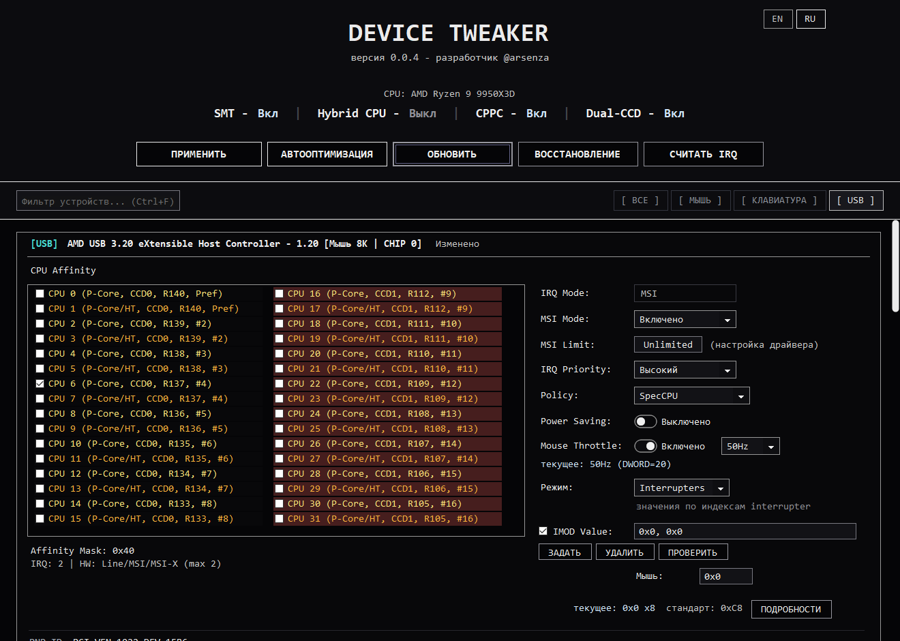
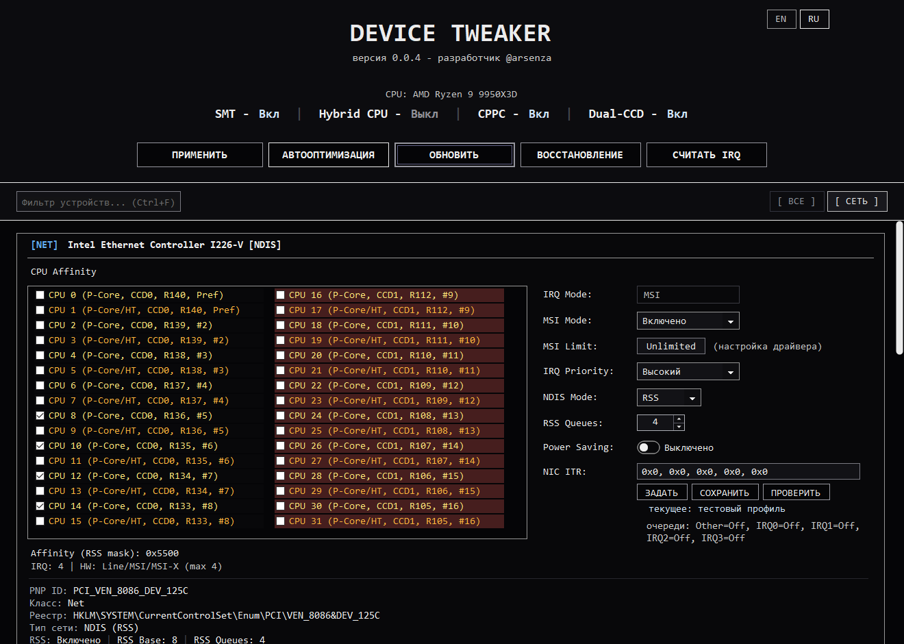
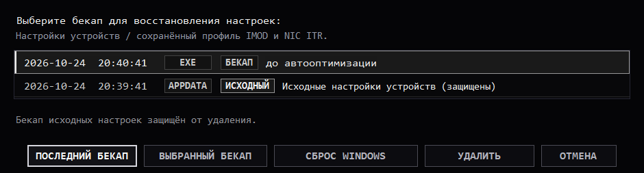
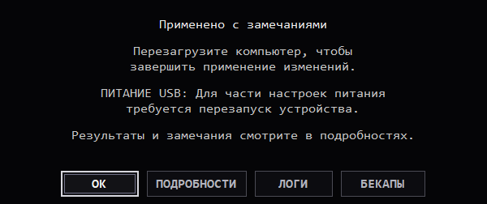
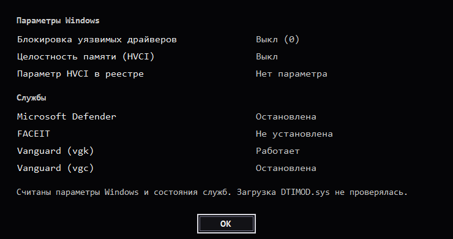

# Скриншоты

[Документация](./README.ru.md) / Скриншоты · [English](./SCREENSHOTS.md)

Примеры интерфейса на моделях Intel и AMD. Устройства, значения и результаты операций показаны на демонстрационных данных.

## Intel: гибридный CPU

P/E-ядра, MSI-X и явная маска привязки к CPU.

AMD: два CCD

Два CCD и оценки CPPC в списке процессоров.

## Роли USB-устройств

Отдельные интервалы для мыши, клавиатуры, геймпада и аудио на одном контроллере.

Индексы USB interrupter

Редактирование IMOD по индексам interrupter.

## RSS и NIC ITR

Выбор CPU для RSS, число очередей и настройки NIC ITR.

## Выбор бекапа

Сохранённые бекапы и защищённая копия исходных настроек устройств.

Результат операции

Итог применения, замечания, переход к логам и бекапам.

Проверка Windows и драйвера

Настройки безопасности Windows и состояния связанных служб.

